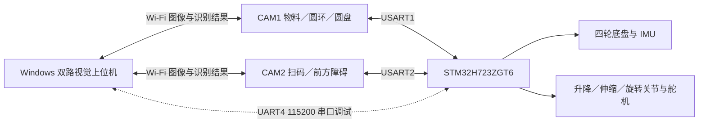

# 2026 工训赛智能搬运小车

面向智能搬运赛项的麦克纳姆轮小车。STM32 主控执行工位导航、视觉对齐和物料取放，Windows 上位机负责双路图传、识别、标定和日志。两台 MaixCAM 分别连接主控和电脑。

## 选择版本

| 分支 | STM32 固件 | 上位机 | CAM1 桥接 | CAM2 桥接 |
| --- | --- | --- | --- | --- |
| [main · 初赛](https://github.com/lingkonglengfeng/2026-Engineering-Training-Open/tree/main) | V306 PRELIM | 2.6.35 | 1.3.6 | 1.4.1 |
| [final · 决赛](https://github.com/lingkonglengfeng/2026-Engineering-Training-Open/tree/final) | V245 FINAL | 2.6.7 | 1.3.1 | 1.4.1 |

当前目录是 **决赛 V245**。本分支取料时的载物盘槽位顺序为 **3 → 2 → 1**。切换赛制时同时切换源码和上位机。两套固件的机械臂姿态保存在各自的 W25Q64 参数区。详细说明见 [版本与参数](docs/electrical/README.md)。

## 系统连接

| 接口 | 设备 |
| --- | --- |
| USART1 · PB14/PB15 | CAM1 |
| USART2 · PA2/PA3 | CAM2 |
| UART4 · PC10/PC11 | 主控文本指令、串口日志 |
| USART10 · PE2/PE3 | HWT101 |
| FDCAN1 · PA11/PA12 | 达妙旋转关节 |
| FDCAN2 · PB12/PB13 | ZDT 底盘、5 号升降和 6 号伸缩 |
| TIM4 CH1/CH2 · PD1 | 夹爪与载物盘 PWM；启动按键输入 |

接线与板卡资料见 [硬件说明](docs/hardware/README.md)。原理图版本和当前固件引脚需要结合实际板卡核对。

## 首次运行

1. 执行 `git clone https://github.com/lingkonglengfeng/2026-Engineering-Training-Open.git`。如需决赛，在仓库目录执行 `git switch final`。使用 Keil MDK 打开 [工程文件](MDK-ARM/Engineering_Training_Project.uvprojx)，安装工程所需的 STM32H7 Device Pack 与 Arm Compiler 5，然后构建当前版本。HEX 输出和烧录步骤见 [固件构建](MDK-ARM/README.md)。
2. 在仓库根目录运行 `python tools/package_pc_vision_bridge.py`。通过 MaixVision 将生成的两个应用分别安装到 CAM1 和 CAM2。电脑与两台相机连接同一可互通的局域网。详见 [CAM1](vision/maixcam_bridge/README.md) 和 [CAM2](vision/maixcam_qr_bridge/README.md)。
3. Windows 安装 Python 3.10～3.13，推荐 3.12。先双击 [一键图传检查.cmd](一键图传检查.cmd)，分别选择两台相机并确认画面。随后使用 [视觉上位机.cmd](视觉上位机.cmd)进入联动模式。按需在串口页选择实际 COM 口、115200 波特率。
4. 在上位机读取主控版本并校验机械臂行程与工位姿态。点击「准备」，保持车辆静止完成归位和零漂，等待 `WAIT_START_OK`。在对应启停区摆正后，PD1 短按松开选 1 号区，按住至少 1 秒松开选 2 号区，也可用上位机对应发车按钮。
5. 查看扫码任务、两轮圆盘取料和 ROUGH／TEMP 放置的进度。故障时优先保存本轮串口日志和必要截图，记录固件、PC 和相机应用版本。配置、日志和标定操作见 [PC 视觉](vision/pc_vision/README.md)。

## 阅读和修改源码

| 目录 | 内容 |
| --- | --- |
| [Core](Core/README.md) | 比赛状态机、底盘导航、机械臂、视觉协议、参数存储 |
| [MDK-ARM](MDK-ARM/README.md) | Keil 工程、启动文件、输出路径 |
| [Drivers](Drivers/README.md) · [Middlewares](Middlewares/README.md) | STM32 HAL、CMSIS、FreeRTOS |
| [vision](vision/README.md) | Windows 上位机、两个相机桥、相机端算法与调试工具 |
| [tools](tools/README.md) · [tools/tests](tools/tests/README.md) | 应用打包、日志分析、图像回放与离线回归 |
| [sim](sim/README.md) | MATLAB 导航模型与绘图 |
| [freertos_task](freertos_task/README.md) | 历史任务设计和接口演进 |
| [docs](docs/README.md) | 硬件、配置、版本、源码导航和验证记录 |

## 验证与贡献

本公开快照来自已构建的 V245 源码，源提交为 `1e005d93d0d9`。公开目录已通过 Keil 从头构建（0 错误、0 警告）、72 项图传与视觉测试和 48 项障碍回归。新机需按相机位置、机械结构和赛场校准。离线回放结果与实车结果分别记录。验证命令见 [测试说明](tools/tests/README.md)，提交要求见 [CONTRIBUTING](CONTRIBUTING.md)。

## 许可证

项目原创源码和文档按 [MIT](LICENSE) 发布。STM32 HAL、CMSIS、FreeRTOS 和图标等第三方组件按各自许可证分发。出处和许可见 [第三方声明](THIRD_PARTY_NOTICES.md)。
