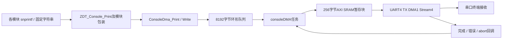

# 工程日志打印汇总

整理日期：2026-10-16。源码基线：当前工作工程 `E:/Engineering_Training_Project`，上电总版本标记 `CAMERA_DEPLOY_V184`。

这份文档汇总STM32电控工程的日志输出链路、标签含义、状态字段、诊断指令及源码中的输出文本。覆盖Keil工程列入的53个 `Core/Src/*.c` 文件；不把 `output` 历史固件快照、测试桩、摄像头Python程序自己的屏幕/终端输出混进电控日志。

正文适合现场查阅；附录A是910处静态输出文本/格式模板，附录B是323处常用故障传播与动作日志入口的字面量参数。统计是**源码位置数**，不是实际一次运行会打印的行数，也不是910种运行事件：包含条件编译、手动诊断、帮助文字和分段拼接；未进行预处理或运行期可达性证明。动态 `%s`、变量拼接和其他原因赋值不一定能被静态清单完全展开。

目录：

- [1. 输出链路和源码入口](#1-输出链路和源码入口)
- [2. DMA队列参数与行为](#2-dma队列参数与行为)
- [3. LOG DMA字段](#3-log-dma字段)
- [4. 模块与日志标签](#4-模块与日志标签)
- [5. 比赛流程的日志阅读顺序](#5-比赛流程的日志阅读顺序)
- [6. 关键字段解释](#6-关键字段解释)
- [7. 日志与状态查询指令](#7-日志与状态查询指令)
- [8. 常见故障如何对应日志](#8-常见故障如何对应日志)
- [9. 当前版本与容易误读的旧文字](#9-当前版本与容易误读的旧文字)
- [10. 新增日志时的写法](#10-新增日志时的写法)
- [附录A：静态日志文本与格式模板](#附录a静态日志文本与格式模板)
- [附录B：动态故障原因和动作文本](#附录b动态故障原因和动作文本)

## 1. 输出链路和源码入口

主日志串口为 **UART4，115200 baud、8位数据、无校验、1位停止位（8N1）**。PC10是TX，PC11是RX。



| 源码 | 职责 |
| --- | --- |
| [Core/Src/zdt_motor.c:574](../../Core/Src/zdt_motor.c#L574) | 统一文字输出入口，转交ConsoleDma_Print；字节回显走ConsoleDma_Write |
| [Core/Inc/console_dma.h:5](../../Core/Inc/console_dma.h#L5) | 队列/块大小/统计结构及API声明 |
| [Core/Src/console_dma.c:29](../../Core/Src/console_dma.c#L29) | 入队边界、ISR限额和丢弃记数 |
| [Core/Src/console_dma.c:60](../../Core/Src/console_dma.c#L60) | 单一发送者状态机、DCache、异步错误恢复 |
| [Core/Src/console_dma.c:101](../../Core/Src/console_dma.c#L101) | 发送任务的服务循环 |
| [Core/Src/freertos.c:83](../../Core/Src/freertos.c#L83) | consoleDMA优先级和栈配置，MX_FREERTOS_Init创建任务 |
| [Core/Src/usart.c:40](../../Core/Src/usart.c#L40) | UART4波特率、引脚及关联的TX DMA配置 |
| [Core/Src/dma.c:38](../../Core/Src/dma.c#L38) | DMA1 Stream4中断启用 |
| [Core/Src/stm32h7xx_it.c:329](../../Core/Src/stm32h7xx_it.c#L329) | 原RX入口与TX完成处理 |
| [Core/Src/vision.c:369](../../Core/Src/vision.c#L369) | 共享UART完成回调分发，UART4交给日志DMA |
| [Core/Src/vision.c:699](../../Core/Src/vision.c#L699) | 共享错误回调，UART4 DMA错误交日志模块 |
| [Core/Src/zdt_motor.c:576](../../Core/Src/zdt_motor.c#L576) | logstat的格式化和统计字段输出 |

`DM_Print()`、`Nav_Print()`、`GridNav_Print()`等模块包装最终调用 `ZDT_Console_Print()`。`snprintf()`只负责CPU侧字符串格式化，不是发送函数；当前业务日志不依赖通用 `printf` 重定向。不要把IPS200界面的 `snprintf(lines[...])` 当成串口日志。

USART1/USART2的MaixCAM通信和USART3串口屏通信是独立链路：视觉控制帧通过 `HAL_UART_Transmit_IT` 发到摄像头，屏幕命令也走自身的IT发送，不是把这些协议帧送到UART4。`[CAM...]`、`[SCREEN]`是电控对这些链路的文字诊断。

## 2. DMA队列参数与行为

| 项目 | 当前实现 |
| --- | --- |
| 环形队列 | `CONSOLE_DMA_QUEUE_BYTES=8192`字节；固定内存 |
| 一次DMA发送块 | `CONSOLE_DMA_CHUNK_BYTES=256`字节 |
| 任务上下文单次文本上限 | `CONSOLE_DMA_TEXT_LIMIT=4096`字节 |
| ISR单次文本上限 | 160字节；超限整次丢弃 |
| 生产者行为 | 临界区内复制文本入队；不等待UART传输，不申请堆内存，不等任务互斥锁 |
| 队列满/调用超长 | 整次拒绝，累计 `dropped_bytes` 与 `dropped_calls`；不会为了日志等待串口 |
| 发送任务 | `consoleDMA`，`osPriorityBelowNormal2`，栈1024字节 |
| 发送调度 | 唤醒标志或5个RTOS tick等待后服务一次；5不是固定5字节 |
| TX DMA | DMA1_Stream4，Normal模式，低DMA优先级；中断优先级5 |
| 专用发送内存 | ARMCC固定在AXI SRAM `0x24010600`；其他编译器使用32字节对齐的 `.console_dma` 段 |
| DCache | 若打开DCache，发送前清洁专用暂存块；不能把DMA发送源放到DMA1无法访问的DTCM |
| 完成处理 | 完成回调设置事件；服务任务确认完成后推进队尾、累加已发送字节 |
| 发送启动失败 | BUSY/错误记数，保留队列，10 ms后重试；外部占用UART也会计BUSY |
| 在途出错/超时 | 异步 `HAL_UART_AbortTransmit_IT`；确认中止或空闲后丢弃该块，随后才允许复用缓冲 |
| 超时上限 | 本块理论线速时间向上取整再加100 ms；波特率无效时使用1000 ms |
| 开机文本 | `ConsoleDma_Init()`不会清掉已经排队的早期开机文本；调度器和发送任务运行后输出 |

DMA承担的是字节搬运，**格式化、文本扫描、有界复制、调度和中断仍消耗CPU**。当前队列中每次写入不可交叉，但一条日志如果拆成多个 `ZDT_Console_Print`，其他任务可能在两次调用之间插入自己的文本；不是严格的“整行原子日志”。

按115200、8N1计算，理论吞吐约 **11520字节/秒**；256字节约22.2 ms，8192字节约0.71 s。实际还受任务调度和连续输出影响，队列不等于实时零延迟，也没有把日志写入Flash/SD卡的持久化功能。

## 3. LOG DMA字段

查询：`&logstat`，或 `&status` 中附带的同一行。

```text
[LOG DMA] queued=5 high=2815 sent=11352 dropped=0 calls=0 errors=0 timeout=0 busy=0 abort=0
```

| 字段 | 内部成员 | 实际含义 |
| --- | --- | --- |
| `queued` | `queued_bytes` | 当前队列字节数；在途块尚未确认完成前也占用队列 |
| `high` | `high_water` | 本次运行队列最大积压字节数 |
| `sent` | `sent_bytes` | 已确认发送完成的累计字节数，**不是日志条数** |
| `dropped` | `dropped_bytes` | 累计丢弃字节数，包含整次入队被拒及在途块被中止后丢弃 |
| `calls` | `dropped_calls` | 入队被拒的调用次数，**不是总打印次数** |
| `errors` | `tx_errors` | TX启动失败或在途错误事件计数；不是CAN/视觉协议错误总数 |
| `timeout` | `tx_timeouts` | 在途块等待完成超过本块期限的次数 |
| `busy` | `tx_busy` | 遇到UART/DMA不空闲、或发送启动返回HAL_BUSY的次数 |
| `abort` | `aborts` | 确认中止/空闲并丢弃在途块的恢复次数；不是机械臂取消次数 |

内部还有 `posted_bytes` 表示成功入队累计字节，但当前 `&logstat` 没有打印它。计数通常从本次MCU启动累积；本模块没有日志统计清零串口命令。`&match reset`不等于重启MCU，也不负责清零这些全局日志计数。

`errors=0 / timeout=0 / dropped=0`只能说明这条日志发送路径未记录相应问题，不能据此排除CAN没有回包、摄像头没有ACK或机械动作异常。

## 4. 模块与日志标签

标签是普通字符串约定，没有统一ERROR/WARN/INFO级别、统一时间戳或统一日志过滤级别。

| 标签/系列 | 用途 | 首要源码 |
| --- | --- | --- |
| `[BOOT]` | 复位寄存器、上电/看门狗等复位来源 | `zdt_motor.c` |
| `[ZDT]` | FDCAN2配置、状态、原始收发、查询、串口输入诊断 | `zdt_motor.c` |
| `[LOG DMA]` | UART4日志发送队列与错误统计 | `zdt_motor.c`、`console_dma.c` |
| `[BT]`、`[ECHO]` | 按键/命令解析反馈、应用层链路回显序号 | `zdt_motor.c`、`bt_button.c` |
| `[IMU]`、`[YAW]` | 零漂标定、原始/导航航向和参考偏置 | `main.c`、`zdt_motor.c` |
| `[MATCH]` | 比赛状态、当前节点、请求、失败传播及结束 | `zdt_motor.c`、`match_control.c` |
| `[QR]` | 扫码会话、四组任务锁定、STOP ACK和任务生效 | `zdt_motor.c`、`qr_scan.c` |
| `[NAV]`、`[GRID]` | 导航参数、路径、位姿、段结果与地图 | `zdt_motor.c`、`grid_nav.c`、`nav_params.c` |
| `[ZONE%u]`、`[ZONE2]`、`[RETURN]`、`[FACE]` | 工位路径分步、最终朝向与返回流程 | `zdt_motor.c` |
| `[OUTER ARC]` | 外环连续直线/圆弧/直线状态、路径与横向误差 | `zdt_motor.c`、`nav_corner.c` |
| `[ODO]`、`[ODO FAULT]` | 直线目标、实际行程、停车误差与拒绝原因 | `zdt_motor.c`、`nav_odometry.c` |
| `[MILEAGE]` | 四轮编码器采样、里程投影和缺包 | `zdt_motor.c` |
| `[TURN]`、`[CHASSIS]` | 底盘转向结果、使能反馈 | `zdt_motor.c`、`chassis_motor.c` |
| `[ALIGN]` | 视觉XY纠偏、视觉状态、重新锚定位姿 | `zdt_motor.c`、`vision_align.c` |
| `[VYAW]` | 圆环轴线角度纠偏、地图航向参考修正 | `zdt_motor.c`、`vision_yaw.c` |
| `[VDIAG]`、`VDR,...` | 纠偏RAM轨迹导出头、统计及逐条CSV记录 | `vision_align_diag.c`、`zdt_motor.c` |
| `[CAM]`、`[CAM%u]`、`[CAM%u RX]` | 摄像头UART、会话/ACK/心跳、原始字节旁路 | `vision.c`、`zdt_motor.c` |
| `[ARM]`、`[ARM QUERY]`、`[ARM POS]` | 5/6号状态、百分比运动、查询与定位请求 | `arm_calibration.c` |
| `[ARM START]`、`[ARM MOVE]`、`[ARM DM]` | 还原出发姿态、通用姿态及DM所选速度 | `arm_start_pose.c` |
| `[ARM CAMERA]`、`[CAMERA HANDOFF]` | CAMERA恢复状态、衔接与保存的故障快照 | `arm_calibration.c` |
| `[ARM FEEDBACK]` | 5/6号反馈过期等待及同一动作恢复 | `arm_calibration.c` |
| `[ARM PICK]`、`[ARM PLACE]`、`[ARM RING]`、`[ARM RING PICK]` | 载物盘/圆环取放动作分步 | `arm_start_pose.c` |
| `[ARM TRANSFER]`、`[ARM TRAY]`、`[ARM GRIP]`、`[ARM RESULT]` | 半程上升并行、转盘等待、夹爪与动作结果锁定 | `arm_start_pose.c` |
| `[ARM PLACE TRACK]`、`[ARM PLACE HOLD]`、`[ARM PLACE RECOVERY]`、`[ARM RECOVERY]` | 放置中的6号跟踪、松爪前保持及恢复 | `arm_start_pose.c` |
| `[MAT]`、`[MAT REACH]`、`[MAT FAULT]`、`[MAT LOOP]`、`[ARM COLOR]` | 圆盘取料、触发窗口、闭合/升高、循环与取色 | `arm_material.c` |
| `[ROUND]`、`[ROUND PLAN]`、旧`[ROUND1]` | 轮次、物料到槽/圆环映射、库存与批次完成 | `arm_round1.c`、`arm_calibration.c` |
| `[SERVO]` | 夹爪/载物盘PWM请求、角度、渐变和HAL状态 | `arm_servo.c` |
| `[DM]`、`[DM DIAG]`、`[DM GUARD]`、`[DM ZERO]` | FDCAN1达妙反馈、诊断、零点及高度角度联锁 | `dm_motor.c`、`arm_driver.c`、`arm_calibration.c` |
| `[REACH RETRY]`、`[REACH START RETRY]`、`[REACH CHECK]`、`[REACH RETREAT]`、`[28 TRIAL]` | 6号原生位置命令、重发与试验堵转策略 | `arm_driver.c` |
| `[PID]`、`[FLASH]` | PID/导航参数保存、读取和Flash诊断 | `pid_storage.c`、`nav_params.c` |
| `[SCREEN]` | 串口屏输入应用与拒绝结果 | `zdt_motor.c`、`screen_hmi.c` |

表中某些模块仅提供状态/原因，由 `zdt_motor.c` 输出文字；不能因为在该模块搜不到 `ZDT_Console_Print`就认为没有相关诊断。

## 5. 比赛流程的日志阅读顺序

```text
PREPARING -> IMU zero-drift ready -> ARM START READY -> WAIT_START_OK
发送一次新的 &ok
LEAVING QR -> MOVING QR -> QR task/STOP ready
RAW_BATCH1 -> ROUGH_BATCH1 -> TEMP_BATCH1
RAW_BATCH2 -> ROUGH_BATCH2 -> TEMP_BATCH2
RETURN_START -> FINISHED
```

| 看到的日志 | 表示已经完成什么 | 不能等同于什么 |
| --- | --- | --- |
| `OK!` / `HAL=0 (queued)` | 命令被解析或已排队 | 不代表电机已经动作或到位 |
| `native FD ACK=0x02` | 驱动接受了定位命令 | 不代表编码器已到目标 |
| `[NAV] ARRIVED` / `[OUTER ARC] DONE` | 本段底盘行驶结果成立 | 该工位纠偏/机械臂批次不一定完成 |
| `[FACE] ... verified` | 工位朝向检查通过 | 不代表扫码/目标识别成功 |
| `[QR] LOCK ... waiting STOP ACK` | 四组任务内容已锁定 | 相机STOP握手尚未完成 |
| `[QR] task latched; CAM2 STOP ACK confirmed` | 扫码任务及STOP握手就绪 | 不是整轮搬运结束 |
| `[ALIGN] done` + `[ALIGN] ANCHOR` | 纠偏达到条件并重建当前工位坐标 | RAW后续靠近30 mm和装盘可能尚未做完 |
| `[MAT] SLOT_DONE` | 一件物料已释放到对应载物盘槽 | 不代表三个槽都装完 |
| `[ROUND] ... ring release complete` | 该件圆环放置完成 | 不代表ROUGH取回批次也完成 |
| `[ROUND] ... item returned to SAME tray slot` | 该件已从ROUGH取回对应槽 | 不代表后续TEMP已放置 |
| `[ROUND] ... STATION_DONE` | 本工位物料任务完成且已到允许离开的高度条件 | CAMERA可继续与底盘并行恢复 |
| `[MATCH] FINISHED ...` | 当前控制流程到达结束状态 | 当前返回日志明确写着最终停车仍pending，不能当成最终入库已完成 |

统计耗时应先确定口径：起点用发送 `&ok` 或主控进入LEAVING，两者不要混用；单件放置用 `ring release complete`，整个工位用 `STATION_DONE`，返回用 `FINISHED`。机械臂恢复、扫码、行驶存在并行，不能把各模块区间简单相加。

`[23:44:30 178]收：`这种前缀来自串口软件，不是统一由固件生成。DMA会排队发送，同一行还可能被串口软件切成多个接收块；分析时应先拼接完整行。终端接收时间适合估算流程总时长，精细控制时序优先看固件的 `age/elapsed/total_ms/t_ms`及RAM轨迹。即使统一输出队列保持顺序，多任务之间的事件顺序也只反映实际入队先后。

## 6. 关键字段解释

### 6.1 直线里程计和转弯

```text
[ODO] V174 owner=NAV nominal=672.00 target=692.16mm x1.030 F=1 R=0 vmax=0.750; encoder arrival
[ODO FAULT] owner=1 target=692.2 measured=719.0 err=-26.9mm spread=12.7 age=2ms gain=4.0 final_tol=20.0; odometry final distance outside tolerance
```

上面的故障行是此前实测示例，`final_tol=20.0`不是当前V184容差。

| 字段 | 含义 |
| --- | --- |
| `owner` | `NAV`导航、`SCRIPT`脚本、`ALIGN`纠偏后靠近；故障行编号：1=NAV、2=SCRIPT、3=ALIGN |
| `nominal` / `target` / `x` | 原始名义距离、乘倍率后的目标距离、倍率；当前倍率1.03 |
| `F/R` | 车辆坐标的前后/横移分量；地图方向还受当前航向及FRONT180绑定影响 |
| `vmax` | 速度比例参数，不能直接当m/s；需要结合轮径和最大RPM换算 |
| `measured` | 四轮编码器投影的实际行程 |
| `err` | `target-measured`；负数表示超过目标 |
| `spread` | 轮间投影离散程度，单位mm；显示非零不等于已经触发轮差故障 |
| `age` | 最近轮编码器样本的年龄，单位ms；不是日志队列积压时间 |
| `gain` | 末段按剩余距离限制速度的增益；不是统一速度倍率 |
| `final_tol` | 停车后允许距离误差；当前40 mm。放宽它不会改变实际刹车曲线 |

`[TURN] done ... err / overshoot / peak_o`是航向转向结果；`FAST`等后缀表示该段所用模式/收尾条件。`[OUTER ARC]`的 `phase/cross/yaw/path`分别表示圆弧阶段、横向误差、航向和路径进度。无前缀的 `FINISH!`可能只是转向事件完成，整场结束应看 `[MATCH] FINISHED`。

### 6.2 5号升降、6号伸缩与夹爪

| 字段/内容 | 解释 |
| --- | --- |
| `id=5` / `id=6` | 5号升降 / 6号伸缩 |
| `raw` / `encoder_count` | 编码器位置计数；`relative_deg`是相对RAM零参考换算的角度 |
| `input_pulses` | 驱动输入脉冲累计坐标；不是编码器计数，不能直接一比一比较 |
| `position=...%` | 使用本轴零点/span换算的实测行程百分比，不是完成进度条 |
| `span` / `travel` | 标定计数跨度 / 对应机械行程mm；正负方向由标定和方向配置决定 |
| `pos_age` / `flags_age` | 位置包 / 状态包年龄；两个通道独立刷新 |
| `tx36` / `tx3A` | 位置0x36 / 状态0x3A查询累计排队计数 |
| `no_reply` / `retry` / `pending` | 查询未回复计数 / 重试计数 / 当前待处理状态 |
| `enabled` / `enable_req` | 驱动反馈已使能 / 主控已要求使能，二者不能互相替代 |
| `target crossed ... STOP and settle` | 测得越过目标，先发STOP并检查后续样本；此行本身不等于最终失败 |
| `PERCENT ARRIVED` | 百分比控制器接受到位结果；应结合后续整体动作结果判断 |
| `speed_gain` | 根据实际编码器速度估计的控制补偿；不是当前RPM，也不是CPU占用 |
| `output_us / target_us / ramping` | 舵机实际输出PWM估计、目标PWM及是否仍渐变；无机械位置反馈 |
| `PWM estimate` | 舵机“到位”是PWM及等待条件估计，不代表传感器确认已夹住物料 |

状态位仅列本工程明确使用的低位：`0x01=enabled`、`0x02=reached`、`0x04=stall`、`0x08=protected`。因此0x81和0x83的低位都不含堵转，0x85的低位含堵转；不要忽略工程对5号/6号采用的不同处理策略，也不在本文推断其他厂商位的含义。

`HAL=0/1/2/3`对应HAL_OK/HAL_ERROR/HAL_BUSY/HAL_TIMEOUT；不同业务接口对0还可能写成started或queued，具体看本行注释。6号原生定位ACK的 `0x02`表示接受，`0x9F`表示到位回执；自动流程仍结合实际位置等检查。

### 6.3 CAMERA故障快照

```text
[ARM CAMERA] last_failure phase=6 reason=... elapsed=...ms
[ARM CAMERA] at_fault DM=... age=...ms ZDT5 age=位置/状态ms ZDT6 age=位置/状态ms
[ARM CAMERA] at_fault reach from=... actual=... valid=... target=... raw=... flags=... ACK=... motion=...
[ARM CAMERA] at_fault IO gap=... prev_work=... work=... rxq=... drops=... wait_max=... wire5=... wire6=...
```

- `last_failure`和`at_fault`来自保存的故障现场；后面的实时DM/轴状态可能已经变化。
- `last_failure elapsed`是**从那次故障到本次查询经过多久**，不是该动作运行耗时。
- `gap`是机械臂Poll入口间隔；`prev_work/work`是上一轮/故障当前轮工作耗时。
- `rxq/drops`是机械臂CAN接收队列待处理长度/丢帧计数；不同于UART4日志队列。
- `wait_max`是已记录的最大收包到处理等待时间。
- `wire5/wire6`是CAN ISR实际见到位置/状态包距故障时的年龄；与处理后的 `pos_age/flags_age`对比，可区分线上没回包与接收后排队。
- 快照存在RAM；开始新的CAMERA动作会清除旧快照，不应把重新控制后的实时状态当成故障瞬间状态。

CAMERA状态号定义于 `arm_calibration.h`：0 IDLE、1 PRECHECK、2 DM_HOME、3 LIFT_ENABLE、4 LIFT_ZERO、5 REACH_ENABLE、6 REACH_MOVE、7 LIFT_FINAL、8 DONE、9 FAILED、10 REFERENCE。
`ARM START`、`MAT`、`ROUND`各有自己的phase枚举，**同样的数字不能跨模块解释**；具体枚举分别在 `arm_start_pose.c`、`arm_material.c`、`arm_round1.c`文件开头。

### 6.4 摄像头、像素纠偏和角度纠偏

| 字段 | 含义 |
| --- | --- |
| `[CAM] task/raw` | 视觉任务是否存在、原始旁路选择；不是目标是否识别 |
| `RX/queued/dropped/errors/recover/init` | 相机串口接收字节、积压字节、丢字节、UART错误、恢复次数及初始化HAL结果 |
| `parse_errors` | 摄像头协议解析错误计数；与UART4日志错误分开 |
| `raw_dropped` | 原始日志采样旁路队列丢弃量；不等同于业务协议帧丢失 |
| `mode` | 0 STOP、2 MATERIAL、3 RING、8 PLATE、6 QR；不要与像素帧TYPE 0x09等混为一谈 |
| `station` | 圆盘1、ROUGH2、TEMP3、扫码4；ARM RING中的station有时是环号，需看所属模块 |
| `pending/confirmed` | 模式请求未完成/已确认；单看UART有字节不等于模式确认 |
| `result=254` | 主控侧超时码；255是待结果初始化值；ACK成功还要看confirmed和上下文 |
| `seq/attempts` | 当前模式请求会话序号/发送尝试次数 |
| `HBseen/ver/HBage` | 是否见过心跳、协议版本、最后心跳年龄；无心跳时可能看到UINT32_MAX |
| `dx/dy` | 视觉像素误差；正方向由图像协议定义，不能直接当地图mm |
| `tol/stable_frames/stable_ms` | 纠偏容差、连续确认帧数和确认时间 |
| `ANCHOR pose` | 纠偏成功后写入的地图位置参考 |
| `[VYAW] REFERENCE before/map/now/delta` | 用纠偏结果更新导航航向参考；此后的直行按更新后航向执行 |

### 6.5 两轮库存与取放映射

```text
[ROUND] round=2 color=5 station=3 slot=1 ...; tray=0x6 rough=0x0 temp1=0x7 temp2=0x2 held=0
[ROUND PLAN] round=2 station=3 tray=1 color=5 -> ring=2 rise=72.0mm
```

`round`是轮次，`station`是RAW/ROUGH/TEMP工位，`slot/tray`是载物盘槽，`ring`是目标圆环编号。不能仅凭颜色或槽号判断最终环号；以 `ROUND PLAN`为准。`tray/rough/temp1/temp2`是位图：0x1、0x2、0x4分别对应三个位置，0x7表示三位齐全；`held`表示当前持有物料的槽标识，0表示该库存状态下未持有。

第二轮TEMP按第一轮颜色位置做同色叠放，因此它的取放顺序可以与ROUGH环号顺序不同。该日志是主控软件库存状态，不是物料传感器确认结果。

### 6.6 VDIAG导出

`valign trace`默认启用RAM记录，容量512条；运动中记录结构化数据，停止后才导出，不是每帧都在串口格式化并打印。
导出包括BEGIN、配置、阶段耗时、帧间隔/循环间隔、四轮起止计数、`VDR,...` CSV表头、逐条记录和END。运动开始会打断导出，空闲时可重新导出。

`VDR`中的 `t_ms`相对本次纠偏开始，`obs_id`用于识别新观测，`rx_age_ms`是观测年龄，`F_1e4/R_1e4/O_1e4`为控制量乘10000，`yaw_cdeg/gyro_cdeg_s`为百分之一度单位。CSV中的 `phase/flags/state`属于纠偏诊断定义，不要按机械臂状态位解释。

## 7. 日志与状态查询指令

以下以串口终端常用的 `&`形式列出。查询指令不代表开始新运动；开关/清除诊断缓存的指令单独注明。

| 指令 | 输出/作用 | 备注 |
| --- | --- | --- |
| `&logstat` | `[LOG DMA]` | 日志链路统计 |
| `&status` | FDCAN2状态、TEC/REC、协议错误、UART4及日志DMA统计 | 总线与命令串口诊断 |
| `&match status` | 比赛状态、当前节点和下一步要求 | 不能代替底层故障原因 |
| `&arm status` | 5/6号位置/状态年龄、查询计数、舵机PWM、TOP参考 | 当前实时状态 |
| `&arm camera status` | CAMERA状态、保存的last_failure/at_fault和实时DM状态 | 查看快照时不要误发成`statu` |
| `&arm start status` | 出发姿态及当前动作状态 | 与CAMERA是不同状态机 |
| `&arm material status` | 圆盘取料阶段、窗口与原因 | 不是开始取料 |
| `&arm round1 status` | 当前轮次/工位/库存与批次状态 | 名称沿用round1，代码已支持两轮 |
| `&zdt query 6` | 实测角度、编码器和输入脉冲坐标 | 用于核对伸缩命令与实际结果 |
| `&camstat` | CAM1/CAM2 UART、模式会话及心跳状态 | 可区分相机无字节、无ACK和心跳过期 |
| `&valign status` | 三站纠偏参数及当前状态 | 当前模式由运行配置决定 |
| `&vyaw status` | 角度纠偏状态与标定参数 | 本文不替用户改变标定 |
| `&yaw` | IMU零漂、原始航向与导航参考偏移 | 只读 |
| `&dm status` | 达妙状态、反馈及CAN统计 | FDCAN1，和`&status`的FDCAN2分开 |
| `&nav` | 导航速度/计数/倍率相关配置 | 以实际回显判断Flash加载结果 |
| `&outerarc status` | 外圈圆弧配置 | 与旧tarc手动圆弧路径区分 |
| `&echo` | `[ECHO] n=... tick=...` | 应用层回显自检；不是逐字符回显开关 |
| `verbose` / `quiet` | 打开/关闭FDCAN2原始帧打印 | 日志量会变化；普通串口换行形式，是否`&`兼容以解析器为准 |
| `&dm txlog 1` / `&dm txlog 0` | 打开/关闭DM发送帧日志 | 默认关闭 |
| `&camraw 1` / `2` / `all` / `off` | 开关相机接收原始字节旁路 | 车停着时才输出；二进制按转义文本显示 |
| `&valign trace status` / `dump` | 查询/导出已冻结的纠偏轨迹 | 导出要求底盘空闲；每次Poll最多一行，5 ms节奏 |
| `&valign trace on` / `off` | 开关纠偏RAM记录 | 不是改变纠偏控制目标 |
| `&valign trace clear` / `cancel` | 清除诊断缓存/取消导出 | 清除只作用于轨迹缓存 |
| `uecho 0` / `uecho 1` | 关闭/打开UART4逐字符回显 | 默认关闭；和`&echo`不同 |

故障后需要区分历史现场和当前状态时，可依次保留：

```text
&arm camera status
&arm status
&match status
&status
&logstat
&camstat
&valign status
```

单条回显可能多行，按完整输出读取；没有必要把所有高频原始帧日志同时打开。`help`、`dm help`、`arm help`等帮助也走同一UART4队列。

## 8. 常见故障如何对应日志

| 现象/关键文字 | 对应位置 | 判读重点 |
| --- | --- | --- |
| `odometry final distance outside tolerance` | `[ODO FAULT]` | 比较target/measured/err/final_tol；先确认是超调还是少走 |
| `odometry wheel feedback stale` / baseline timeout | 里程计 | 四轮样本是否齐全、新鲜；和日志DMA错误分开 |
| `BusOff` / CAN error state | `[ZDT]`、`[DM]`、`[MATCH]` | 分辨FDCAN2或FDCAN1，核对TEC/REC及协议错误 |
| `STOP reset not confirmed result=254` | `[CAM1/2]` | 相机STOP握手未确认；看camstat字节、会话和心跳 |
| `lost-confirm` / mode timeout | `[CAM...]` | 核对请求seq、实际seq、station、target、confirmed及reset |
| `stale5/6: QUERY/wait` | `[ARM FEEDBACK]` | 当前生产策略为暂停推进并继续查询；看到该行不等于MATCH FAULT |
| `fresh5/6 restored; resume SAME action` | `[ARM FEEDBACK]` | 反馈恢复后继续原目标；不代表整个动作完成 |
| `ZDT feedback missing/stale` | `[ARM CAMERA] last_failure`等 | 可能是旧固件、历史快照或仍存在的外层路径；结合版本和快照判断 |
| `stalled/protected` | ARM/MAT/CAMERA | 分辨5号/6号和具体位；当前6号原始堵转有清除/继续试验策略，保护位和其他失败不同 |
| `native ... startup / residual / wrong direction` | ARM REACH/CAMERA | 同时看输入脉冲、编码器、目标、motion、ACK及重试记录 |
| `DM ... unsafe/unconfirmed / disabled/faulted/stale` | DM/CAMERA/POSE | 查看DM反馈年龄、使能、code、实际角度和高度/角度联锁 |
| `MAT WAIT ... valid=0` | `[MAT]` | 等颜色/像素条件；并不必然是控制器死机 |
| `[NAV] FAILED`后`[MATCH] motion failed` | 失败传播 | 后者经常重复上游原因，应向前找第一条具体故障 |
| `position=UNKNOWN` / `valid=0` | ARM查询 | 该值不可用，不能把格式化出的0当实际已到零位 |
| 串口完全没后续文字 | 日志链路、调度或复位等多种可能 | 不能只凭“没有下一行”认定某台电机堵转；异步队列在调度器未运行/严重异常时也可能无法送出 |

当前5号位置/6号位置及6号状态参考800 ms、5号状态2000 ms；V179生产配置允许反馈过期时查询等待。V182起取消5号测量行程越界直接使高度失效/拒绝CAMERA启动的判断；目标到位、高度角度联锁、5号实际堵转/保护和其他故障仍在。这里记录代码行为，不把当前版本描述成“永不停机”。

完整停机条件的另一份专项文档：[2026-10-15_V179_停机原因完整审计.md](2026-10-15_V179_停机原因完整审计.md)。该审计是在V179时整理，不能把其中旧版阈值直接替代本文件对应的V184定义；其中提及的外层CAMERA看门狗/启动入口等遗漏未由本次文档任务修复。

## 9. 当前版本与容易误读的旧文字

当前源码总版本V184：车速0.65；空爪DM194.4°/s；空爪升/降上限298 RPM；带物料DM112.5°/s、升/降上限180 RPM；直线停车距离验收40 mm；距离倍率1.03；第二轮TEMP相对地面升高72 mm。

- `[ODO] V174`、`ODOMETRY_V2_4`等是子模块沿用的日志标签，不能据此认定整机固件是V174；总版本优先看开机 `CAMERA_DEPLOY_V184`，再核对实际参数回显。
- 本次静态清单保留原文，因此附录里的旧帮助“factory0.350”“radius150”等，不代表当前默认值；旧帮助关于 `posmode`和定时行驶的说明也可能与强制里程计路径不同。以当前生效配置及实现为准。
- `uecho 1`帮助文字还写着9600下逐字符阻塞；这是旧提示。现在字符回显经 `ZDT_Console_WriteBytes`入DMA队列，实际不会在生产者里等该字节发完，但仍增加队列负荷。
- `dm_motor.c`有“任务直发”的旧注释；当前 `DM_Print`实际转到统一DMA队列，没有任务上下文同步UART发送。
- `sent/errors/calls`、摄像头RX、CAN RX及动作重试分别属于不同统计，不能跨模块互相替代。
- 本文只汇总现有日志，未修改提示文字、动作逻辑、协议或固件版本；不存在需要烧录才能使用本文件的改动。

## 10. 新增日志时的写法

任务上下文沿用固定缓冲和统一入口：

```c
char line[160];
(void)snprintf(line, sizeof(line),
               "[MY MODULE] state=%u target=%.2f age=%lums\r\n",
               (unsigned int)state, (double)target, (unsigned long)age);
ZDT_Console_Print(line);
```

不要把 `snprintf()`返回的“本应写入的总长度”直接当成小缓冲的有效字节长度传给 `ConsoleDma_Write`；发生截断时它可能大于缓冲容量。入口复制数据，栈缓冲在返回后可复用；DMA不会直接读取调用者的局部数组。

优先记录状态变化、目标、实际值、接收年龄和失败原因；高频轨迹参考VDIAG先存RAM、停止后分行导出。ISR只留短事件/计数，不做浮点格式化或长文拼接；即使入队不等串口，IRQ临界区中的复制也不是零耗时。变量在ISR与任务共享时按现有规范使用volatile并保证一致性。

日志没有自动持久化或统一分级；重要故障可仿照CAMERA保存RAM快照，避免只依赖当时是否成功输出一行。不要在控制任务里另开 `HAL_UART_Transmit`来绕过现有发送所有权。

## 附录A：静态日志文本与格式模板

扫描规则：剔除C注释与字符字面量、合并相邻字符串；收集以方括号标签开头的字符串、常用Print包装的直接文本，以及VDIAG的 `VDR,` CSV格式。保留 `%u/%ld/%.3f/%s`等格式占位符，控制字符显示为 `\r\n`，每处标注原源码位置。同一文本可能出现多处，计数不去重；没有前缀的续行、条件分支和动态字符串仍须结合源码。**这不是运行时抓包结果，也不是全部可达打印调用的形式化证明。**

| 源文件 | 静态文本/格式数量 |
| --- | ---: |
| [Core/Src/arm_calibration.c:1](../../Core/Src/arm_calibration.c#L1) | 132 |
| [Core/Src/arm_driver.c:1](../../Core/Src/arm_driver.c#L1) | 16 |
| [Core/Src/arm_material.c:1](../../Core/Src/arm_material.c#L1) | 38 |
| [Core/Src/arm_round1.c:1](../../Core/Src/arm_round1.c#L1) | 7 |
| [Core/Src/arm_servo.c:1](../../Core/Src/arm_servo.c#L1) | 4 |
| [Core/Src/arm_start_pose.c:1](../../Core/Src/arm_start_pose.c#L1) | 82 |
| [Core/Src/arm_task.c:1](../../Core/Src/arm_task.c#L1) | 21 |
| [Core/Src/dm_motor.c:1](../../Core/Src/dm_motor.c#L1) | 116 |
| [Core/Src/grid_nav.c:1](../../Core/Src/grid_nav.c#L1) | 25 |
| [Core/Src/main.c:1](../../Core/Src/main.c#L1) | 1 |
| [Core/Src/nav_params.c:1](../../Core/Src/nav_params.c#L1) | 24 |
| [Core/Src/pid_storage.c:1](../../Core/Src/pid_storage.c#L1) | 21 |
| [Core/Src/vision.c:1](../../Core/Src/vision.c#L1) | 6 |
| [Core/Src/vision_align_diag.c:1](../../Core/Src/vision_align_diag.c#L1) | 9 |
| [Core/Src/zdt_motor.c:1](../../Core/Src/zdt_motor.c#L1) | 408 |

### Core/Src/arm_calibration.c（132处）

| 源码位置 | 标签 | 原文/格式 |
| --- | --- | --- |
| [Core/Src/arm_calibration.c:259](../../Core/Src/arm_calibration.c#L259) | `ARM CAMERA` | `[ARM CAMERA] native FD ACK=0x%02X (02=accepted,9F=reached)\r\n` |
| [Core/Src/arm_calibration.c:427](../../Core/Src/arm_calibration.c#L427) | `ARM FEEDBACK` | `[ARM FEEDBACK] fresh5/6 restored; resume SAME action\r\n` |
| [Core/Src/arm_calibration.c:430](../../Core/Src/arm_calibration.c#L430) | `ARM FEEDBACK` | `[ARM FEEDBACK] stale5/6: QUERY/wait, no feedback-age FAULT; arrival still needs NEW packets\r\n` |
| [Core/Src/arm_calibration.c:464](../../Core/Src/arm_calibration.c#L464) | `ARM` | `[ARM] id=%u dir=%u speed=%urpm enable_req=%u\r\n` |
| [Core/Src/arm_calibration.c:469](../../Core/Src/arm_calibration.c#L469) | `ARM` | `[ARM] id=%u query tx36=%lu tx3A=%lu busy=%lu error=%lu no_reply=%lu retry=%lu last_hal=%u pending=%u\r\n` |
| [Core/Src/arm_calibration.c:474](../../Core/Src/arm_calibration.c#L474) | `ARM` | `[ARM] id=%u %s raw=%lld flags=0x%02X stall=%u protected=%u\r\n` |
| [Core/Src/arm_calibration.c:483](../../Core/Src/arm_calibration.c#L483) | `ARM` | `[ARM] id=%u pos_rx=%lu pos_age=%lums flags_rx=%lu flags_age=%lums\r\n` |
| [Core/Src/arm_calibration.c:488](../../Core/Src/arm_calibration.c#L488) | `ARM` | `[ARM] id=%u position=%.2f%% relative_deg=%.2f span=%.3fcounts travel=%.1fmm\r\n` |
| [Core/Src/arm_calibration.c:493](../../Core/Src/arm_calibration.c#L493) | `ARM` | `[ARM] id=%u position=UNKNOWN (record 0%% and require fresh feedback); span=%.3fcounts travel=%.1fmm\r\n` |
| [Core/Src/arm_calibration.c:501](../../Core/Src/arm_calibration.c#L501) | `ARM` | `[ARM] id=%u lower=%lld upper=%lld span=%lld counts rev=%.5f travel_mm=%.3f\r\n` |
| [Core/Src/arm_calibration.c:520](../../Core/Src/arm_calibration.c#L520) | `ARM` | `[ARM] calibration failed: ` |
| [Core/Src/arm_calibration.c:524](../../Core/Src/arm_calibration.c#L524) | `ARM` | `[ARM] id=%u fault dir=%u flags=0x%02X enabled=%u enable_req=%u stall=%u protected=%u raw=%lld pos_age=%lums flags_age=%lums\r\n` |
| [Core/Src/arm_calibration.c:532](../../Core/Src/arm_calibration.c#L532) | `ARM` | `[ARM] id=%u percent fault target=%.4f actual=%.4f valid=%u last=%.4f cmd_rpm=%d zero=%lld span=%.3f\r\n` |
| [Core/Src/arm_calibration.c:620](../../Core/Src/arm_calibration.c#L620) | `28 TRIAL` | `[28 TRIAL] stall-based reach seek unavailable; use stationary arm zero6/reference teach\r\n` |
| [Core/Src/arm_calibration.c:674](../../Core/Src/arm_calibration.c#L674) | `ARM CAMERA` | `[ARM CAMERA] cancelled; stop requested\r\n` |
| [Core/Src/arm_calibration.c:677](../../Core/Src/arm_calibration.c#L677) | `ARM START` | `[ARM START] cancelled; native reach STOP requested\r\n` |
| [Core/Src/arm_calibration.c:797](../../Core/Src/arm_calibration.c#L797) | `ARM` | `[ARM] id=%u percent target=%.2f%% from=%.2f%%\r\n` |
| [Core/Src/arm_calibration.c:910](../../Core/Src/arm_calibration.c#L910) | `ARM` | `[ARM] id=%u target crossed: target=%.3f actual=%.3f; STOP and settle; speed_gain=%.2f\r\n` |
| [Core/Src/arm_calibration.c:921](../../Core/Src/arm_calibration.c#L921) | `ARM` | `[ARM] id=%u PERCENT ARRIVED target=%.2f%% actual=%.2f%% range=[%.2f,%.2f]%% speed_gain=%.2f\r\n` |
| [Core/Src/arm_calibration.c:1051](../../Core/Src/arm_calibration.c#L1051) | `ARM CAMERA` | `[ARM CAMERA] INIT: DM already holds existing zero; keep enabled\r\n` |
| [Core/Src/arm_calibration.c:1055](../../Core/Src/arm_calibration.c#L1055) | `ARM CAMERA` | `[ARM CAMERA] INIT: asserted TOP/RETRACTED; waiting stationary RAM reference; no flash write\r\n` |
| [Core/Src/arm_calibration.c:1060](../../Core/Src/arm_calibration.c#L1060) | `ARM CAMERA` | `[ARM CAMERA] start: TOP first -> DM=%+.2fdeg -> reach=%+.2fdeg -> lift=%+.2fdeg; waiting fresh feedback\r\n` |
| [Core/Src/arm_calibration.c:1110](../../Core/Src/arm_calibration.c#L1110) | `ARM CAMERA` | `[ARM CAMERA] ZDT stop requested; DM stays ENABLED holding configured camera angle\r\n` |
| [Core/Src/arm_calibration.c:1113](../../Core/Src/arm_calibration.c#L1113) | `ARM CAMERA` | `[ARM CAMERA] DM hold unsafe/unconfirmed; release requested\r\n` |
| [Core/Src/arm_calibration.c:1115](../../Core/Src/arm_calibration.c#L1115) | `ARM CAMERA` | `[ARM CAMERA] FAILED: ` |
| [Core/Src/arm_calibration.c:1117](../../Core/Src/arm_calibration.c#L1117) | `ARM CAMERA` | `[ARM CAMERA] DM fault angle=%.4fdeg valid=%u raw=%.6frad vel=%.5frad/s age=%lums enabled=%u code=%u hold_bad=%u\r\n` |
| [Core/Src/arm_calibration.c:1125](../../Core/Src/arm_calibration.c#L1125) | `ARM CAMERA` | `[ARM CAMERA] id=%u reference raw=%lld zero=%lld pct=%.4f valid=%u flags=0x%02X span=%.3f\r\n` |
| [Core/Src/arm_calibration.c:1154](../../Core/Src/arm_calibration.c#L1154) | `ARM CAMERA` | `[ARM CAMERA] fresh axes restored; continue SAME action\r\n` |
| [Core/Src/arm_calibration.c:1163](../../Core/Src/arm_calibration.c#L1163) | `ARM CAMERA` | `[ARM CAMERA] idle ZDT feedback gap; QUERY before next motion, hold axes\r\n` |
| [Core/Src/arm_calibration.c:1179](../../Core/Src/arm_calibration.c#L1179) | `CAMERA HANDOFF` | `[CAMERA HANDOFF] reach stall cleared in NEW status; resume same stage, no retry consumed\r\n` |
| [Core/Src/arm_calibration.c:1189](../../Core/Src/arm_calibration.c#L1189) | `CAMERA HANDOFF` | `[CAMERA HANDOFF] reach stall flag: observe NEW status/position,3 samples/300ms; no new reach move\r\n` |
| [Core/Src/arm_calibration.c:1246](../../Core/Src/arm_calibration.c#L1246) | `ARM CAMERA` | `[ARM CAMERA] DM home start HAL=%u (BUSY may be enable sway); capture cap %.2frad/s\r\n` |
| [Core/Src/arm_calibration.c:1252](../../Core/Src/arm_calibration.c#L1252) | `ARM CAMERA` | `[ARM CAMERA] DM HOME raw_ref=%.6frad target=%.6frad offset=%.6frad; existing zero unchanged\r\n` |
| [Core/Src/arm_calibration.c:1259](../../Core/Src/arm_calibration.c#L1259) | `ARM CAMERA` | `[ARM CAMERA] 2/3 DM camera target queued after lift TOP; waiting actual angle\r\n` |
| [Core/Src/arm_calibration.c:1295](../../Core/Src/arm_calibration.c#L1295) | `ARM CAMERA` | `[ARM CAMERA] NATIVE FD id=6 mode=01 ABS goal_pulses=%ld from=%.3f%% target=%.3f%% speed=%uRPM acc=%u; verify actual target\r\n` |
| [Core/Src/arm_calibration.c:1332](../../Core/Src/arm_calibration.c#L1332) | `ARM CAMERA` | `[ARM CAMERA] residual corrected; verify NEW stopped feedback before READY\r\n` |
| [Core/Src/arm_calibration.c:1362](../../Core/Src/arm_calibration.c#L1362) | `ARM CAMERA` | `[ARM CAMERA] no meaningful startup: from=%.3f%% actual=%.3f%% target=%.3f%% flags=0x%02X ACK=%u/0x%02X; SAME ABS retry\r\n` |
| [Core/Src/arm_calibration.c:1390](../../Core/Src/arm_calibration.c#L1390) | `ARM CAMERA` | `[ARM CAMERA] small residual=%+.3fdeg (%.3fmm); encoder correction <=5RPM to SAME target; DM holds\r\n` |
| [Core/Src/arm_calibration.c:1403](../../Core/Src/arm_calibration.c#L1403) | `ARM CAMERA` | `[ARM CAMERA] driver REACHED; wait NEW position/stability before residual decision\r\n` |
| [Core/Src/arm_calibration.c:1415](../../Core/Src/arm_calibration.c#L1415) | `ARM CAMERA` | `[ARM CAMERA] small stable residual; STOP then NEW hold samples before correction\r\n` |
| [Core/Src/arm_calibration.c:1430](../../Core/Src/arm_calibration.c#L1430) | `ARM CAMERA` | `[ARM CAMERA] encoder target stable, driver REACHED=0; STOP sent, verify fresh hold feedback\r\n` |
| [Core/Src/arm_calibration.c:1433](../../Core/Src/arm_calibration.c#L1433) | `ARM CAMERA` | `[ARM CAMERA] NATIVE ARRIVED target=%.3f%% actual=%.3f%% range=[%.3f,%.3f]%% reply=%s; target/stopped feedback confirmed\r\n` |
| [Core/Src/arm_calibration.c:1482](../../Core/Src/arm_calibration.c#L1482) | `ARM CAMERA` | `[ARM CAMERA] INIT confirmed: TOP5=%lld RETRACT6=%lld counts; RAM only\r\n` |
| [Core/Src/arm_calibration.c:1529](../../Core/Src/arm_calibration.c#L1529) | `ARM CAMERA` | `[ARM CAMERA] 1/3 TOP already arrived; STOP and verify NEW held samples; skip duplicate ascent\r\n` |
| [Core/Src/arm_calibration.c:1533](../../Core/Src/arm_calibration.c#L1533) | `ARM CAMERA` | `[ARM CAMERA] 1/3 lift moving to TOP 0%; DM/reach wait\r\n` |
| [Core/Src/arm_calibration.c:1542](../../Core/Src/arm_calibration.c#L1542) | `ARM CAMERA` | `[ARM CAMERA] TOP hold drift; bounded near-TOP correction; DM/reach wait\r\n` |
| [Core/Src/arm_calibration.c:1604](../../Core/Src/arm_calibration.c#L1604) | `ARM CAMERA` | `[ARM CAMERA] DM camera target confirmed; stays ENABLED; enabling reach\r\n` |
| [Core/Src/arm_calibration.c:1639](../../Core/Src/arm_calibration.c#L1639) | `ARM CAMERA` | `[ARM CAMERA] 3/3 reach moving to configured camera angle\r\n` |
| [Core/Src/arm_calibration.c:1685](../../Core/Src/arm_calibration.c#L1685) | `ARM CAMERA` | `[ARM CAMERA] READY: lift=%+.2fdeg reach=%+.2fdeg DM=%+.2fdeg; motors hold\r\n` |
| [Core/Src/arm_calibration.c:1717](../../Core/Src/arm_calibration.c#L1717) | `ARM` | `[ARM] height interlock: DM disable and lift stop requested\r\n` |
| [Core/Src/arm_calibration.c:1811](../../Core/Src/arm_calibration.c#L1811) | `ARM` | `[ARM] down feedback=%.6f counts/mm; reuse: arm feedback 5 %.6f\r\n` |
| [Core/Src/arm_calibration.c:1879](../../Core/Src/arm_calibration.c#L1879) | `DM` | `[DM] software zero disabled; place at mechanical zero, then dm off and dm zero save (motor internal flash)\r\n` |
| [Core/Src/arm_calibration.c:1882](../../Core/Src/arm_calibration.c#L1882) | `DM` | `[DM] busy: finish arm calibration or arm stop first.\r\n` |
| [Core/Src/arm_calibration.c:1885](../../Core/Src/arm_calibration.c#L1885) | `DM` | `[DM] OFF requested during calibration; feedback confirmation pending.\r\n` |
| [Core/Src/arm_calibration.c:1894](../../Core/Src/arm_calibration.c#L1894) | `DM` | `[DM] ON confirmed; motor enabled.\r\n` |
| [Core/Src/arm_calibration.c:1895](../../Core/Src/arm_calibration.c#L1895) | `DM` | `[DM] OFF confirmed by fresh motor feedback.\r\n` |
| [Core/Src/arm_calibration.c:1896](../../Core/Src/arm_calibration.c#L1896) | `DM` | `[DM] SOFT ZERO OK: current arm angle=0; RAM only, stays OFF.\r\n` |
| [Core/Src/arm_calibration.c:1897](../../Core/Src/arm_calibration.c#L1897) | `DM` | `[DM] ZERO SAVE OK: raw zero feedback confirmed; stays OFF. Power-cycle motor to verify persistence.\r\n` |
| [Core/Src/arm_calibration.c:1898](../../Core/Src/arm_calibration.c#L1898) | `DM` | `[DM] HOME queued: target arm 0deg; dm query checks actual angle.\r\n` |
| [Core/Src/arm_calibration.c:1902](../../Core/Src/arm_calibration.c#L1902) | `DM` | `[DM] QUERY raw_deg=%+.4f arm_deg=%+.4f raw_rad=%+.6f age=%lums enabled=%u code=%u\r\n` |
| [Core/Src/arm_calibration.c:1904](../../Core/Src/arm_calibration.c#L1904) | `DM` | `[DM] QUERY raw_deg=%+.4f arm_deg=UNKNOWN raw_rad=%+.6f age=%lums enabled=%u code=%u\r\n` |
| [Core/Src/arm_calibration.c:1910](../../Core/Src/arm_calibration.c#L1910) | `DM` | `[DM] %s FAILED HAL=%u state=%u fb=%lu age=%lums enabled=%u code=%u raw=%.3f vel=%.3f ref=%u\r\n` |
| [Core/Src/arm_calibration.c:1915](../../Core/Src/arm_calibration.c#L1915) | `DM` | `[DM] check POS mode, fresh CAN feedback, motor fault and height/angle limit; dm status for details.\r\n` |
| [Core/Src/arm_calibration.c:1916](../../Core/Src/arm_calibration.c#L1916) | `DM` | `[DM] zero reference unknown; motor stays OFF. Retry dm zero/save after link recovers.\r\n` |
| [Core/Src/arm_calibration.c:1917](../../Core/Src/arm_calibration.c#L1917) | `DM` | `[DM] no fresh position reply; target/enable unchanged.\r\n` |
| [Core/Src/arm_calibration.c:1918](../../Core/Src/arm_calibration.c#L1918) | `DM` | `[DM] HOME requires valid zero, fresh position and permitted height/angle.\r\n` |
| [Core/Src/arm_calibration.c:1919](../../Core/Src/arm_calibration.c#L1919) | `DM` | `[DM] need disabled, stationary, fresh feedback; no confirmed change.\r\n` |
| [Core/Src/arm_calibration.c:1937](../../Core/Src/arm_calibration.c#L1937) | `ARM` | `[ARM] pose cancelled; other axes stopped and retain hold\r\n` |
| [Core/Src/arm_calibration.c:1938](../../Core/Src/arm_calibration.c#L1938) | `ARM` | `[ARM] pose cancellation send failed; requested axis disable still proceeds; arm status\r\n` |
| [Core/Src/arm_calibration.c:1963](../../Core/Src/arm_calibration.c#L1963) | `ROUND1` | `[ROUND1] station task owns arm; status/query/window, disable or STOP available\r\n` |
| [Core/Src/arm_calibration.c:1976](../../Core/Src/arm_calibration.c#L1976) | `MAT` | `[MAT] material/color job owns arm; status/query, disable or arm material/color stop available\r\n` |
| [Core/Src/arm_calibration.c:1988](../../Core/Src/arm_calibration.c#L1988) | `ARM` | `[ARM] pose switch stop failed; arm status\r\n` |
| [Core/Src/arm_calibration.c:1995](../../Core/Src/arm_calibration.c#L1995) | `ARM QUERY` | `[ARM QUERY] usage: arm query 5\|6\|dm\r\n` |
| [Core/Src/arm_calibration.c:2002](../../Core/Src/arm_calibration.c#L2002) | `ARM QUERY` | `[ARM QUERY] waiting fresh position/zero; retry query or arm zero axis\r\n` |
| [Core/Src/arm_calibration.c:2005](../../Core/Src/arm_calibration.c#L2005) | `ARM QUERY` | `[ARM QUERY] id=%u angle=%+.4fdeg raw=%lld zero=%lld age=%lums flags=0x%02X flags_age=%lums\r\n` |
| [Core/Src/arm_calibration.c:2016](../../Core/Src/arm_calibration.c#L2016) | `ARM START` | `[ARM START] busy; arm start status or arm stop\r\n` |
| [Core/Src/arm_calibration.c:2025](../../Core/Src/arm_calibration.c#L2025) | `DM DIAG` | `[DM DIAG] busy: wait DONE, query status, or arm stop\r\n` |
| [Core/Src/arm_calibration.c:2035](../../Core/Src/arm_calibration.c#L2035) | `ARM CAMERA` | `[ARM CAMERA] busy; arm camera status or arm stop\r\n` |
| [Core/Src/arm_calibration.c:2041](../../Core/Src/arm_calibration.c#L2041) | `DM` | `[DM] W25 zero support REMOVED; use dm off then dm zero save for motor internal zero\r\n` |
| [Core/Src/arm_calibration.c:2044](../../Core/Src/arm_calibration.c#L2044) | `DM` | `[DM] diag: read-only async firmware/Gr/scales/p_m/xout scan; diag status\r\n` |
| [Core/Src/arm_calibration.c:2045](../../Core/Src/arm_calibration.c#L2045) | `DM` | `[DM] on/off: enable or confirmed disable; query/angle: fresh actual angle\r\n` |
| [Core/Src/arm_calibration.c:2046](../../Core/Src/arm_calibration.c#L2046) | `DM` | `[DM] zero save/confirm: save motor INTERNAL zero, stays OFF; home: motor raw 0deg\r\n` |
| [Core/Src/arm_calibration.c:2047](../../Core/Src/arm_calibration.c#L2047) | `DM` | `[DM] home: safely enable if needed, then move to current arm 0deg\r\n` |
| [Core/Src/arm_calibration.c:2048](../../Core/Src/arm_calibration.c#L2048) | `DM` | `[DM] status/target/probe/recover/clear: diagnostics and explicit recovery\r\n` |
| [Core/Src/arm_calibration.c:2053](../../Core/Src/arm_calibration.c#L2053) | `DM DIAG` | `[DM DIAG] start HAL=%u; read-only, require still motor\r\n` |
| [Core/Src/arm_calibration.c:2059](../../Core/Src/arm_calibration.c#L2059) | `DM DIAG` | `[DM DIAG] active=%u raw_ref=%.6f target=%.6f offset=%.6f compiled PMAX=%.3f VMAX=%.3f TMAX=%.3f\r\n` |
| [Core/Src/arm_calibration.c:2071](../../Core/Src/arm_calibration.c#L2071) | `ARM` | `[ARM] calibration busy\r\n` |
| [Core/Src/arm_calibration.c:2074](../../Core/Src/arm_calibration.c#L2074) | `ARM` | `[ARM] use arm zero/rotate; raw/MIT/speed/flash-zero bypass the height limit\r\n` |
| [Core/Src/arm_calibration.c:2078](../../Core/Src/arm_calibration.c#L2078) | `ARM` | `[ARM] DM enable HAL=%u\r\n` |
| [Core/Src/arm_calibration.c:2084](../../Core/Src/arm_calibration.c#L2084) | `ARM` | `[ARM] DM target rejected by height/angle limit\r\n` |
| [Core/Src/arm_calibration.c:2094](../../Core/Src/arm_calibration.c#L2094) | `ARM` | `[ARM] command too long\r\n` |
| [Core/Src/arm_calibration.c:2101](../../Core/Src/arm_calibration.c#L2101) | `ARM` | `[ARM] too many arguments\r\n` |
| [Core/Src/arm_calibration.c:2108](../../Core/Src/arm_calibration.c#L2108) | `无固定前缀` | `arm camera [init\|status\|defaults]; arm camera mode position\|encoder; POSITION 3200steps/rev (1.8deg/16); arm stop cancels\r\n` |
| [Core/Src/arm_calibration.c:2112](../../Core/Src/arm_calibration.c#L2112) | `无固定前缀` | `dm on/off; dm zero save (motor INTERNAL flash, stays OFF); W25 zero ignored in internal mode\r\n` |
| [Core/Src/arm_calibration.c:2113](../../Core/Src/arm_calibration.c#L2113) | `无固定前缀` | `dm query/angle (fresh actual angle); dm home (move to arm zero)\r\n` |
| [Core/Src/arm_calibration.c:2114](../../Core/Src/arm_calibration.c#L2114) | `无固定前缀` | `arm mark/seek 5\|6 min\|max; arm clear 5\|6\r\n` |
| [Core/Src/arm_calibration.c:2115](../../Core/Src/arm_calibration.c#L2115) | `无固定前缀` | `arm pulse/mm 5\|6 <signed>; arm rotate/by <deg>\r\n` |
| [Core/Src/arm_calibration.c:2116](../../Core/Src/arm_calibration.c#L2116) | `无固定前缀` | `arm pct 5\|6 [0..100]: absolute travel position; no auto-enable\r\n` |
| [Core/Src/arm_calibration.c:2117](../../Core/Src/arm_calibration.c#L2117) | `无固定前缀` | `arm span 5\|6 <signed_feedback_counts>; defaults: 5=-219505 6=-132619.378\r\n` |
| [Core/Src/arm_calibration.c:2118](../../Core/Src/arm_calibration.c#L2118) | `无固定前缀` | `arm travel/scale 5\|6 <value>; arm zero\r\n` |
| [Core/Src/arm_calibration.c:2119](../../Core/Src/arm_calibration.c#L2119) | `无固定前缀` | `arm top 5; arm dropcal <measured_down_mm>; arm feedback 5 <signed_counts/mm>\r\n` |
| [Core/Src/arm_calibration.c:2120](../../Core/Src/arm_calibration.c#L2120) | `无固定前缀` | `arm zero dm\|5\|6; arm dir 5\|6 0\|1; arm speed 5\|6 <rpm>\r\n` |
| [Core/Src/arm_calibration.c:2121](../../Core/Src/arm_calibration.c#L2121) | `无固定前缀` | `arm query 5\|6\|dm; arm zero dm writes INTERNAL zero; 5/6 record RAM references\r\n` |
| [Core/Src/arm_calibration.c:2122](../../Core/Src/arm_calibration.c#L2122) | `无固定前缀` | `arm start/camera set <lift_deg> <reach_deg> <dm_deg>; RAM targets; prepare 1\|2 then OK\r\n` |
| [Core/Src/arm_calibration.c:2123](../../Core/Src/arm_calibration.c#L2123) | `无固定前缀` | `arm guardtop <drop_mm> <min_deg> <max_deg>; arm guardoff\r\n` |
| [Core/Src/arm_calibration.c:2124](../../Core/Src/arm_calibration.c#L2124) | `无固定前缀` | `arm limit <min_deg> <max_deg>; arm guard <height_mm> <min_deg> <max_deg>\r\n` |
| [Core/Src/arm_calibration.c:2125](../../Core/Src/arm_calibration.c#L2125) | `无固定前缀` | `arm grip test <0..360deg> (enable+target); angle <deg> after enable; open225/close308; status\r\n` |
| [Core/Src/arm_calibration.c:2126](../../Core/Src/arm_calibration.c#L2126) | `无固定前缀` | `arm material [status\|stop\|loop start/stop/status\|loop limit 0..1000\|auto on/off\|window gx gy wx wy]; arm ring 1\|2\|3 (after PICK); arm pick/place; arm pick/place status; place requires closed grip\r\n` |
| [Core/Src/arm_calibration.c:2127](../../Core/Src/arm_calibration.c#L2127) | `无固定前缀` | `arm color [1..6] -> CAMERA READY then CAM1 touch calibration; arm color status/stop; save colors on screen\r\n` |
| [Core/Src/arm_calibration.c:2128](../../Core/Src/arm_calibration.c#L2128) | `无固定前缀` | `arm table enable/disable; arm table go/save 1\|2\|3 (120/210/300deg); arm table angle <0..360deg>; test <0..385deg> (385=2639us trial)\r\n` |
| [Core/Src/arm_calibration.c:2135](../../Core/Src/arm_calibration.c#L2135) | `ARM CAMERA` | `[ARM CAMERA] usage: arm camera set <lift_deg> <reach_deg> <dm_deg>\r\n` |
| [Core/Src/arm_calibration.c:2138](../../Core/Src/arm_calibration.c#L2138) | `ARM CAMERA` | `[ARM CAMERA] set HAL=%u lift=%+.2f reach=%+.2f DM=%+.2f deg; RAM only\r\n` |
| [Core/Src/arm_calibration.c:2145](../../Core/Src/arm_calibration.c#L2145) | `ARM CAMERA` | `[ARM CAMERA] mode=%s HAL=%u\r\n` |
| [Core/Src/arm_calibration.c:2153](../../Core/Src/arm_calibration.c#L2153) | `ARM CAMERA` | `[ARM CAMERA] refused: busy or zero/span/top reference unavailable\r\n` |
| [Core/Src/arm_calibration.c:2155](../../Core/Src/arm_calibration.c#L2155) | `ARM CAMERA` | `[ARM CAMERA] state=%u active=%u targets lift=%+.2f reach=%+.2f DM=%+.2f deg HAL=%u mode=%s\r\n` |
| [Core/Src/arm_calibration.c:2160](../../Core/Src/arm_calibration.c#L2160) | `ARM CAMERA` | `[ARM CAMERA] last_failure phase=%u reason=%.96s elapsed=%lums\r\n` |
| [Core/Src/arm_calibration.c:2162](../../Core/Src/arm_calibration.c#L2162) | `ARM CAMERA` | `[ARM CAMERA] at_fault DM=%+.4fdeg vel=%.5f age=%lums ZDT5 age=%lu/%lums ZDT6 age=%lu/%lums\r\n` |
| [Core/Src/arm_calibration.c:2166](../../Core/Src/arm_calibration.c#L2166) | `ARM CAMERA` | `[ARM CAMERA] at_fault reach from=%.3f%% actual=%.3f%% valid=%u target=%.3f%% raw=%lld flags=0x%02X ACK=%u/0x%02X motion=%u\r\n` |
| [Core/Src/arm_calibration.c:2173](../../Core/Src/arm_calibration.c#L2173) | `ARM CAMERA` | `[ARM CAMERA] at_fault IO gap=%lums prev_work=%lums work=%lums rxq=%u drops=%lu wait_max=%lums wire5=%lu/%lums wire6=%lu/%lums\r\n` |
| [Core/Src/arm_calibration.c:2180](../../Core/Src/arm_calibration.c#L2180) | `ARM CAMERA` | `[ARM CAMERA] DM enabled_req=%u feedback_enabled=%u angle=%.4fdeg valid=%u vel=%.5frad/s age=%lums\r\n` |
| [Core/Src/arm_calibration.c:2186](../../Core/Src/arm_calibration.c#L2186) | `ARM CAMERA` | `[ARM CAMERA] DM raw_ref=%.6frad target=%.6frad offset=%.6frad\r\n` |
| [Core/Src/arm_calibration.c:2196](../../Core/Src/arm_calibration.c#L2196) | `ARM` | `[ARM] zero5=%u delta5=%lldcounts zero6=%u delta6=%lldcounts\r\n` |
| [Core/Src/arm_calibration.c:2200](../../Core/Src/arm_calibration.c#L2200) | `ARM` | `[ARM] calibration_state=%u\r\n` |
| [Core/Src/arm_calibration.c:2202](../../Core/Src/arm_calibration.c#L2202) | `ARM CAMERA` | `[ARM CAMERA] state=%u active=%u\r\n` |
| [Core/Src/arm_calibration.c:2211](../../Core/Src/arm_calibration.c#L2211) | `ARM` | `[ARM] down_from_top=%.6gmm measured=%u (RAM reference)\r\n` |
| [Core/Src/arm_calibration.c:2213](../../Core/Src/arm_calibration.c#L2213) | `ARM` | `[ARM] TOP5 valid=%u drop_counts=%lld down_counts/mm=%.6g guard=%.6gmm [%.6g,%.6g]deg\r\n` |
| [Core/Src/arm_calibration.c:2231](../../Core/Src/arm_calibration.c#L2231) | `ARM` | `[ARM] id=%u position=%.2f%%\r\n` |
| [Core/Src/arm_calibration.c:2233](../../Core/Src/arm_calibration.c#L2233) | `ARM` | `[ARM] percent UNKNOWN: record 0% and check fresh position feedback\r\n` |
| [Core/Src/arm_calibration.c:2238](../../Core/Src/arm_calibration.c#L2238) | `ARM` | `[ARM] percent refused: need 0..100, recorded zero, fresh feedback and axis enable\r\n` |
| [Core/Src/arm_calibration.c:2240](../../Core/Src/arm_calibration.c#L2240) | `ARM` | `[ARM] id=%u pct check enable_req=%u zero=%u pos_rx=%lu pos_age=%lums; arm status shows query counters\r\n` |
| [Core/Src/arm_calibration.c:2325](../../Core/Src/arm_calibration.c#L2325) | `ARM POS` | `[ARM POS] id=6 target=%+.4fdeg from=%+.3fdeg ABS pulses=%ld HAL=%u; %s; query checks actual\r\n` |
| [Core/Src/arm_calibration.c:2349](../../Core/Src/arm_calibration.c#L2349) | `ARM` | `[ARM] HAL=%u (0=queued,1=error,2=busy,3=timeout)\r\n` |

### Core/Src/arm_driver.c（16处）

| 源码位置 | 标签 | 原文/格式 |
| --- | --- | --- |
| [Core/Src/arm_driver.c:219](../../Core/Src/arm_driver.c#L219) | `DM GUARD` | `[DM GUARD] enable/home: angle=%+.2fdeg height_valid=%u age=%lums down_from_TOP=%.2fmm drop_limit=%.2fmm sector=[%.1f,%.1f]deg\r\n` |
| [Core/Src/arm_driver.c:379](../../Core/Src/arm_driver.c#L379) | `DM ZERO` | `[DM ZERO] INTERNAL FE once: ESC=0x%02X POS id=0x%03X before_raw=%+.4fdeg; stationary/OFF confirmed\r\n` |
| [Core/Src/arm_driver.c:681](../../Core/Src/arm_driver.c#L681) | `REACH RETRY` | `[REACH RETRY] phase=%s attempt=%u/3 ABS=%ld speed=%uRPM actual=%+.3fdeg raw=%lld zero=%lld flags=0x%02X age=%lu/%lums\r\n` |
| [Core/Src/arm_driver.c:691](../../Core/Src/arm_driver.c#L691) | `REACH RETRY` | `[REACH RETRY] FAILED attempts=%u/3: %s; reach STOP requested; owner stops flow\r\n` |
| [Core/Src/arm_driver.c:700](../../Core/Src/arm_driver.c#L700) | `REACH RETRY` | `[REACH RETRY] stall -> attempt=%u/3 STOP/clear/enable; SAME ABS target=%ld speed=%uRPM\r\n` |
| [Core/Src/arm_driver.c:718](../../Core/Src/arm_driver.c#L718) | `REACH START RETRY` | `[REACH START RETRY] attempt=%u/3 SAME ABS=%ld actual=%+.3fdeg; STOP/enable/replay, no reverse retreat\r\n` |
| [Core/Src/arm_driver.c:784](../../Core/Src/arm_driver.c#L784) | `28 TRIAL` | `[28 TRIAL] id6 raw STALL ignored; clear/enable SAME target, no stall retry limit\r\n` |
| [Core/Src/arm_driver.c:827](../../Core/Src/arm_driver.c#L827) | `REACH CHECK` | `[REACH CHECK] stall flag cleared after %lums; no STOP or retry consumed\r\n` |
| [Core/Src/arm_driver.c:834](../../Core/Src/arm_driver.c#L834) | `REACH CHECK` | `[REACH CHECK] stall flag: observe NEW feedback/progress; no STOP or DM pause yet\r\n` |
| [Core/Src/arm_driver.c:840](../../Core/Src/arm_driver.c#L840) | `REACH CHECK` | `[REACH CHECK] sustained stall + NEW samples + no target progress300ms; begin recovery\r\n` |
| [Core/Src/arm_driver.c:879](../../Core/Src/arm_driver.c#L879) | `REACH RETREAT` | `[REACH RETREAT] reverse blocked by recorded travel boundary; skip retreat, keep original goal\r\n` |
| [Core/Src/arm_driver.c:892](../../Core/Src/arm_driver.c#L892) | `REACH RETREAT` | `[REACH RETREAT] attempt=%u/3 reverse=%.3fmm ABS=%ld speed=%uRPM; original ABS=%ld kept\r\n` |
| [Core/Src/arm_driver.c:900](../../Core/Src/arm_driver.c#L900) | `REACH RETREAT` | `[REACH RETREAT] movement/hold timeout; recovery attempt failed\r\n` |
| [Core/Src/arm_driver.c:916](../../Core/Src/arm_driver.c#L916) | `REACH RETREAT` | `[REACH RETREAT] position reached; STOP, verify NEW held samples before original goal\r\n` |
| [Core/Src/arm_driver.c:931](../../Core/Src/arm_driver.c#L931) | `REACH RETREAT` | `[REACH RETREAT] actual reverse STOP/hold confirmed; NOW retry original ABS target\r\n` |
| [Core/Src/arm_driver.c:942](../../Core/Src/arm_driver.c#L942) | `REACH RETRY` | `[REACH RETRY] attempt=%u/3 SAME ABS target=%ld speed=%uRPM resent; wait actual position\r\n` |

### Core/Src/arm_material.c（38处）

| 源码位置 | 标签 | 原文/格式 |
| --- | --- | --- |
| [Core/Src/arm_material.c:69](../../Core/Src/arm_material.c#L69) | `ARM COLOR` | `[ARM COLOR] FAILED: %s; arm camera status / camstat\r\n` |
| [Core/Src/arm_material.c:82](../../Core/Src/arm_material.c#L82) | `ARM COLOR` | `[ARM COLOR] CAMERA READY; NOW request CAM1 color calibration, flags04\r\n` |
| [Core/Src/arm_material.c:101](../../Core/Src/arm_material.c#L101) | `ARM COLOR` | `[ARM COLOR] READY: CAM1 touch Color/Sample/Save/Exit; samples persist on CAM1; arm color stop after saving\r\n` |
| [Core/Src/arm_material.c:109](../../Core/Src/arm_material.c#L109) | `ARM COLOR` | `[ARM COLOR] phase=%u active=%u target=%u %s\r\n` |
| [Core/Src/arm_material.c:116](../../Core/Src/arm_material.c#L116) | `ARM COLOR` | `[ARM COLOR] STOP requested; save on screen BEFORE stopping; CAM1 stored samples kept\r\n` |
| [Core/Src/arm_material.c:120](../../Core/Src/arm_material.c#L120) | `ARM COLOR` | `[ARM COLOR] usage: arm color [1..6] \| status \| stop\r\n` |
| [Core/Src/arm_material.c:123](../../Core/Src/arm_material.c#L123) | `ARM COLOR` | `[ARM COLOR] busy: stop chassis/arm job before color calibration\r\n` |
| [Core/Src/arm_material.c:126](../../Core/Src/arm_material.c#L126) | `ARM COLOR` | `[ARM COLOR] CAMERA start rejected; arm camera status / arm status\r\n` |
| [Core/Src/arm_material.c:129](../../Core/Src/arm_material.c#L129) | `ARM COLOR` | `[ARM COLOR] start: CAMERA pose first -> CAM1 color screen; no automatic grasp\r\n` |
| [Core/Src/arm_material.c:141](../../Core/Src/arm_material.c#L141) | `MAT` | `[MAT] FAILED phase=%u: %s; arm status/query for axis feedback\r\n` |
| [Core/Src/arm_material.c:157](../../Core/Src/arm_material.c#L157) | `MAT` | `[MAT] arm away from tray; preselect slot=%u angle=%.0fdeg BEFORE supply grab completes\r\n` |
| [Core/Src/arm_material.c:181](../../Core/Src/arm_material.c#L181) | `MAT REACH` | `[MAT REACH] id6 STALL clear/enable; keep wait position; plate flow continues\r\n` |
| [Core/Src/arm_material.c:230](../../Core/Src/arm_material.c#L230) | `MAT FAULT` | `[MAT FAULT] id=%u angle=%+.3f raw=%lld flags=0x%02X pos_age=%lums flags_age=%lums pos_rx=%lu flags_rx=%lu\r\n` |
| [Core/Src/arm_material.c:236](../../Core/Src/arm_material.c#L236) | `MAT FAULT` | `[MAT FAULT] DM request=%u enabled=%u code=%u age=%lums task_fault=%u PLACE_owner=%u\r\n` |
| [Core/Src/arm_material.c:251](../../Core/Src/arm_material.c#L251) | `MAT` | `[MAT] color=%u -> tray%u: fixed wait lift=%+.4f, grab UP10mm (drop40mm); reach=-185.1581 DM=-2.0217; CAM1 ACK FIRST\r\n` |
| [Core/Src/arm_material.c:336](../../Core/Src/arm_material.c#L336) | `MAT` | `[MAT] CAM1 ACK/session confirmed; NOW move wait pose; no grab before pose/open ready\r\n` |
| [Core/Src/arm_material.c:351](../../Core/Src/arm_material.c#L351) | `MAT` | `[MAT] WAIT_COLOR id=%u: pose/open ready; only new matching frames trigger\r\n` |
| [Core/Src/arm_material.c:383](../../Core/Src/arm_material.c#L383) | `MAT` | `[MAT] TRIGGER color=%u seq=%u obs=%lu dx=%+.1f dy=%+.1f age=%lums; reach HOLD wait pose (NO extension), descend/CLOSE75%%; rise when ready\r\n` |
| [Core/Src/arm_material.c:390](../../Core/Src/arm_material.c#L390) | `MAT` | `[MAT] WAIT color=%u valid=%u age=%lums dx=%+.1f dy=%+.1f aim=(%.1f,%.1f) half=(%.1f,%.1f) frames=%u/%u\r\n` |
| [Core/Src/arm_material.c:405](../../Core/Src/arm_material.c#L405) | `MAT` | `[MAT] grip closed + lift READY + reach HOLD; TOP RAISE NOW, no dwell; turn/reach at half-rise\r\n` |
| [Core/Src/arm_material.c:418](../../Core/Src/arm_material.c#L418) | `MAT` | `[MAT] tray slot=%u already preselected; approach in parallel, gate final descent\r\n` |
| [Core/Src/arm_material.c:435](../../Core/Src/arm_material.c#L435) | `MAT` | `[MAT] tray%u: fully closed -> half-rise -> parallel DM/reach; TOP and both held -> lower/open\r\n` |
| [Core/Src/arm_material.c:445](../../Core/Src/arm_material.c#L445) | `MAT` | `[MAT] SLOT_DONE slot=%u: release complete; station batch continues\r\n` |
| [Core/Src/arm_material.c:452](../../Core/Src/arm_material.c#L452) | `MAT LOOP` | `[MAT LOOP] DONE rounds=%lu limit=%u; tray1 released; ensure slot clear before more rounds\r\n` |
| [Core/Src/arm_material.c:455](../../Core/Src/arm_material.c#L455) | `MAT LOOP` | `[MAT LOOP] round=%lu placed; reopen -> wait pose -> NEW CAM1 SET/ACK; clear old observations\r\n` |
| [Core/Src/arm_material.c:459](../../Core/Src/arm_material.c#L459) | `MAT` | `[MAT] tray1 released; restore camera pose for next route\r\n` |
| [Core/Src/arm_material.c:464](../../Core/Src/arm_material.c#L464) | `MAT` | `[MAT] DONE: material grab/place sequence -> tray1; camera arm READY; no object sensor\r\n` |
| [Core/Src/arm_material.c:472](../../Core/Src/arm_material.c#L472) | `MAT` | `[MAT] phase=%u active=%u auto=%u loop=%u color=%u rounds=%lu limit=%u %s aim=(%.1f,%.1f) half=(%.1f,%.1f) fresh=%ums confirm=%u jump=%.1fpx\r\n` |
| [Core/Src/arm_material.c:477](../../Core/Src/arm_material.c#L477) | `MAT` | `[MAT] stop requested\r\n` |
| [Core/Src/arm_material.c:481](../../Core/Src/arm_material.c#L481) | `MAT LOOP` | `[MAT LOOP] start HAL=%u limit=%u (0=continuous); tray1 must be cleared or have capacity for every round\r\n` |
| [Core/Src/arm_material.c:485](../../Core/Src/arm_material.c#L485) | `MAT LOOP` | `[MAT LOOP] set limit while stopped\r\n` |
| [Core/Src/arm_material.c:487](../../Core/Src/arm_material.c#L487) | `MAT LOOP` | `[MAT LOOP] RAM limit updated (0=continuous); ensure tray1 clearance/capacity; loop status\r\n` |
| [Core/Src/arm_material.c:491](../../Core/Src/arm_material.c#L491) | `MAT` | `[MAT] auto ON: after station1 PLATE alignment; one red -> tray1\r\n` |
| [Core/Src/arm_material.c:491](../../Core/Src/arm_material.c#L491) | `MAT` | `[MAT] auto OFF for subsequent arrivals; arm material stop cancels current job\r\n` |
| [Core/Src/arm_material.c:495](../../Core/Src/arm_material.c#L495) | `MAT` | `[MAT] start HAL=%u (0=started,1=error,2=busy)\r\n` |
| [Core/Src/arm_material.c:498](../../Core/Src/arm_material.c#L498) | `MAT` | `[MAT] config waits for idle/WAIT_RED; status or stop available\r\n` |
| [Core/Src/arm_material.c:505](../../Core/Src/arm_material.c#L505) | `MAT` | `[MAT] usage: arm material [red\|blue\|status\|stop\|auto on/off\|loop start/stop/status\|loop limit 0..1000\|window gx gy wx wy\|fresh 50..200\|confirm 1/2\|jump px]\r\n` |
| [Core/Src/arm_material.c:506](../../Core/Src/arm_material.c#L506) | `MAT` | `[MAT] RAM config updated; arm material status\r\n` |

### Core/Src/arm_round1.c（7处）

| 源码位置 | 标签 | 原文/格式 |
| --- | --- | --- |
| [Core/Src/arm_round1.c:49](../../Core/Src/arm_round1.c#L49) | `ROUND` | `[ROUND] round=%u FAILED station=%u phase=%u slot=%u: %s\r\n` |
| [Core/Src/arm_round1.c:53](../../Core/Src/arm_round1.c#L53) | `ROUND` | `[ROUND] round=%u color=%u station=%u slot=%u %s; tray=0x%X rough=0x%X temp1=0x%X temp2=0x%X held=%u\r\n` |
| [Core/Src/arm_round1.c:87](../../Core/Src/arm_round1.c#L87) | `ROUND` | `[ROUND] TOP and DM away confirmed; preselect tray slot%u during transfer from slot%u\r\n` |
| [Core/Src/arm_round1.c:118](../../Core/Src/arm_round1.c#L118) | `ROUND` | `[ROUND] inventory mismatch; arm round1 status; reset only after physically reloading/emptying\r\n` |
| [Core/Src/arm_round1.c:123](../../Core/Src/arm_round1.c#L123) | `ROUND` | `[ROUND] invalid QR task: require SAME three colors and ring permutations\r\n` |
| [Core/Src/arm_round1.c:205](../../Core/Src/arm_round1.c#L205) | `ROUND PLAN` | `[ROUND PLAN] round=%u station=%u tray=%u color=%u -> ring=%u rise=%.1fmm\r\n` |
| [Core/Src/arm_round1.c:253](../../Core/Src/arm_round1.c#L253) | `ROUND` | `[ROUND] round=%u color=%u station=%u phase=%u active=%u slot=%u return=%u tray=0x%X rough=0x%X temp1=0x%X temp2=0x%X held=%u failed_phase=%u %.64s\r\n` |

### Core/Src/arm_servo.c（4处）

| 源码位置 | 标签 | 原文/格式 |
| --- | --- | --- |
| [Core/Src/arm_servo.c:357](../../Core/Src/arm_servo.c#L357) | `ARM` | `[ARM] servos not initialized\r\n` |
| [Core/Src/arm_servo.c:362](../../Core/Src/arm_servo.c#L362) | `ARM` | `[ARM] %s enabled=%u output_us=%.1f target_us=%u pwm_angle=%.2f target_angle=%.2f span=%.0f ramping=%u fault=%u (PWM estimate)\r\n` |
| [Core/Src/arm_servo.c:402](../../Core/Src/arm_servo.c#L402) | `SERVO` | `[SERVO] %s %s requested=%.2fdeg target=%uus enabled=%u ramping=%u HAL=%u\r\n` |
| [Core/Src/arm_servo.c:417](../../Core/Src/arm_servo.c#L417) | `SERVO` | `[SERVO] table slot=%u target=%uus enabled=%u ramping=%u HAL=%u\r\n` |

### Core/Src/arm_start_pose.c（82处）

| 源码位置 | 标签 | 原文/格式 |
| --- | --- | --- |
| [Core/Src/arm_start_pose.c:239](../../Core/Src/arm_start_pose.c#L239) | `ARM START` | `[ARM START] fixed defaults: lift=%+.4fdeg reach=%+.4fdeg DM=%+.4fdeg; NO W25 read/write\r\n` |
| [Core/Src/arm_start_pose.c:243](../../Core/Src/arm_start_pose.c#L243) | `ARM START` | `[ARM START] defaults unavailable: establish axis references first\r\n` |
| [Core/Src/arm_start_pose.c:249](../../Core/Src/arm_start_pose.c#L249) | `ARM RING` | `[ARM RING] FAILED; detailed pose diagnostics follow\r\n` |
| [Core/Src/arm_start_pose.c:249](../../Core/Src/arm_start_pose.c#L249) | `ARM PLACE` | `[ARM PLACE] FAILED; detailed pose diagnostics follow\r\n` |
| [Core/Src/arm_start_pose.c:249](../../Core/Src/arm_start_pose.c#L249) | `ARM PICK` | `[ARM PICK] FAILED; detailed pose diagnostics follow\r\n` |
| [Core/Src/arm_start_pose.c:256](../../Core/Src/arm_start_pose.c#L256) | `ARM START` | `[ARM START] FAILED: ` |
| [Core/Src/arm_start_pose.c:256](../../Core/Src/arm_start_pose.c#L256) | `无固定前缀` | `\r\n` |
| [Core/Src/arm_start_pose.c:257](../../Core/Src/arm_start_pose.c#L257) | `ARM START` | `[ARM START] phase=%u DM actual=%+.3f target=%+.3fdeg code=%u enabled=%u age=%lums\r\n` |
| [Core/Src/arm_start_pose.c:262](../../Core/Src/arm_start_pose.c#L262) | `ARM START` | `[ARM START] id=%u actual=%+.3f target=%+.3fdeg raw=%lld zero=%lld flags=0x%02X pos_age=%lums flags_age=%lums\r\n` |
| [Core/Src/arm_start_pose.c:293](../../Core/Src/arm_start_pose.c#L293) | `ARM GRIP` | `[ARM GRIP] OPEN PWM already settled; skip duplicate open/500ms wait\r\n` |
| [Core/Src/arm_start_pose.c:374](../../Core/Src/arm_start_pose.c#L374) | `ARM RING` | `[ARM RING] refused: successful PICK and closed grip required\r\n` |
| [Core/Src/arm_start_pose.c:384](../../Core/Src/arm_start_pose.c#L384) | `ARM RING` | `[ARM RING] station=%u half-rise -> DM%+.4f reach%+.4f; TOP/DM arrived -> lift%+.4fdeg (ground+%.1fmm); reach live -> open\r\n` |
| [Core/Src/arm_start_pose.c:409](../../Core/Src/arm_start_pose.c#L409) | `ARM PLACE` | `[ARM PLACE] adopt existing TOP raise; grip fully closed; DM/reach wait actual half-rise\r\n` |
| [Core/Src/arm_start_pose.c:425](../../Core/Src/arm_start_pose.c#L425) | `ARM RING PICK` | `[ARM RING PICK] open -> TOP -> taught ring angle -> teach height LOWER15mm from V88 -> close; then return to tray\r\n` |
| [Core/Src/arm_start_pose.c:473](../../Core/Src/arm_start_pose.c#L473) | `ARM PLACE TRACK` | `[ARM PLACE TRACK] placement reach dead zone +/-4deg; outside read/correct during DM turn/lowering; no extra settle\r\n` |
| [Core/Src/arm_start_pose.c:476](../../Core/Src/arm_start_pose.c#L476) | `ARM START` | `[ARM START] reach NATIVE mode=01 ABS goal_pulses=%ld from=%.3f%% target=%.3f%% speed=%uRPM acc=%u\r\n` |
| [Core/Src/arm_start_pose.c:511](../../Core/Src/arm_start_pose.c#L511) | `ARM PLACE RECOVERY` | `[ARM PLACE RECOVERY] hold lift5 at current height, keep grip CLOSED; retry6 then resume recorded descent/open\r\n` |
| [Core/Src/arm_start_pose.c:551](../../Core/Src/arm_start_pose.c#L551) | `ARM PLACE TRACK` | `[ARM PLACE TRACK] phase=%u actual=%+.3f target=%+.3fdeg err=%.3fmm/%.3fdeg >4deg SAME ABS=%ld <=15RPM\r\n` |
| [Core/Src/arm_start_pose.c:561](../../Core/Src/arm_start_pose.c#L561) | `ARM TRAY` | `[ARM TRAY] parallel selection settled; final descent permitted\r\n` |
| [Core/Src/arm_start_pose.c:565](../../Core/Src/arm_start_pose.c#L565) | `ARM PLACE RECOVERY` | `[ARM PLACE RECOVERY] reach/DM recovered; resume original lift endpoint, then open only at actual target\r\n` |
| [Core/Src/arm_start_pose.c:569](../../Core/Src/arm_start_pose.c#L569) | `ARM %s` | `[ARM %s] 3/4 DM arrived; lower lift to %+.4fdeg%s\r\n` |
| [Core/Src/arm_start_pose.c:592](../../Core/Src/arm_start_pose.c#L592) | `ARM RING PICK` | `[ARM RING PICK] open confirmed; raise TOP before ring positioning\r\n` |
| [Core/Src/arm_start_pose.c:595](../../Core/Src/arm_start_pose.c#L595) | `ARM PICK` | `[ARM PICK] 2/4 rotation clearance=%+.4fdeg (raised 40mm); lift only if below, then parallel DM/reach\r\n` |
| [Core/Src/arm_start_pose.c:609](../../Core/Src/arm_start_pose.c#L609) | `ARM RESULT` | `[ARM RESULT] grip settled, fresh axes/DM held; COMPLETE latched (2mm/2deg hold band, existing guard retained)\r\n` |
| [Core/Src/arm_start_pose.c:612](../../Core/Src/arm_start_pose.c#L612) | `ARM RING` | `[ARM RING] DONE station=%u: grip 225deg, motors hold\r\n` |
| [Core/Src/arm_start_pose.c:614](../../Core/Src/arm_start_pose.c#L614) | `ARM PLACE` | `[ARM PLACE] DONE: grip 225deg PWM applied; motors hold (no grip feedback)\r\n` |
| [Core/Src/arm_start_pose.c:614](../../Core/Src/arm_start_pose.c#L614) | `ARM RING PICK` | `[ARM RING PICK] DONE: grip308deg settled at taught grasp height; next lift may overlap turn\r\n` |
| [Core/Src/arm_start_pose.c:614](../../Core/Src/arm_start_pose.c#L614) | `ARM PICK` | `[ARM PICK] DONE: grip308deg settled at taught grasp height; next lift may overlap turn\r\n` |
| [Core/Src/arm_start_pose.c:657](../../Core/Src/arm_start_pose.c#L657) | `ARM START` | `[ARM START] RAM CAPTURED: lift=%.4f%% (%+.3fdeg) reach=%.4f%% (%+.3fdeg) DM=%+.4fdeg; RAM only, lost after power cycle\r\n` |
| [Core/Src/arm_start_pose.c:673](../../Core/Src/arm_start_pose.c#L673) | `ARM TRANSFER` | `[ARM TRANSFER] lift TOP confirmed during turn/reach; final descent still waits both held\r\n` |
| [Core/Src/arm_start_pose.c:704](../../Core/Src/arm_start_pose.c#L704) | `ARM PICK` | `[ARM PICK] lift already above rotation clearance; hold height, skip initial lift\r\n` |
| [Core/Src/arm_start_pose.c:712](../../Core/Src/arm_start_pose.c#L712) | `ARM TRANSFER` | `[ARM TRANSFER] TOP already within arrival band; HOLD lift, skip duplicate ascent; parallel DM/reach next\r\n` |
| [Core/Src/arm_start_pose.c:728](../../Core/Src/arm_start_pose.c#L728) | `ARM TRANSFER` | `[ARM TRANSFER] actual half-rise crossed: %.3f%% <= %.3f%%; lift continues TOP, start parallel DM/reach\r\n` |
| [Core/Src/arm_start_pose.c:732](../../Core/Src/arm_start_pose.c#L732) | `ARM DM` | `[ARM DM] rotation speed=%.1fdeg/s; settled OPEN x1.728, closed/unknown x1.00\r\n` |
| [Core/Src/arm_start_pose.c:737](../../Core/Src/arm_start_pose.c#L737) | `ARM TRANSFER` | `[ARM TRANSFER] rise clearance met; after TOP/DM arrival lower immediately; reach stays live\r\n` |
| [Core/Src/arm_start_pose.c:737](../../Core/Src/arm_start_pose.c#L737) | `ARM TRANSFER` | `[ARM TRANSFER] rise clearance met; DM/reach concurrent; lower only after TOP and BOTH held\r\n` |
| [Core/Src/arm_start_pose.c:751](../../Core/Src/arm_start_pose.c#L751) | `ARM RECOVERY` | `[ARM RECOVERY] reach stalled: DM holds current angle, grip unchanged; retry reach FIRST\r\n` |
| [Core/Src/arm_start_pose.c:783](../../Core/Src/arm_start_pose.c#L783) | `ARM PLACE TRACK` | `[ARM PLACE TRACK] reach recovered; resume DM, keep live position tracking\r\n` |
| [Core/Src/arm_start_pose.c:805](../../Core/Src/arm_start_pose.c#L805) | `ARM REACH` | `[ARM REACH] encoder target/hold confirmed; lift may proceed\r\n` |
| [Core/Src/arm_start_pose.c:834](../../Core/Src/arm_start_pose.c#L834) | `ARM REACH` | `[ARM REACH] STOP queued; verify fresh held position before lowering\r\n` |
| [Core/Src/arm_start_pose.c:856](../../Core/Src/arm_start_pose.c#L856) | `ARM REACH` | `[ARM REACH] %s encoder correction: actual=%+.3f target=%+.3fdeg; lift waits for held feedback\r\n` |
| [Core/Src/arm_start_pose.c:874](../../Core/Src/arm_start_pose.c#L874) | `ARM REACH` | `[ARM REACH] auto correction %u/2 error=%+.3fdeg goal_pulses=%ld speed=%uRPM\r\n` |
| [Core/Src/arm_start_pose.c:885](../../Core/Src/arm_start_pose.c#L885) | `ARM REACH` | `[ARM REACH] hold drift while waiting DM; recheck then slow correction\r\n` |
| [Core/Src/arm_start_pose.c:893](../../Core/Src/arm_start_pose.c#L893) | `ARM PLACE` | `[ARM PLACE] reach actual STOP/hold confirmed; NOW rotate DM to tray; lift/grip wait\r\n` |
| [Core/Src/arm_start_pose.c:893](../../Core/Src/arm_start_pose.c#L893) | `ARM RECOVERY` | `[ARM RECOVERY] reach actual STOP/hold confirmed; resume original DM target; lift/grip wait\r\n` |
| [Core/Src/arm_start_pose.c:909](../../Core/Src/arm_start_pose.c#L909) | `ARM PLACE HOLD` | `[ARM PLACE HOLD] within4deg; STOP reach before OPEN; keep enabled, verify held feedback during PWM\r\n` |
| [Core/Src/arm_start_pose.c:913](../../Core/Src/arm_start_pose.c#L913) | `ARM RING` | `[ARM RING] 4/4 open grip 225deg\r\n` |
| [Core/Src/arm_start_pose.c:913](../../Core/Src/arm_start_pose.c#L913) | `ARM PLACE` | `[ARM PLACE] 4/4 open grip 225deg\r\n` |
| [Core/Src/arm_start_pose.c:913](../../Core/Src/arm_start_pose.c#L913) | `ARM RING PICK` | `[ARM RING PICK] close308deg at teach height LOWER15mm from V88\r\n` |
| [Core/Src/arm_start_pose.c:913](../../Core/Src/arm_start_pose.c#L913) | `ARM PICK` | `[ARM PICK] 4/4 close grip 308deg\r\n` |
| [Core/Src/arm_start_pose.c:915](../../Core/Src/arm_start_pose.c#L915) | `ARM MOVE` | `[ARM MOVE] READY: requested three-axis pose reached; motors hold\r\n` |
| [Core/Src/arm_start_pose.c:915](../../Core/Src/arm_start_pose.c#L915) | `ARM START` | `[ARM START] READY: recorded launch pose reached; motors hold\r\n` |
| [Core/Src/arm_start_pose.c:922](../../Core/Src/arm_start_pose.c#L922) | `ARM RING` | `[ARM RING] reach span/travel invalid; arm status\r\n` |
| [Core/Src/arm_start_pose.c:927](../../Core/Src/arm_start_pose.c#L927) | `ARM RING` | `[ARM RING] station=%u pick_completed=%u grip_closed=%u active=%u phase=%u targets 5=%+.4f 6=%+.4f DM=%+.4fdeg\r\n` |
| [Core/Src/arm_start_pose.c:935](../../Core/Src/arm_start_pose.c#L935) | `ARM RING` | `[ARM RING] usage: arm ring 1\|2\|3; arm ring status\r\n` |
| [Core/Src/arm_start_pose.c:943](../../Core/Src/arm_start_pose.c#L943) | `ARM PLACE` | `[ARM PLACE] lift span/travel invalid; arm status\r\n` |
| [Core/Src/arm_start_pose.c:945](../../Core/Src/arm_start_pose.c#L945) | `ARM %s` | `[ARM %s] active=%u phase=%u action=%u targets lift=%+.4f reach=-4.0000 DM=+162.8250deg\r\n` |
| [Core/Src/arm_start_pose.c:954](../../Core/Src/arm_start_pose.c#L954) | `ARM PLACE` | `[ARM PLACE] usage: arm place 1\|2\|3; bare arm place keeps common pose\r\n` |
| [Core/Src/arm_start_pose.c:958](../../Core/Src/arm_start_pose.c#L958) | `ARM PLACE` | `[ARM PLACE] active=%u phase=%u action=%u last_slot=%u; height=%+.4fdeg\r\n` |
| [Core/Src/arm_start_pose.c:961](../../Core/Src/arm_start_pose.c#L961) | `ARM PLACE` | `[ARM PLACE] reach span/travel invalid\r\n` |
| [Core/Src/arm_start_pose.c:962](../../Core/Src/arm_start_pose.c#L962) | `ARM PLACE` | `[ARM PLACE] slot=%u lift=%+.4f reach=%+.4f DM=%+.4fdeg\r\n` |
| [Core/Src/arm_start_pose.c:970](../../Core/Src/arm_start_pose.c#L970) | `ARM PICK` | `[ARM PICK] refused: stop chassis/arm first\r\n` |
| [Core/Src/arm_start_pose.c:973](../../Core/Src/arm_start_pose.c#L973) | `ARM PLACE` | `[ARM PLACE] refused: grip must be enabled and settled at closed preset; arm grip status\r\n` |
| [Core/Src/arm_start_pose.c:977](../../Core/Src/arm_start_pose.c#L977) | `ARM PICK` | `[ARM PICK] invalid zero/span/reference; arm query 5/6/dm\r\n` |
| [Core/Src/arm_start_pose.c:987](../../Core/Src/arm_start_pose.c#L987) | `ARM REACH` | `[ARM REACH] arrival tolerance=%.3fdeg; fresh held feedback required\r\n` |
| [Core/Src/arm_start_pose.c:992](../../Core/Src/arm_start_pose.c#L992) | `ARM PLACE` | `[ARM PLACE] slot=%u targets lift=%+.4f reach=%+.4f DM=%+.4fdeg; numbered tray placement\r\n` |
| [Core/Src/arm_start_pose.c:994](../../Core/Src/arm_start_pose.c#L994) | `ARM PLACE` | `[ARM PLACE] closed PWM; half-rise -> parallel DM/reach; DM arrived -> lower with live reach; precise release\r\n` |
| [Core/Src/arm_start_pose.c:997](../../Core/Src/arm_start_pose.c#L997) | `ARM PICK` | `[ARM PICK] 1/4 open grip 225deg; wait PWM ramp before arm motion\r\n` |
| [Core/Src/arm_start_pose.c:1000](../../Core/Src/arm_start_pose.c#L1000) | `ARM START` | `[ARM START] configured=%u source=%u phase=%u lift=%.4f%% (%+.3fdeg) reach=%.4f%% (%+.3fdeg) DM=%+.4fdeg\r\n` |
| [Core/Src/arm_start_pose.c:1008](../../Core/Src/arm_start_pose.c#L1008) | `ARM START` | `[ARM START] set/defaults requires idle arm and chassis stopped\r\n` |
| [Core/Src/arm_start_pose.c:1011](../../Core/Src/arm_start_pose.c#L1011) | `ARM START` | `[ARM START] usage: arm start set <lift_deg> <reach_deg> <dm_deg>; RAM only\r\n` |
| [Core/Src/arm_start_pose.c:1013](../../Core/Src/arm_start_pose.c#L1013) | `ARM START` | `[ARM START] angles/ref invalid; previous targets kept\r\n` |
| [Core/Src/arm_start_pose.c:1014](../../Core/Src/arm_start_pose.c#L1014) | `ARM START` | `[ARM START] RAM targets configured; NO W25 save; arm start status\r\n` |
| [Core/Src/arm_start_pose.c:1026](../../Core/Src/arm_start_pose.c#L1026) | `ARM START` | `[ARM START] reference rebind failed; arm query 5/6/dm\r\n` |
| [Core/Src/arm_start_pose.c:1028](../../Core/Src/arm_start_pose.c#L1028) | `ARM START` | `[ARM START] angles rebound to newly recorded zeros\r\n` |
| [Core/Src/arm_start_pose.c:1034](../../Core/Src/arm_start_pose.c#L1034) | `ARM START` | `[ARM START] refused: idle arm, chassis stopped and fresh valid references required\r\n` |
| [Core/Src/arm_start_pose.c:1038](../../Core/Src/arm_start_pose.c#L1038) | `ARM START` | `[ARM START] save requires dm off; keep all three axes stationary\r\n` |
| [Core/Src/arm_start_pose.c:1040](../../Core/Src/arm_start_pose.c#L1040) | `ARM START` | `[ARM START] capturing stationary pose in RAM; waiting fresh samples\r\n` |
| [Core/Src/arm_start_pose.c:1050](../../Core/Src/arm_start_pose.c#L1050) | `ARM START` | `[ARM START] mismatch saved=%u DMzero now=%+.6frad saved=%+.6frad zero5 now=%lld saved=%lld zero6 now=%lld saved=%lld\r\n` |
| [Core/Src/arm_start_pose.c:1053](../../Core/Src/arm_start_pose.c#L1053) | `ARM START` | `[ARM START] span5 now=%.3f saved=%.3f span6 now=%.3f saved=%.3f dir now=%u/%u saved=%lu/%lu\r\n` |
| [Core/Src/arm_start_pose.c:1056](../../Core/Src/arm_start_pose.c#L1056) | `ARM START` | `[ARM START] profile/ref mismatch; arm start defaults or set after references are established\r\n` |
| [Core/Src/arm_start_pose.c:1061](../../Core/Src/arm_start_pose.c#L1061) | `ARM START` | `[ARM START] restore: TOP lift180RPM profile -> recorded DM -> reach native60RPM -> lift\r\n` |

### Core/Src/arm_task.c（21处）

| 源码位置 | 标签 | 原文/格式 |
| --- | --- | --- |
| [Core/Src/arm_task.c:199](../../Core/Src/arm_task.c#L199) | `ARM` | `[ARM] ERROR: FDCAN1 init failed; turntable joint is dead.\r\n      (check PA11/PA12 wiring, 120R termination, motor 24V)\r\n` |
| [Core/Src/arm_task.c:206](../../Core/Src/arm_task.c#L206) | `ARM` | `[ARM] turntable joint ready: FDCAN1 1 Mbps classic, esc=0x01 mst=0x11, POS mode. Not enabled yet.\r\n` |
| [Core/Src/arm_task.c:208](../../Core/Src/arm_task.c#L208) | `ARM` | `[ARM] type 'dm help'; start with 'dm probe' (read-only).\r\n` |
| [Core/Src/arm_task.c:278](../../Core/Src/arm_task.c#L278) | `ARM` | `[ARM] refused: target %.3f rad is outside +/-%.2f rad\r\n` |
| [Core/Src/arm_task.c:288](../../Core/Src/arm_task.c#L288) | `ARM` | `[ARM] refused: velocity must be in (0, %.1f] rad/s\r\n` |
| [Core/Src/arm_task.c:295](../../Core/Src/arm_task.c#L295) | `ARM` | `[ARM] refused: joint not enabled (run ArmTask_Enable or 'dm enable' first)\r\n` |
| [Core/Src/arm_task.c:312](../../Core/Src/arm_task.c#L312) | `ARM` | `[ARM] refused: joint not enabled (run ArmTask_Enable or 'dm enable' first)\r\n` |
| [Core/Src/arm_task.c:321](../../Core/Src/arm_task.c#L321) | `ARM` | `[ARM] refused: no fresh feedback, cannot compute a relative move safely (run dm probe)\r\n` |
| [Core/Src/arm_task.c:389](../../Core/Src/arm_task.c#L389) | `ARM` | `[ARM] three-axis init failed\r\n` |
| [Core/Src/arm_task.c:392](../../Core/Src/arm_task.c#L392) | `ARM` | `[ARM] ZDT5 lift/ZDT6 reach ready; top guard: down >%.0fmm -> [%+.0f,%+.0f]deg\r\n` |
| [Core/Src/arm_task.c:395](../../Core/Src/arm_task.c#L395) | `ARM` | `[ARM] defaults: ZDT5 TOP=0deg/0counts; ZDT6 RETRACTED=0deg/0counts; wait fresh feedback.\r\n` |
| [Core/Src/arm_task.c:396](../../Core/Src/arm_task.c#L396) | `DM` | `[DM] INTERNAL ZERO: home uses raw 0rad; START/CAMERA use their configured angles; dm zero save to calibrate\r\n` |
| [Core/Src/arm_task.c:398](../../Core/Src/arm_task.c#L398) | `ARM` | `[ARM] grip default OPEN failed; arm grip status\r\n` |
| [Core/Src/arm_task.c:399](../../Core/Src/arm_task.c#L399) | `ARM` | `[ARM] grip default OPEN=225deg; arm pick closes at grasp only\r\n` |
| [Core/Src/arm_task.c:401](../../Core/Src/arm_task.c#L401) | `ARM` | `[ARM] tray default SLOT2 failed; arm table status\r\n` |
| [Core/Src/arm_task.c:402](../../Core/Src/arm_task.c#L402) | `ARM` | `[ARM] tray default SLOT2=295deg PWM applied at boot\r\n` |
| [Core/Src/arm_task.c:404](../../Core/Src/arm_task.c#L404) | `ARM` | `[ARM] QUERY_PACED_V1: single read request, 10ms gap, 30ms reply, one retry; arm status for TX/RX.\r\n` |
| [Core/Src/arm_task.c:405](../../Core/Src/arm_task.c#L405) | `ARM` | `[ARM] REPLACEMENT_REACH_DIR_V2: ZDT6 dir=1 (old motor dir=0); signed feedback unchanged; test pct 6 2 first.\r\n` |
| [Core/Src/arm_task.c:406](../../Core/Src/arm_task.c#L406) | `ARM` | `[ARM] CAMERA_DEPLOY_V184: LIFT_MEASURED_RANGE_STOP_OFF; GRIP_CLOSE308deg; ZDT5/6_STALE_QUERY_WAIT_NO_FAULT; ODO_FINAL_TOL40mm; CHASSIS_SPD0.650 TRAY_SLEW750us/s x1.50; EMPTY_DMx1.728=194.4deg/s LOADED_DM112.5deg/s; CHASSIS_STRAIGHT_TARGETx1.030 outer_tangentx1.030; RING_DROP shared ROUGH/TEMP reach_mm0,7,8 DMoffset+2,+3.2,+3.3 TEMP2rise72mm; UART4 DMA_TX + arm IO pump; MAT grasp reach HOLD/no extension; 28_TRIAL ID6 STALL_IGNORE_ALL clear150ms/SAME_ABS; lift5 STALL retained; plate6 STALL clear/continue; TJC USART3 9600; tray boot SLOT2=295deg; fixed QR2125,1150; ALIGN clockAFTERobserver IMU150ms; CAMERA handoff STALL3/300ms; lift5 STATUS2000ms; positions/reach6 STATUS/DM800ms; CAMERA idleZDT query/no immediate staleFAULT; preMove freshWAIT_NO_TIMEOUT; ROUGH anchor1190,380; motion settle50ms/2samples; PLATE tolerance16px/3frames searchIMAGE_LEFT0.03; tray PICK lower3mm; lift loaded180/empty298RPM scale1.656 BOTH_UP_DOWN TOP no fixed1RPM cap arrival8mm ref20mm; RAW approach30mm; ALL_ALIGN V155 XY/SEARCH/CONFIRM; RAW1/2 SEARCH_IMAGE_LEFT0.03; TEMP2 flags3 V155;; outer arc half-speed cap213 lat320 yaw100 radius165.\r\n` |
| [Core/Src/arm_task.c:498](../../Core/Src/arm_task.c#L498) | `ARM` | `[ARM] turntable link lost #%lu; disable requested, release not confirmed without feedback. Run 'dm probe'.\r\n` |
| [Core/Src/arm_task.c:512](../../Core/Src/arm_task.c#L512) | `ARM` | `[ARM] FDCAN1 BUS-OFF #%lu (flags=0x%08lX): check CANH/CANL, 120R, motor 24V.\r\n` |

### Core/Src/dm_motor.c（116处）

| 源码位置 | 标签 | 原文/格式 |
| --- | --- | --- |
| [Core/Src/dm_motor.c:300](../../Core/Src/dm_motor.c#L300) | `DM` | `[DM] TX 0x%03lX len=%u HAL=%d\r\n` |
| [Core/Src/dm_motor.c:313](../../Core/Src/dm_motor.c#L313) | `DM` | `[DM] TX 0x%03lX len=%u DATA=` |
| [Core/Src/dm_motor.c:350](../../Core/Src/dm_motor.c#L350) | `DM` | `[DM] TX FAILED x%lu id=0x%03lX err=0x%08lX%s%s%s\r\n` |
| [Core/Src/dm_motor.c:369](../../Core/Src/dm_motor.c#L369) | `DM` | `[DM] cause: controller is in BUS-OFF, so TX is disabled. This is\r\n     NOT a full FIFO. Auto-recovery handles it (see status for the\r\n     bus-off counters); check CANH/CANL, 120R, common ground and the\r\n     motor's 24 V supply.\r\n` |
| [Core/Src/dm_motor.c:376](../../Core/Src/dm_motor.c#L376) | `DM` | `` [DM] cause: frames cannot be queued. Run `dm recover`, then\r\n     `dm probe` to see whether the motor answers at all.\r\n `` |
| [Core/Src/dm_motor.c:386](../../Core/Src/dm_motor.c#L386) | `DM` | `[DM] TX recovered after %lu failures\r\n` |
| [Core/Src/dm_motor.c:623](../../Core/Src/dm_motor.c#L623) | `DM DIAG` | `[DM DIAG] read-only scan started; no enable/zero/mode/flash writes\r\n` |
| [Core/Src/dm_motor.c:632](../../Core/Src/dm_motor.c#L632) | `DM DIAG` | `[DM DIAG] cancelled: motor moving; no target change\r\n` |
| [Core/Src/dm_motor.c:643](../../Core/Src/dm_motor.c#L643) | `DM DIAG` | `[DM DIAG] rid=%u %s raw=0x%08lX ascii_hi=%c%c%c%c ascii_lo=%c%c%c%c age=%lums\r\n` |
| [Core/Src/dm_motor.c:645](../../Core/Src/dm_motor.c#L645) | `DM DIAG` | `[DM DIAG] rid=%u %s=%lu raw=0x%08lX age=%lums\r\n` |
| [Core/Src/dm_motor.c:650](../../Core/Src/dm_motor.c#L650) | `DM DIAG` | `[DM DIAG] rid=%u %s=%.7g raw=0x%08lX age=%lums\r\n` |
| [Core/Src/dm_motor.c:652](../../Core/Src/dm_motor.c#L652) | `DM DIAG` | `[DM DIAG] rid=%u %s=INVALID raw=0x%08lX\r\n` |
| [Core/Src/dm_motor.c:658](../../Core/Src/dm_motor.c#L658) | `DM DIAG` | `[DM DIAG] rid=%u %s=UNKNOWN (no register reply)\r\n` |
| [Core/Src/dm_motor.c:665](../../Core/Src/dm_motor.c#L665) | `DM DIAG` | `[DM DIAG] DONE; p_m/xout are raw register floats, zero/target unchanged\r\n` |
| [Core/Src/dm_motor.c:676](../../Core/Src/dm_motor.c#L676) | `DM DIAG` | `[DM DIAG] rid=%u %s=UNKNOWN (TX HAL=%u)\r\n` |
| [Core/Src/dm_motor.c:1259](../../Core/Src/dm_motor.c#L1259) | `DM` | `` [DM] enable refused: safe holding is supported only in POS mode; run `dm pos`/recover first.\r\n `` |
| [Core/Src/dm_motor.c:1298](../../Core/Src/dm_motor.c#L1298) | `DM` | `[DM] enable refused: no fresh legal POS feedback after disable query.\r\n` |
| [Core/Src/dm_motor.c:1299](../../Core/Src/dm_motor.c#L1299) | `DM` | `[DM] enable refused: disable query could not be queued.\r\n` |
| [Core/Src/dm_motor.c:1310](../../Core/Src/dm_motor.c#L1310) | `DM` | `[DM] enable refused: fresh POS feedback is outside the configured soft limit.\r\n` |
| [Core/Src/dm_motor.c:1345](../../Core/Src/dm_motor.c#L1345) | `DM` | `[DM] enable failed: HAL=%u confirm fb=%lu->%lu code=%u age=%lums; disable requested, release unconfirmed.\r\n` |
| [Core/Src/dm_motor.c:1364](../../Core/Src/dm_motor.c#L1364) | `DM` | `[DM] enable confirmed: POS hold at raw %.3f rad, vel %.2f rad/s; periodic resend forced ON.\r\n` |
| [Core/Src/dm_motor.c:1737](../../Core/Src/dm_motor.c#L1737) | `DM` | `[DM] EMERGENCY STOP: disable requested; release not confirmed without feedback.\r\n` |
| [Core/Src/dm_motor.c:1761](../../Core/Src/dm_motor.c#L1761) | `DM` | `[DM] FDCAN1 BUS-OFF: TX is disabled by the controller and it does NOT\r\n     leave this state by itself. Recovering automatically; disable was\r\n     requested and release is not confirmed without feedback.\r\n` |
| [Core/Src/dm_motor.c:1767](../../Core/Src/dm_motor.c#L1767) | `DM` | `` [DM] bus-off recovery done. Check CANH/CANL, 120R and the motor supply,\r\n     then `dm probe`.\r\n `` |
| [Core/Src/dm_motor.c:1770](../../Core/Src/dm_motor.c#L1770) | `DM` | `` [DM] auto-recovery is compiled out (DM_BUSOFF_AUTO_RECOVER=0).\r\n     Run `dm recover` manually, or `dm brscan` to test other rates.\r\n `` |
| [Core/Src/dm_motor.c:1838](../../Core/Src/dm_motor.c#L1838) | `DM` | `[DM] link lost: disable requested; release not confirmed without feedback.\r\n` |
| [Core/Src/dm_motor.c:1852](../../Core/Src/dm_motor.c#L1852) | `DM` | `[DM] motor fault code %u (0x%X): DISABLED. Use dm clear after checking the cause.\r\n` |
| [Core/Src/dm_motor.c:1972](../../Core/Src/dm_motor.c#L1972) | `DM` | `[DM] loopback: no bus bound\r\n` |
| [Core/Src/dm_motor.c:1979](../../Core/Src/dm_motor.c#L1979) | `DM` | `[DM] loopback test (%s), no second node needed...\r\n` |
| [Core/Src/dm_motor.c:1987](../../Core/Src/dm_motor.c#L1987) | `DM` | `[DM] loopback: HAL_FDCAN_Init failed; cannot run the test\r\n` |
| [Core/Src/dm_motor.c:2007](../../Core/Src/dm_motor.c#L2007) | `DM` | `[DM] loopback RX: SID=0x%03lX dlc=%lu data=%02X %02X %02X %02X %02X %02X %02X %02X\r\n` |
| [Core/Src/dm_motor.c:2024](../../Core/Src/dm_motor.c#L2024) | `DM` | `[DM] loopback RX: frame was consumed by the RX interrupt (counted as PASS)\r\n` |
| [Core/Src/dm_motor.c:2036](../../Core/Src/dm_motor.c#L2036) | `DM` | `[DM] ERROR: could not return to normal mode; re-init the board\r\n` |
| [Core/Src/dm_motor.c:2044](../../Core/Src/dm_motor.c#L2044) | `DM` | `[DM] loopback EXTERNAL = PASS. Transceiver and pin mux are fine,\r\n     so a bit0 error on the real bus points at the OTHER node:\r\n     CANH/CANL polarity, the motor's baud rate, common ground, or\r\n     termination - not at this board.\r\n` |
| [Core/Src/dm_motor.c:2051](../../Core/Src/dm_motor.c#L2051) | `DM` | `` [DM] loopback INTERNAL = PASS. Controller, clock, bit timing, RAM\r\n     and filter are all fine. Now run `dm loopback ext` to test the\r\n     transceiver, then check CANH/CANL polarity and the motor side.\r\n `` |
| [Core/Src/dm_motor.c:2060](../../Core/Src/dm_motor.c#L2060) | `DM` | `` [DM] loopback EXTERNAL = FAIL. If `dm loopback` (internal) passed,\r\n     the fault is the transceiver, its supply, or the pin mux -\r\n     not the wiring to the motor.\r\n `` |
| [Core/Src/dm_motor.c:2066](../../Core/Src/dm_motor.c#L2066) | `DM` | `[DM] loopback INTERNAL = FAIL. This does NOT involve the transceiver\r\n     or the wiring at all, so stop checking CANH/CANL: the fault is\r\n     in the FDCAN1 config or the kernel clock (PLL2Q).\r\n` |
| [Core/Src/dm_motor.c:2107](../../Core/Src/dm_motor.c#L2107) | `DM` | `[DM] bitrate scan: classic CAN 125K/250K/500K/1M, ~250 ms each.\r\n     A hit means the motor answered at that rate.\r\n` |
| [Core/Src/dm_motor.c:2119](../../Core/Src/dm_motor.c#L2119) | `DM` | `[DM] scan: could not switch bitrate; aborting\r\n` |
| [Core/Src/dm_motor.c:2153](../../Core/Src/dm_motor.c#L2153) | `DM` | `[DM] %-4s -> %s\r\n` |
| [Core/Src/dm_motor.c:2167](../../Core/Src/dm_motor.c#L2167) | `DM` | `` [DM] scan result: motor answered at %s (code %u). Left on this rate: run `dm probe` to confirm.\r\n `` |
| [Core/Src/dm_motor.c:2174](../../Core/Src/dm_motor.c#L2174) | `DM` | `[DM] scan result: no rate produced a frame. The motor is either\r\n     not powered, not wired to this bus, or set to a rate outside\r\n     this list (FD data rates are not scanned here).\r\n` |
| [Core/Src/dm_motor.c:2178](../../Core/Src/dm_motor.c#L2178) | `DM` | `[DM] restored bitrate to %s\r\n` |
| [Core/Src/dm_motor.c:2197](../../Core/Src/dm_motor.c#L2197) | `DM` | `[DM] CCCR=0x%08lX TXBRP=0x%08lX (DAR bit6: 1=no auto-retry; FDOE bit8: 1=FD)\r\n` |
| [Core/Src/dm_motor.c:2205](../../Core/Src/dm_motor.c#L2205) | `DM` | `[DM] CAN TEC=%lu REC=%lu RP=%lu LEC=%lu passive=%lu warning=%lu busoff=%lu\r\n` |
| [Core/Src/dm_motor.c:2214](../../Core/Src/dm_motor.c#L2214) | `DM` | `[DM] CAN status read failed.\r\n` |
| [Core/Src/dm_motor.c:2217](../../Core/Src/dm_motor.c#L2217) | `DM` | `[DM] error history: last=%lu seen=0x%02lX (bits 1=stuff 2=form 3=ACK 4=bit1 5=bit0 6=CRC)\r\n` |
| [Core/Src/dm_motor.c:2222](../../Core/Src/dm_motor.c#L2222) | `DM` | `[DM] state=%u esc=0x%02X mst=0x%02X mode=%u online=%u en=%u(code=%u) pos=%.3f vel=%.3f tor=%.3f Tmos=%.0f Tcoil=%.0f fb=%lu tx=%lu txfail=%lu lost=%lu\r\n` |
| [Core/Src/dm_motor.c:2246](../../Core/Src/dm_motor.c#L2246) | `DM` | `[DM] target=%.3f rad (user %.3f) offset=%.3f resend=%u txlog=%u sanity=%d\r\n` |
| [Core/Src/dm_motor.c:2261](../../Core/Src/dm_motor.c#L2261) | `DM` | `` [DM] *** TX BLOCKED: %lu consecutive send failures (total %lu).\r\n     Nothing you send is reaching the motor. Run `dm recover`.\r\n `` |
| [Core/Src/dm_motor.c:2270](../../Core/Src/dm_motor.c#L2270) | `DM` | `[DM] bus-off events=%lu auto-recovered=%lu now_busoff=%u\r\n` |
| [Core/Src/dm_motor.c:2279](../../Core/Src/dm_motor.c#L2279) | `DM` | `[DM] note: temperature fields read 0 -> this motor firmware may\r\n     not report Tmos/Tcoil; ignore the two temperature numbers.\r\n` |
| [Core/Src/dm_motor.c:2322](../../Core/Src/dm_motor.c#L2322) | `DM` | `[DM] NBTP=0x%08lX brp=%lu seg1=%lu seg2=%lu clock=%lu Hz rate=%lu bit/s\r\n` |
| [Core/Src/dm_motor.c:2328](../../Core/Src/dm_motor.c#L2328) | `DM` | `[DM] Clock unavailable/not ready; the displayed zero rate is not a measured bitrate.\r\n` |
| [Core/Src/dm_motor.c:2329](../../Core/Src/dm_motor.c#L2329) | `DM` | `[DM] probe: observe 300 ms; no probe TX. Normal motor service remains active.\r\n` |
| [Core/Src/dm_motor.c:2336](../../Core/Src/dm_motor.c#L2336) | `DM` | `[DM] probe: cannot read CAN error counters.\r\n` |
| [Core/Src/dm_motor.c:2344](../../Core/Src/dm_motor.c#L2344) | `DM` | `[DM] probe: cannot read CAN status.\r\n` |
| [Core/Src/dm_motor.c:2350](../../Core/Src/dm_motor.c#L2350) | `DM` | `[DM] probe: matched=%lu other_id=%lu tx_enqueue_fail_delta=%lu\r\n` |
| [Core/Src/dm_motor.c:2355](../../Core/Src/dm_motor.c#L2355) | `DM` | `[DM] TEC=%lu->%lu REC=%lu->%lu RP=%lu->%lu\r\n` |
| [Core/Src/dm_motor.c:2361](../../Core/Src/dm_motor.c#L2361) | `DM` | `[DM] LEC=%lu passive=%lu warning=%lu busoff=%lu recover_delta=%lu\r\n` |
| [Core/Src/dm_motor.c:2366](../../Core/Src/dm_motor.c#L2366) | `DM` | `[DM] LEC: 0=none 1=stuff 2=form 3=ACK 4=bit1 5=bit0 6=CRC 7=no-change.\r\n` |
| [Core/Src/dm_motor.c:2368](../../Core/Src/dm_motor.c#L2368) | `DM` | `[DM] Controller recovered during observation; counters may have reset.\r\n` |
| [Core/Src/dm_motor.c:2371](../../Core/Src/dm_motor.c#L2371) | `DM` | `[DM] VERDICT: CAN error state present, even if LEC=7 or feedback arrived.\r\n     Check supply, bitrate, wiring and termination; compare after dm recover.\r\n` |
| [Core/Src/dm_motor.c:2374](../../Core/Src/dm_motor.c#L2374) | `DM` | `[DM] VERDICT: CAN error recorded; LEC alone does not date it to this probe.\r\n` |
| [Core/Src/dm_motor.c:2376](../../Core/Src/dm_motor.c#L2376) | `DM` | `[DM] VERDICT: matching feedback observed.\r\n` |
| [Core/Src/dm_motor.c:2378](../../Core/Src/dm_motor.c#L2378) | `DM` | `[DM] VERDICT: other frames observed; verify motor command and feedback IDs.\r\n` |
| [Core/Src/dm_motor.c:2380](../../Core/Src/dm_motor.c#L2380) | `DM` | `[DM] VERDICT: no feedback observed; passive observation cannot prove link failure.\r\n     A disabled/non-reporting motor may be silent. LEC=7 is not a health check.\r\n` |
| [Core/Src/dm_motor.c:2406](../../Core/Src/dm_motor.c#L2406) | `DM` | `[DM] usage: dm raw <can_id 0..2047> <b0> [b1] .. [b7]   (hex or dec)\r\n     example: dm raw 0x101 0 0 0 0 0 0 0 0\r\n     example: dm raw 0x101 255 255 255 255 255 255 255 252  (enable)\r\n` |
| [Core/Src/dm_motor.c:2419](../../Core/Src/dm_motor.c#L2419) | `DM` | `[DM] raw: each byte must be 0..255 (hex like 0xFF also ok)\r\n` |
| [Core/Src/dm_motor.c:2426](../../Core/Src/dm_motor.c#L2426) | `DM` | `[DM] raw: need at least one data byte\r\n` |
| [Core/Src/dm_motor.c:2434](../../Core/Src/dm_motor.c#L2434) | `DM` | `[DM] raw TX id=0x%03lX len=%u ...\r\n` |
| [Core/Src/dm_motor.c:2450](../../Core/Src/dm_motor.c#L2450) | `DM` | `[DM] raw RX SID=0x%03lX dlc=%lu  %02X %02X %02X %02X %02X %02X %02X %02X\r\n` |
| [Core/Src/dm_motor.c:2467](../../Core/Src/dm_motor.c#L2467) | `DM` | `[DM] raw done: replies match=%lu other=%lu (counters also fed by the RX interrupt)\r\n` |
| [Core/Src/dm_motor.c:2508](../../Core/Src/dm_motor.c#L2508) | `DM` | `[DM] commands (Damiao turntable joint on FDCAN1):\r\n  dm status            state / ids / pos / vel / tor / temps / counters\r\n  dm probe             observe CAN for 300 ms (no probe control frame)\r\n  dm loopback          INTERNAL loopback: proves controller+clock; the\r\n                       transceiver and any second node are NOT involved\r\n  dm loopback ext      EXTERNAL loopback: also drives the pins through\r\n                       the transceiver\r\n  dm brscan            sweep 125K/250K/500K/1M and report which one the\r\n                       motor answers on (motor RID_CAN_BR is unset here)\r\n  dm br <code>         set local bitrate: 0=125K 1=200K 2=250K 3=500K\r\n                       4=1M 5=2M 6=2M5 7=3M2 8=4M 9=5M (RAM only)\r\n  dm enable \| disable  POS safe hold (fresh query + confirmation) /\r\n                       disable requested (release needs feedback)\r\n  dm clear             clear motor fault (0xFB)\r\n  dm zero confirm      save current position as zero (writes motor flash!)\r\n  dm pos <rad> [rad/s] position move. NOTE: <rad> is in the MOTOR's\r\n                       own frame, same as the pos in dm status; the\r\n                       velocity must be non-zero (default 2.0 rad/s)\r\n  dm zerohere          set a RAM soft zero at fresh CURRENT position\r\n                       (does not touch motor flash); dm pos 0 = here\r\n  dm target            show target / offset / resend / txlog\r\n  dm raw <id> <b0..b7> send any frame, print every reply (raw bytes)\r\n  dm recover           re-init FDCAN1: clears a wedged TX FIFO or\r\n                       bus-off. First thing to try when TX keeps failing\r\n  dm txlog 0\|1         print every control frame with its payload\r\n  dm speed <rad/s>     velocity mode (needs re-enable afterwards)\r\n  dm mit <p> <v> <kp> <kd> <t>   MIT mixed control\r\n  dm setid <mst> <esc> set feedback/command IDs (RAM only, no flash)\r\n  dm resend 0\|1        show/set periodic target resend at runtime\r\n` |
| [Core/Src/dm_motor.c:2561](../../Core/Src/dm_motor.c#L2561) | `DM` | `[DM] usage: dm loopback [ext]   (no argument = internal)\r\n` |
| [Core/Src/dm_motor.c:2582](../../Core/Src/dm_motor.c#L2582) | `DM` | `[DM] usage: dm br <0..%u>  (0=125K 1=200K 2=250K 3=500K 4=1M 5=2M 6=2M5 7=3M2 8=4M 9=5M)\r\n` |
| [Core/Src/dm_motor.c:2590](../../Core/Src/dm_motor.c#L2590) | `DM` | `` [DM] local bitrate = %s (code %u). Now run `dm probe`.\r\n `` |
| [Core/Src/dm_motor.c:2597](../../Core/Src/dm_motor.c#L2597) | `DM` | `[DM] br failed: could not re-init FDCAN1\r\n` |
| [Core/Src/dm_motor.c:2606](../../Core/Src/dm_motor.c#L2606) | `DM` | `` [DM] bus recovered: TX/RX FIFO cleared, counters reset.\r\n     The joint was released and is NOT enabled - send `dm enable`.\r\n `` |
| [Core/Src/dm_motor.c:2611](../../Core/Src/dm_motor.c#L2611) | `DM` | `[DM] recover FAILED: HAL_FDCAN_Init error; re-init the board.\r\n` |
| [Core/Src/dm_motor.c:2624](../../Core/Src/dm_motor.c#L2624) | `DM` | `[DM] txlog=%u; usage: dm txlog 0\|1\r\n` |
| [Core/Src/dm_motor.c:2631](../../Core/Src/dm_motor.c#L2631) | `DM` | `[DM] txlog off\r\n` |
| [Core/Src/dm_motor.c:2636](../../Core/Src/dm_motor.c#L2636) | `DM` | `` [DM] txlog ON: every control frame will be printed with its payload.\r\n     Send `dm txlog 0` to stop (printing at 9600 baud slows the\r\n     task down, so keep it short).\r\n `` |
| [Core/Src/dm_motor.c:2643](../../Core/Src/dm_motor.c#L2643) | `DM` | `` [DM] txlog: got '%s' (not 0/1). NOTE: if you typed\r\n     'dm txlog 1' and the argument went missing, the UART\r\n     dropped bytes - check `status` for dropped!=0 and keep\r\n     char-echo off (`uecho 0`). Text before that was ignored.\r\n `` |
| [Core/Src/dm_motor.c:2660](../../Core/Src/dm_motor.c#L2660) | `DM` | `[DM] zerohere refused: enable the motor and wait for feedback first.\r\n` |
| [Core/Src/dm_motor.c:2668](../../Core/Src/dm_motor.c#L2668) | `DM` | `` [DM] soft zero set at raw pos %.3f rad. `dm pos 0` now means HERE.\r\n `` |
| [Core/Src/dm_motor.c:2671](../../Core/Src/dm_motor.c#L2671) | `DM` | `[DM] note: this is a RAM soft-zero; it does not touch the motor flash.\r\n` |
| [Core/Src/dm_motor.c:2678](../../Core/Src/dm_motor.c#L2678) | `DM` | `[DM] target=%.3f rad  offset=%.3f  resend=%u txlog=%u tx=%lu\r\n` |
| [Core/Src/dm_motor.c:2691](../../Core/Src/dm_motor.c#L2691) | `DM` | `[DM] enable refused: bus not initialised (DM_Motor_Init failed)\r\n` |
| [Core/Src/dm_motor.c:2696](../../Core/Src/dm_motor.c#L2696) | `DM` | `[DM] enable confirmed on POS control ID 0x%03X.\r\n` |
| [Core/Src/dm_motor.c:2702](../../Core/Src/dm_motor.c#L2702) | `DM` | `[DM] enable failed: TX FIFO rejected the frame\r\n` |
| [Core/Src/dm_motor.c:2708](../../Core/Src/dm_motor.c#L2708) | `DM` | `[DM] disable requested; motor release is NOT confirmed without feedback.\r\n` |
| [Core/Src/dm_motor.c:2713](../../Core/Src/dm_motor.c#L2713) | `DM` | `[DM] CLEAR confirmed: fresh disabled/no-fault feedback; READY and still OFF; retry dm home\r\n` |
| [Core/Src/dm_motor.c:2715](../../Core/Src/dm_motor.c#L2715) | `DM` | `[DM] CLEAR FAILED HAL=%u state=%u latch=%u; need fresh disabled/no-fault feedback, no confirmed recovery\r\n` |
| [Core/Src/dm_motor.c:2726](../../Core/Src/dm_motor.c#L2726) | `DM` | `[DM] zero refused: this OVERWRITES the motor's zero point in its\r\n     own flash. If you really mean it, send: dm zero confirm\r\n` |
| [Core/Src/dm_motor.c:2731](../../Core/Src/dm_motor.c#L2731) | `DM` | `[DM] save-zero sent (0xFE). Motor will reboot its zero.\r\n` |
| [Core/Src/dm_motor.c:2735](../../Core/Src/dm_motor.c#L2735) | `DM` | `[DM] zero refused: disable the motor first (dm disable).\r\n` |
| [Core/Src/dm_motor.c:2747](../../Core/Src/dm_motor.c#L2747) | `DM` | `[DM] usage: dm pos <rad> [rad/s]\r\n` |
| [Core/Src/dm_motor.c:2754](../../Core/Src/dm_motor.c#L2754) | `DM` | `[DM] usage: dm pos <rad> [rad/s]  (velocity must be a number)\r\n` |
| [Core/Src/dm_motor.c:2761](../../Core/Src/dm_motor.c#L2761) | `DM` | `[DM] refused: pos must be in [-%.1f, %.1f] rad, vel in [0, %.1f] rad/s\r\n` |
| [Core/Src/dm_motor.c:2775](../../Core/Src/dm_motor.c#L2775) | `DM` | `` [DM] refused: %.3f rad + offset %.3f exceeds the +/-%.1f rad range.\r\n     Use `dm zerohere` to re-base the soft zero, or smaller steps.\r\n `` |
| [Core/Src/dm_motor.c:2786](../../Core/Src/dm_motor.c#L2786) | `DM` | `[DM] pos refused: motor is not enabled (send dm enable first).\r\n` |
| [Core/Src/dm_motor.c:2791](../../Core/Src/dm_motor.c#L2791) | `DM` | `[DM] pos %.3f rad (raw %.3f) @ %.2f rad/s sent to 0x%03X\r\n` |
| [Core/Src/dm_motor.c:2806](../../Core/Src/dm_motor.c#L2806) | `DM` | `[DM] usage: dm speed <rad/s>\r\n` |
| [Core/Src/dm_motor.c:2811](../../Core/Src/dm_motor.c#L2811) | `DM` | `[DM] refused: speed must be in [-%.0f, %.0f] rad/s\r\n` |
| [Core/Src/dm_motor.c:2817](../../Core/Src/dm_motor.c#L2817) | `DM` | `[DM] speed refused: motor is not enabled (send dm enable first).\r\n` |
| [Core/Src/dm_motor.c:2822](../../Core/Src/dm_motor.c#L2822) | `DM` | `[DM] speed sent. NOTE: mode changed -> send dm enable again before any further dm pos.\r\n` |
| [Core/Src/dm_motor.c:2846](../../Core/Src/dm_motor.c#L2846) | `DM` | `[DM] usage: dm mit <pos_rad> <vel_rad/s> <kp> <kd> <tor_nm>\r\n` |
| [Core/Src/dm_motor.c:2850](../../Core/Src/dm_motor.c#L2850) | `DM` | `[DM] mit refused: motor is not enabled (send dm enable first).\r\n` |
| [Core/Src/dm_motor.c:2855](../../Core/Src/dm_motor.c#L2855) | `DM` | `[DM] MIT frame sent. NOTE: mode changed -> re-enable before dm pos.\r\n` |
| [Core/Src/dm_motor.c:2871](../../Core/Src/dm_motor.c#L2871) | `DM` | `[DM] usage: dm setid <mst_id 0..127> <esc_id 0..127>\r\n` |
| [Core/Src/dm_motor.c:2878](../../Core/Src/dm_motor.c#L2878) | `DM` | `[DM] RAM only: mst=0x%02X esc=0x%02X. This does NOT change\r\n     the motor; configure it in DMTool and it will revert\r\n     on reboot.\r\n` |
| [Core/Src/dm_motor.c:2893](../../Core/Src/dm_motor.c#L2893) | `DM` | `[DM] periodic resend = %u (period %u ms, compile default %u).\r\n     Why it defaults on: the motor does NOT report feedback on its\r\n     own, so without a periodic frame the link-loss protection\r\n     would fire on a perfectly healthy link.\r\n` |
| [Core/Src/dm_motor.c:2906](../../Core/Src/dm_motor.c#L2906) | `DM` | `[DM] periodic resend = %u. WARNING: with 0 the link-loss\r\n     protection will fire on a healthy link (see dm resend).\r\n` |
| [Core/Src/dm_motor.c:2913](../../Core/Src/dm_motor.c#L2913) | `DM` | `[DM] usage: dm resend [0\|1]\r\n` |
| [Core/Src/dm_motor.c:2918](../../Core/Src/dm_motor.c#L2918) | `DM` | `[DM] unknown command; send 'dm help'\r\n` |

### Core/Src/grid_nav.c（25处）

| 源码位置 | 标签 | 原文/格式 |
| --- | --- | --- |
| [Core/Src/grid_nav.c:1073](../../Core/Src/grid_nav.c#L1073) | `NAV` | `[NAV] note: not drivable -> snap start (%u,%u)->(%u,%u) target (%u,%u)->(%u,%u); stop at (%umm,%umm) not (%umm,%umm)\r\n` |
| [Core/Src/grid_nav.c:1094](../../Core/Src/grid_nav.c#L1094) | `NAV` | `[NAV] PATH ` |
| [Core/Src/grid_nav.c:1149](../../Core/Src/grid_nav.c#L1149) | `NAV` | `[NAV] SEG%u %c %ucell=%umm (%u,%u)->(%u,%u)\r\n` |
| [Core/Src/grid_nav.c:1172](../../Core/Src/grid_nav.c#L1172) | `GRID` | `\r\n[GRID] 48x48 x 50mm  origin=left-bottom  x=right  y=UP  unit=mm\r\n` |
| [Core/Src/grid_nav.c:1173](../../Core/Src/grid_nav.c#L1173) | `GRID` | `[GRID] legend: R/o=road S=start W=work(area) P=pad(NO-CONTACT)\r\n` |
| [Core/Src/grid_nav.c:1174](../../Core/Src/grid_nav.c#L1174) | `GRID` | `[GRID]         lower-case = too narrow for the car body\r\n` |
| [Core/Src/grid_nav.c:1175](../../Core/Src/grid_nav.c#L1175) | `GRID` | `[GRID]         #=obstacle .=yellow-block  @=car  +=goal\r\n` |
| [Core/Src/grid_nav.c:1176](../../Core/Src/grid_nav.c#L1176) | `GRID` | `[GRID]      y=2400 top\r\n` |
| [Core/Src/grid_nav.c:1182](../../Core/Src/grid_nav.c#L1182) | `GRID` | `[GRID] y=%4u ` |
| [Core/Src/grid_nav.c:1220](../../Core/Src/grid_nav.c#L1220) | `GRID` | `[GRID] pose=(%u,%u)cell = (%umm,%umm)  target=(%umm,%umm)\r\n` |
| [Core/Src/grid_nav.c:1364](../../Core/Src/grid_nav.c#L1364) | `NAV` | `[NAV] NO PATH (out of drivable area or blocked)\r\n` |
| [Core/Src/grid_nav.c:1377](../../Core/Src/grid_nav.c#L1377) | `NAV` | `[NAV] plan ready: goal=(%umm,%umm) cell=(%u,%u) steps=%u\r\n` |
| [Core/Src/grid_nav.c:1569](../../Core/Src/grid_nav.c#L1569) | `NAV` | `[NAV] bad args: '%s'\r\n` |
| [Core/Src/grid_nav.c:1571](../../Core/Src/grid_nav.c#L1571) | `NAV` | `[NAV] usage: &goto raw\|rough\|temp\|qr\|h1\|h2\|center  or  &goto <cell_x> <cell_y>  or  &goto <mm_x> <mm_y>\r\n` |
| [Core/Src/grid_nav.c:1586](../../Core/Src/grid_nav.c#L1586) | `NAV` | `[NAV] usage: &path <target>\r\n` |
| [Core/Src/grid_nav.c:1600](../../Core/Src/grid_nav.c#L1600) | `NAV` | `[NAV] usage: &posemm <mm_x> <mm_y>\r\n` |
| [Core/Src/grid_nav.c:1605](../../Core/Src/grid_nav.c#L1605) | `NAV` | `[NAV] pose=(%umm,%umm) cell=(%u,%u)\r\n` |
| [Core/Src/grid_nav.c:1621](../../Core/Src/grid_nav.c#L1621) | `NAV` | `[NAV] usage: &pose <cell_x> <cell_y> (0..47)\r\n` |
| [Core/Src/grid_nav.c:1625](../../Core/Src/grid_nav.c#L1625) | `NAV` | `[NAV] out of range (0..47); use &posemm for mm\r\n` |
| [Core/Src/grid_nav.c:1631](../../Core/Src/grid_nav.c#L1631) | `NAV` | `[NAV] pose=(%u,%u)cell = (%umm,%umm)\r\n` |
| [Core/Src/grid_nav.c:1673](../../Core/Src/grid_nav.c#L1673) | `NAV` | `[NAV] usage: &obs x y / &free x y  (both <48 = cell coords, else rule-book mm)\r\n` |
| [Core/Src/grid_nav.c:1679](../../Core/Src/grid_nav.c#L1679) | `NAV` | `[NAV] %s=(%u,%u)cell (%umm,%umm)\r\n` |
| [Core/Src/grid_nav.c:1688](../../Core/Src/grid_nav.c#L1688) | `NAV` | `[NAV] note: car body is 280mm, so this blocks a 7x7 area of car-centre positions\r\n` |
| [Core/Src/grid_nav.c:1703](../../Core/Src/grid_nav.c#L1703) | `NAV` | `[NAV] runtime obstacles cleared (yellow blocks stay)\r\n` |
| [Core/Src/grid_nav.c:1717](../../Core/Src/grid_nav.c#L1717) | `NAV` | `[NAV] named waypoints (mm, origin=left-bottom, y up):\r\n` |

### Core/Src/main.c（1处）

| 源码位置 | 标签 | 原文/格式 |
| --- | --- | --- |
| [Core/Src/main.c:369](../../Core/Src/main.c#L369) | `IMU` | `[IMU] zero-drift ready: %lu samples/%lums, gyro bias %+.3f dps\r\n` |

### Core/Src/nav_params.c（24处）

| 源码位置 | 标签 | 原文/格式 |
| --- | --- | --- |
| [Core/Src/nav_params.c:113](../../Core/Src/nav_params.c#L113) | `NAV` | `[NAV] WARNING: reference plan %.3fms is out of range (%.0f~%.0f); kept t1000=%.0fms\r\n` |
| [Core/Src/nav_params.c:145](../../Core/Src/nav_params.c#L145) | `NAV` | `[NAV] V177 straight target x%.3f; encoder units unchanged; outer tangent legs included\r\n` |
| [Core/Src/nav_params.c:156](../../Core/Src/nav_params.c#L156) | `NAV` | `[NAV] spd=%.3f (%.0f RPM, %.0f mm/s)  t1000=%.0fms  k=%.3f (theory%.0fms)  cnt=%.0f/rev\r\n` |
| [Core/Src/nav_params.c:168](../../Core/Src/nav_params.c#L168) | `NAV` | `[NAV] spd=%.3f (%.0f RPM, %.0f mm/s)  t1000=%.0fms  cnt=%.0f/rev\r\n` |
| [Core/Src/nav_params.c:176](../../Core/Src/nav_params.c#L176) | `NAV` | `[NAV] dcomp=%.3f ignored in ODOMETRY mode; nominal 1000mm -> 1000mm (legacy %.0fmm)\r\n` |
| [Core/Src/nav_params.c:177](../../Core/Src/nav_params.c#L177) | `NAV` | `[NAV] dcomp=%.3f: timed translation D*(1+dcomp); 1000mm -> %.0fmm; no end pulses\r\n` |
| [Core/Src/nav_params.c:182](../../Core/Src/nav_params.c#L182) | `NAV` | `[NAV] turn cost: t90=%.0fms  t180=%.0fms (used by A* to choose routes)\r\n` |
| [Core/Src/nav_params.c:203](../../Core/Src/nav_params.c#L203) | `NAV` | `[NAV] arc: tarc=%.0fms aspd=%.2f -> v=%.0f mm/s R=%.0f mm outer %.0f RPM (cap %.0f)\r\n` |
| [Core/Src/nav_params.c:212](../../Core/Src/nav_params.c#L212) | `NAV` | `` [NAV] arc: OFF (tarc=0) -> every 90 deg corner stops and turns in place; `tarc1000` to try arc cornering\r\n `` |
| [Core/Src/nav_params.c:217](../../Core/Src/nav_params.c#L217) | `NAV` | `` [NAV] mode=%s  defaults: spd%.3f / t1000%.0f / cnt65536 / navreset, then `save`\r\n `` |
| [Core/Src/nav_params.c:306](../../Core/Src/nav_params.c#L306) | `NAV` | `[NAV] old turn-cost defaults upgraded: t90=1700ms t180=2800ms; save to persist\r\n` |
| [Core/Src/nav_params.c:336](../../Core/Src/nav_params.c#L336) | `NAV` | `[NAV] migrated flash v4; spd=0.650, kept timing/counts, dcomp=0.000; save to store v11\r\n` |
| [Core/Src/nav_params.c:348](../../Core/Src/nav_params.c#L348) | `NAV` | `[NAV] flash record v%u obsolete (expected v%u); keeping current/default params. Set and save again.\r\n` |
| [Core/Src/nav_params.c:362](../../Core/Src/nav_params.c#L362) | `NAV` | `[NAV] migrated flash v5/v6; spd=0.650, kept timing/counts; save to store v11\r\n` |
| [Core/Src/nav_params.c:367](../../Core/Src/nav_params.c#L367) | `NAV` | `[NAV] old speed default upgraded: spd=0.650; save to store v11\r\n` |
| [Core/Src/nav_params.c:373](../../Core/Src/nav_params.c#L373) | `NAV` | `[NAV] old0.400 default upgraded to spd=0.650; timing/counts retained; save to store v11\r\n` |
| [Core/Src/nav_params.c:377](../../Core/Src/nav_params.c#L377) | `NAV` | `[NAV] V182 old0.500 default upgraded to spd=0.650; timing/counts retained; save to store v11\r\n` |
| [Core/Src/nav_params.c:381](../../Core/Src/nav_params.c#L381) | `NAV` | `[NAV] V184 old0.750 default upgraded to spd=0.650; timing/counts retained; save to store v11\r\n` |
| [Core/Src/nav_params.c:400](../../Core/Src/nav_params.c#L400) | `NAV` | `[NAV] usage: %.16s<value>\r\n` |
| [Core/Src/nav_params.c:409](../../Core/Src/nav_params.c#L409) | `NAV` | `[NAV] out of range (%.3f ~ %.3f)\r\n` |
| [Core/Src/nav_params.c:415](../../Core/Src/nav_params.c#L415) | `NAV` | `` [NAV] updated; send `save` to store\r\n `` |
| [Core/Src/nav_params.c:435](../../Core/Src/nav_params.c#L435) | `NAV` | `[NAV] parameters reset to default\r\n` |
| [Core/Src/nav_params.c:484](../../Core/Src/nav_params.c#L484) | `NAV` | `[NAV] usage: tarc<ms>, 0 = off, or 200~10000 (short = tight)\r\n` |
| [Core/Src/nav_params.c:488](../../Core/Src/nav_params.c#L488) | `NAV` | `` [NAV] updated; send `save` to store\r\n `` |

### Core/Src/pid_storage.c（21处）

| 源码位置 | 标签 | 原文/格式 |
| --- | --- | --- |
| [Core/Src/pid_storage.c:143](../../Core/Src/pid_storage.c#L143) | `PID` | `[PID] ERROR: IPS200 initialization failed\r\n` |
| [Core/Src/pid_storage.c:173](../../Core/Src/pid_storage.c#L173) | `FLASH` | `[FLASH] JEDEC=%02X %02X %02X id_rc=%u SR1=%02X sr_rc=%u SPI_err=0x%08lX\r\n` |
| [Core/Src/pid_storage.c:202](../../Core/Src/pid_storage.c#L202) | `PID` | `[PID] kp=%.4f ki=%.4f kd=%.4f\r\n` |
| [Core/Src/pid_storage.c:222](../../Core/Src/pid_storage.c#L222) | `PID` | `[PID] usage: &kp1.0\r\n` |
| [Core/Src/pid_storage.c:227](../../Core/Src/pid_storage.c#L227) | `PID` | `[PID] kp updated; send &save to store\r\n` |
| [Core/Src/pid_storage.c:239](../../Core/Src/pid_storage.c#L239) | `PID` | `[PID] usage: &ki0.01\r\n` |
| [Core/Src/pid_storage.c:244](../../Core/Src/pid_storage.c#L244) | `PID` | `[PID] ki updated; send &save to store\r\n` |
| [Core/Src/pid_storage.c:256](../../Core/Src/pid_storage.c#L256) | `PID` | `[PID] usage: &kd0.001\r\n` |
| [Core/Src/pid_storage.c:261](../../Core/Src/pid_storage.c#L261) | `PID` | `[PID] kd updated; send &save to store\r\n` |
| [Core/Src/pid_storage.c:271](../../Core/Src/pid_storage.c#L271) | `PID` | `[PID] saved and verified\r\n` |
| [Core/Src/pid_storage.c:272](../../Core/Src/pid_storage.c#L272) | `PID` | `[PID] ERROR: flash save or verify failed\r\n` |
| [Core/Src/pid_storage.c:275](../../Core/Src/pid_storage.c#L275) | `NAV` | `[NAV] params saved and verified\r\n` |
| [Core/Src/pid_storage.c:276](../../Core/Src/pid_storage.c#L276) | `NAV` | `[NAV] ERROR: flash save or verify failed\r\n` |
| [Core/Src/pid_storage.c:284](../../Core/Src/pid_storage.c#L284) | `PID` | `[PID] no valid parameters in flash\r\n` |
| [Core/Src/pid_storage.c:289](../../Core/Src/pid_storage.c#L289) | `PID` | `[PID] loaded from W25Q64\r\n` |
| [Core/Src/pid_storage.c:295](../../Core/Src/pid_storage.c#L295) | `NAV` | `[NAV] params loaded from W25Q64\r\n` |
| [Core/Src/pid_storage.c:299](../../Core/Src/pid_storage.c#L299) | `NAV` | `[NAV] no valid nav params in flash (using default)\r\n` |
| [Core/Src/pid_storage.c:319](../../Core/Src/pid_storage.c#L319) | `PID` | `[PID] sector 0x%06lX erased\r\n` |
| [Core/Src/pid_storage.c:325](../../Core/Src/pid_storage.c#L325) | `PID` | `[PID] ERROR: sector erase failed\r\n` |
| [Core/Src/pid_storage.c:333](../../Core/Src/pid_storage.c#L333) | `PID` | `[PID] no valid parameters in flash\r\n` |
| [Core/Src/pid_storage.c:337](../../Core/Src/pid_storage.c#L337) | `PID` | `[PID] kp=%.3f ki=%.3f kd=%.3f\r\n` |

### Core/Src/vision.c（6处）

| 源码位置 | 标签 | 原文/格式 |
| --- | --- | --- |
| [Core/Src/vision.c:809](../../Core/Src/vision.c#L809) | `CAM` | `[CAM] task=%u raw=%u parse_errors=%lu raw_dropped=%lu bytes\r\n` |
| [Core/Src/vision.c:814](../../Core/Src/vision.c#L814) | `CAM%u` | `[CAM%u] USART%u 115200 RX=%lu queued=%u dropped=%lu errors=%lu recover=%lu init=%u\r\n` |
| [Core/Src/vision.c:819](../../Core/Src/vision.c#L819) | `CAM%u` | `[CAM%u] mode=%u station=%u target=%u pending=%u confirmed=%u result=%u seq=%u attempts=%u HBseen=%u ver=%u HBage=%lums reset=%u\r\n` |
| [Core/Src/vision.c:834](../../Core/Src/vision.c#L834) | `CAM` | `[CAM] usage: camraw 1\|2\|all\|off; camstat\r\n` |
| [Core/Src/vision.c:836](../../Core/Src/vision.c#L836) | `CAM` | `[CAM] raw=%u; output while chassis idle; binary bytes escaped.\r\n` |
| [Core/Src/vision.c:846](../../Core/Src/vision.c#L846) | `CAM%u RX` | `[CAM%u RX] ` |

### Core/Src/vision_align_diag.c（9处）

| 源码位置 | 标签 | 原文/格式 |
| --- | --- | --- |
| [Core/Src/vision_align_diag.c:107](../../Core/Src/vision_align_diag.c#L107) | `VDIAG` | `[VDIAG] BEGIN v=2 station=%u success=%u rows=%u capacity=%u dropped=%lu total_ms=%lu reason=%s\r\n` |
| [Core/Src/vision_align_diag.c:111](../../Core/Src/vision_align_diag.c#L111) | `VDIAG` | `[VDIAG] config cam=%u type=%02X id=%u axes=%u K=%.5f,%.5f,%.5f,%.5f tol=%.2f min=%.4f max=%.4f\r\n` |
| [Core/Src/vision_align_diag.c:115](../../Core/Src/vision_align_diag.c#L115) | `VDIAG` | `[VDIAG] config pulse=%u settle=%u stable_ms=%u stable_frames=%u loss=%u timeout=%lu drive_limit=%lu age_limit=%u mode=%u search=%u PID=%.3f,%.3f,%.3f\r\n` |
| [Core/Src/vision_align_diag.c:120](../../Core/Src/vision_align_diag.c#L120) | `VDIAG` | `[VDIAG] ms ACK=%lu BASE=%lu PULSE=%lu BRAKE=%lu SETTLE=%lu WAIT=%lu END=%lu pulses=%lu\r\n` |
| [Core/Src/vision_align_diag.c:125](../../Core/Src/vision_align_diag.c#L125) | `VDIAG` | `[VDIAG] frames=%lu invalid_new=%lu same_obs_polls=%lu rx_gap_max=%lu tick_max=%lu can_enqueue_fail=%lu gap_bins=50:%lu,100:%lu,200:%lu,500:%lu,over:%lu\r\n` |
| [Core/Src/vision_align_diag.c:132](../../Core/Src/vision_align_diag.c#L132) | `VDIAG` | `[VDIAG] wheel_%s mask=%u counts=%ld,%ld,%ld,%ld\r\n` |
| [Core/Src/vision_align_diag.c:136](../../Core/Src/vision_align_diag.c#L136) | `VDR` | `VDR,t_ms,obs_id,rx_age_ms,dx_px,dy_px,F_1e4,R_1e4,O_1e4,yaw_cdeg,gyro_cdeg_s,FL_cmd_rpm,FR_cmd_rpm,RL_cmd_rpm,RR_cmd_rpm,phase,flags,type,id,state,stable,ring_count,scene_valid\r\n` |
| [Core/Src/vision_align_diag.c:140](../../Core/Src/vision_align_diag.c#L140) | `VDR` | `VDR,%lu,%lu,%lu,%.2f,%.2f,%d,%d,%d,%d,%d,%d,%d,%d,%d,%u,%u,%u,%u,%u,%u,%u,%u\r\n` |
| [Core/Src/vision_align_diag.c:146](../../Core/Src/vision_align_diag.c#L146) | `VDIAG` | `[VDIAG] END station=%u rows=%u dropped=%lu last_dx=%.2f last_dy=%.2f\r\n` |

### Core/Src/zdt_motor.c（408处）

| 源码位置 | 标签 | 原文/格式 |
| --- | --- | --- |
| [Core/Src/zdt_motor.c:579](../../Core/Src/zdt_motor.c#L579) | `LOG DMA` | `[LOG DMA] queued=%lu high=%lu sent=%lu dropped=%lu calls=%lu errors=%lu timeout=%lu busy=%lu abort=%lu\r\n` |
| [Core/Src/zdt_motor.c:587](../../Core/Src/zdt_motor.c#L587) | `无固定前缀` | `ZDT> ` |
| [Core/Src/zdt_motor.c:635](../../Core/Src/zdt_motor.c#L635) | `ECHO` | `[ECHO] n=%lu tick=%lums\r\n` |
| [Core/Src/zdt_motor.c:648](../../Core/Src/zdt_motor.c#L648) | `ARM` | `[ARM] command queue busy; resend when idle\r\n` |
| [Core/Src/zdt_motor.c:664](../../Core/Src/zdt_motor.c#L664) | `MATCH` | `[MATCH] chassis owned by flow; use ok or STOP.\r\n` |
| [Core/Src/zdt_motor.c:672](../../Core/Src/zdt_motor.c#L672) | `CHASSIS` | `[CHASSIS] enable HAL=%u (0=queued,1=error,2=busy)\r\n` |
| [Core/Src/zdt_motor.c:706](../../Core/Src/zdt_motor.c#L706) | `TURN` | `[TURN] rejected: need &EN and IMU zero-drift ready\r\n` |
| [Core/Src/zdt_motor.c:716](../../Core/Src/zdt_motor.c#L716) | `TURN` | `[TURN] rejected: need &EN and IMU zero-drift ready\r\n` |
| [Core/Src/zdt_motor.c:743](../../Core/Src/zdt_motor.c#L743) | `BT` | `[BT] heading zero re-armed; keep still ~3s.\r\n` |
| [Core/Src/zdt_motor.c:757](../../Core/Src/zdt_motor.c#L757) | `NAV` | `[NAV] usage: &startpose 1\|2  (1=bottom-right zone, 2=top-right zone)\r\n` |
| [Core/Src/zdt_motor.c:780](../../Core/Src/zdt_motor.c#L780) | `NAV` | `[NAV] nudge needs an integer distance 1..1000mm\r\n` |
| [Core/Src/zdt_motor.c:784](../../Core/Src/zdt_motor.c#L784) | `NAV` | `[NAV] nudge needs an integer distance 1..1000mm\r\n` |
| [Core/Src/zdt_motor.c:792](../../Core/Src/zdt_motor.c#L792) | `NAV` | `[NAV] usage: &nudge u\|d\|l\|r [mm]\r\n` |
| [Core/Src/zdt_motor.c:815](../../Core/Src/zdt_motor.c#L815) | `NAV` | `[NAV] usage: &cross [1\|2]  (no arg = the other start zone)\r\n` |
| [Core/Src/zdt_motor.c:821](../../Core/Src/zdt_motor.c#L821) | `NAV` | `[NAV] cross refused: already in that start zone (use &leave to move out, or &startpose N to correct the zone)\r\n` |
| [Core/Src/zdt_motor.c:852](../../Core/Src/zdt_motor.c#L852) | `BT` | `[BT] motors disabled; wheels turn freely by hand.\r\n` |
| [Core/Src/zdt_motor.c:858](../../Core/Src/zdt_motor.c#L858) | `ZDT` | `[ZDT] posref: sampling current positions...\r\n` |
| [Core/Src/zdt_motor.c:859](../../Core/Src/zdt_motor.c#L859) | `ZDT` | `[ZDT] tip: if wheels are locked, send &dis first.\r\n` |
| [Core/Src/zdt_motor.c:866](../../Core/Src/zdt_motor.c#L866) | `ZDT` | `[ZDT] posd: sampling and comparing with posref...\r\n` |
| [Core/Src/zdt_motor.c:879](../../Core/Src/zdt_motor.c#L879) | `NAV` | `[NAV] ODOMETRY_V2_4 active; posmode cannot select timed/0xFD transport.\r\n` |
| [Core/Src/zdt_motor.c:885](../../Core/Src/zdt_motor.c#L885) | `ZDT` | `[ZDT] nav mode = POSITION (0xFD pulses)\r\n` |
| [Core/Src/zdt_motor.c:886](../../Core/Src/zdt_motor.c#L886) | `ZDT` | `[ZDT] nav mode = VELOCITY + timed drive\r\n` |
| [Core/Src/zdt_motor.c:897](../../Core/Src/zdt_motor.c#L897) | `ZDT` | `[ZDT] posq: dumping raw 0x36 replies...\r\n` |
| [Core/Src/zdt_motor.c:917](../../Core/Src/zdt_motor.c#L917) | `NAV` | `[NAV] car is in the start zone: leaving first, then running the goto\r\n` |
| [Core/Src/zdt_motor.c:951](../../Core/Src/zdt_motor.c#L951) | `BT` | `[BT] unknown command: '%s'\r\n` |
| [Core/Src/zdt_motor.c:981](../../Core/Src/zdt_motor.c#L981) | `无固定前缀` | `\r\n=== commands (press Enter after each; & form also works over BT) ===\r\n` |
| [Core/Src/zdt_motor.c:982](../../Core/Src/zdt_motor.c#L982) | `无固定前缀` | `-- drive / motion --\r\n` |
| [Core/Src/zdt_motor.c:983](../../Core/Src/zdt_motor.c#L983) | `无固定前缀` | `  &EN           enable holding torque (loads PID from flash)\r\n` |
| [Core/Src/zdt_motor.c:984](../../Core/Src/zdt_motor.c#L984) | `无固定前缀` | `  &M1 / &M2     mode: turn-in-place / strafe\r\n` |
| [Core/Src/zdt_motor.c:985](../../Core/Src/zdt_motor.c#L985) | `无固定前缀` | `  &U &D &L &R   manual fwd/back/left/right (1/3 speed)\r\n` |
| [Core/Src/zdt_motor.c:986](../../Core/Src/zdt_motor.c#L986) | `无固定前缀` | `  &STOP         stop (after &U it also prints wheel mileage)\r\n` |
| [Core/Src/zdt_motor.c:987](../../Core/Src/zdt_motor.c#L987) | `无固定前缀` | `  &L90 / &R90   relative heading turn, PID, 90 deg\r\n` |
| [Core/Src/zdt_motor.c:988](../../Core/Src/zdt_motor.c#L988) | `无固定前缀` | `  &dis / &off   disable motors (wheels free for hand calibration)\r\n` |
| [Core/Src/zdt_motor.c:989](../../Core/Src/zdt_motor.c#L989) | `无固定前缀` | `-- map / navigation (48x48 x 50mm, origin=left-bottom, y UP) --\r\n` |
| [Core/Src/zdt_motor.c:990](../../Core/Src/zdt_motor.c#L990) | `无固定前缀` | `  &map / &grid        print the whole map + pose + goal\r\n` |
| [Core/Src/zdt_motor.c:991](../../Core/Src/zdt_motor.c#L991) | `无固定前缀` | `  &waypoints / &wp    print named waypoints (mm)\r\n` |
| [Core/Src/zdt_motor.c:992](../../Core/Src/zdt_motor.c#L992) | `无固定前缀` | `  &goto raw           plan+run to a NAME: raw rough1..3 temp1..3\r\n` |
| [Core/Src/zdt_motor.c:993](../../Core/Src/zdt_motor.c#L993) | `无固定前缀` | `                      qr h1 h2 exit1 exit2 center\r\n` |
| [Core/Src/zdt_motor.c:994](../../Core/Src/zdt_motor.c#L994) | `无固定前缀` | `  &goto 1200 2250     plan by mm (a value >=48 means mm)\r\n` |
| [Core/Src/zdt_motor.c:995](../../Core/Src/zdt_motor.c#L995) | `无固定前缀` | `  &goto 24 3          plan by cell (both values < 48)\r\n` |
| [Core/Src/zdt_motor.c:996](../../Core/Src/zdt_motor.c#L996) | `无固定前缀` | `  &obs x y / &free x y  add/remove a runtime obstacle\r\n` |
| [Core/Src/zdt_motor.c:997](../../Core/Src/zdt_motor.c#L997) | `无固定前缀` | `                (both <48 = cell, else rule-book mm; RAM only)\r\n` |
| [Core/Src/zdt_motor.c:998](../../Core/Src/zdt_motor.c#L998) | `无固定前缀` | `  &clear              clear runtime obstacles (blocks stay)\r\n` |
| [Core/Src/zdt_motor.c:999](../../Core/Src/zdt_motor.c#L999) | `无固定前缀` | `  &pose x y / &posemm x y   set current pose (cell / mm)\r\n` |
| [Core/Src/zdt_motor.c:1000](../../Core/Src/zdt_motor.c#L1000) | `无固定前缀` | `  &startpose 1\|2      set start-zone pose + heading binding\r\n` |
| [Core/Src/zdt_motor.c:1001](../../Core/Src/zdt_motor.c#L1001) | `无固定前缀` | `  &leave              zone exit: fwd 300mm then strafe 125mm\r\n` |
| [Core/Src/zdt_motor.c:1002](../../Core/Src/zdt_motor.c#L1002) | `无固定前缀` | `  &camraw 1\|2\|all\|off  raw camera RX on this debug UART\r\n` |
| [Core/Src/zdt_motor.c:1003](../../Core/Src/zdt_motor.c#L1003) | `无固定前缀` | `  &camstat             camera byte/error/task counters\r\n` |
| [Core/Src/zdt_motor.c:1004](../../Core/Src/zdt_motor.c#L1004) | `无固定前缀` | `  &valign on\|off\|status automatic station pixel alignment\r\n` |
| [Core/Src/zdt_motor.c:1005](../../Core/Src/zdt_motor.c#L1005) | `无固定前缀` | `  &home               return: strafe 125mm then back 300mm\r\n` |
| [Core/Src/zdt_motor.c:1006](../../Core/Src/zdt_motor.c#L1006) | `无固定前缀` | `  &cross [1\|2]        drive straight to the OTHER start zone:\r\n` |
| [Core/Src/zdt_motor.c:1007](../../Core/Src/zdt_motor.c#L1007) | `无固定前缀` | `                      exit -> 1500mm straight on lane x=2125 ->\r\n` |
| [Core/Src/zdt_motor.c:1008](../../Core/Src/zdt_motor.c#L1008) | `无固定前缀` | `                      180 turn -> enter; switches zone/binding\r\n` |
| [Core/Src/zdt_motor.c:1009](../../Core/Src/zdt_motor.c#L1009) | `无固定前缀` | `-- tuning (stored in W25Q64 by save) --\r\n` |
| [Core/Src/zdt_motor.c:1010](../../Core/Src/zdt_motor.c#L1010) | `无固定前缀` | `  nav                 print spd / t1000 / cnt\r\n` |
| [Core/Src/zdt_motor.c:1011](../../Core/Src/zdt_motor.c#L1011) | `无固定前缀` | `  spd0.35             wheel rpm = value x 250 (factory 0.350)\r\n` |
| [Core/Src/zdt_motor.c:1012](../../Core/Src/zdt_motor.c#L1012) | `无固定前缀` | `  t10001930           ms per 1000 mm at reference spd=0.50\r\n` |
| [Core/Src/zdt_motor.c:1013](../../Core/Src/zdt_motor.c#L1013) | `无固定前缀` | `  dcomp0.10           timed distance D*(1+0.10); range -0.30~0.30; save\r\n` |
| [Core/Src/zdt_motor.c:1014](../../Core/Src/zdt_motor.c#L1014) | `无固定前缀` | `  endturn             disabled; stop before changing heading\r\n` |
| [Core/Src/zdt_motor.c:1015](../../Core/Src/zdt_motor.c#L1015) | `无固定前缀` | `  cnt65536            encoder counts per wheel rev\r\n` |
| [Core/Src/zdt_motor.c:1016](../../Core/Src/zdt_motor.c#L1016) | `无固定前缀` | `  t901700 / t1802800 ms per 90 / 180 deg turn (A* route cost)\r\n` |
| [Core/Src/zdt_motor.c:1017](../../Core/Src/zdt_motor.c#L1017) | `无固定前缀` | `  tarc0 / tarc1000    90deg ARC cornering: target ms, 0=off (short=tight)\r\n` |
| [Core/Src/zdt_motor.c:1018](../../Core/Src/zdt_motor.c#L1018) | `无固定前缀` | `  aspd1.00            arc body speed = spd x this ratio\r\n` |
| [Core/Src/zdt_motor.c:1019](../../Core/Src/zdt_motor.c#L1019) | `无固定前缀` | `  outerarc on\|off\|status   RAM outer90 corner trial; radius150 / speed<=half straight (mm,mm/s)\r\n` |
| [Core/Src/zdt_motor.c:1020](../../Core/Src/zdt_motor.c#L1020) | `无固定前缀` | `  navreset            restore default nav params\r\n` |
| [Core/Src/zdt_motor.c:1021](../../Core/Src/zdt_motor.c#L1021) | `无固定前缀` | `  kp@1ki@0kd@0        SAVE pid gains (also &kp0.045 &ki0.0005 &kd0.0035)\r\n` |
| [Core/Src/zdt_motor.c:1022](../../Core/Src/zdt_motor.c#L1022) | `无固定前缀` | `  show                load pid from flash and show on IPS200\r\n` |
| [Core/Src/zdt_motor.c:1023](../../Core/Src/zdt_motor.c#L1023) | `无固定前缀` | `  save / read         store/load pid + nav params (+ &save / &read)\r\n` |
| [Core/Src/zdt_motor.c:1024](../../Core/Src/zdt_motor.c#L1024) | `无固定前缀` | `  posmode 0/1         segment drive 0=velocity+timed (default) 1=0xFD\r\n` |
| [Core/Src/zdt_motor.c:1025](../../Core/Src/zdt_motor.c#L1025) | `无固定前缀` | `-- diagnostics --\r\n` |
| [Core/Src/zdt_motor.c:1026](../../Core/Src/zdt_motor.c#L1026) | `无固定前缀` | `  yaw           HWT101 raw/zero/gyro/bias/ready/cal/turn\r\n` |
| [Core/Src/zdt_motor.c:1027](../../Core/Src/zdt_motor.c#L1027) | `无固定前缀` | `  status        CAN status;  ver = motor version;  verall = all 4\r\n` |
| [Core/Src/zdt_motor.c:1028](../../Core/Src/zdt_motor.c#L1028) | `无固定前缀` | `  help / ?      this text;  verbose / quiet = CAN frame logging\r\n` |
| [Core/Src/zdt_motor.c:1029](../../Core/Src/zdt_motor.c#L1029) | `无固定前缀` | `  zero / &zero  re-arm heading zero (keep still ~3s afterwards)\r\n` |
| [Core/Src/zdt_motor.c:1030](../../Core/Src/zdt_motor.c#L1030) | `无固定前缀` | `  posq          dump raw 0x36 position replies of all 4 wheels\r\n` |
| [Core/Src/zdt_motor.c:1031](../../Core/Src/zdt_motor.c#L1031) | `无固定前缀` | `  posref/posd   snapshot positions, then print delta (counts/rev)\r\n` |
| [Core/Src/zdt_motor.c:1032](../../Core/Src/zdt_motor.c#L1032) | `无固定前缀` | `                (send &dis first: enabled motors hold the shaft)\r\n` |
| [Core/Src/zdt_motor.c:1033](../../Core/Src/zdt_motor.c#L1033) | `无固定前缀` | `  poscal        per-wheel calib: pulses/rev, 0xFD support, sign\r\n` |
| [Core/Src/zdt_motor.c:1034](../../Core/Src/zdt_motor.c#L1034) | `无固定前缀` | `  run <rpm> / test <id> <rpm> / zpos <id> <pulses> <rpm>  raw tests\r\n` |
| [Core/Src/zdt_motor.c:1035](../../Core/Src/zdt_motor.c#L1035) | `无固定前缀` | `  &echo         link check: prints [ECHO] n=<seq>; repeated n = the\r\n` |
| [Core/Src/zdt_motor.c:1036](../../Core/Src/zdt_motor.c#L1036) | `无固定前缀` | `                receiver duplicated the line, rising n = the command\r\n` |
| [Core/Src/zdt_motor.c:1037](../../Core/Src/zdt_motor.c#L1037) | `无固定前缀` | `                really was sent several times (check the app).\r\n` |
| [Core/Src/zdt_motor.c:1038](../../Core/Src/zdt_motor.c#L1038) | `无固定前缀` | `  dm help       Damiao turntable joint (FDCAN1) commands; start\r\n` |
| [Core/Src/zdt_motor.c:1039](../../Core/Src/zdt_motor.c#L1039) | `无固定前缀` | `                with 'dm probe' -- it listens on the bus and prints\r\n` |
| [Core/Src/zdt_motor.c:1040](../../Core/Src/zdt_motor.c#L1040) | `无固定前缀` | `                every frame, so a wrong ID or dead wiring is obvious.\r\n` |
| [Core/Src/zdt_motor.c:1041](../../Core/Src/zdt_motor.c#L1041) | `无固定前缀` | `  delete / flash  erase pid sector / W25Q64 diagnostics\r\n` |
| [Core/Src/zdt_motor.c:1042](../../Core/Src/zdt_motor.c#L1042) | `无固定前缀` | `-- notes --\r\n` |
| [Core/Src/zdt_motor.c:1043](../../Core/Src/zdt_motor.c#L1043) | `无固定前缀` | `  - place the car in a start zone, then &startpose 1 (or 2): it sets the\r\n` |
| [Core/Src/zdt_motor.c:1044](../../Core/Src/zdt_motor.c#L1044) | `无固定前缀` | `    pose, the nose-to-map binding and re-arms the gyro zero drift.\r\n` |
| [Core/Src/zdt_motor.c:1045](../../Core/Src/zdt_motor.c#L1045) | `无固定前缀` | `  - turns are refused until the zero-drift baseline exists\r\n` |
| [Core/Src/zdt_motor.c:1046](../../Core/Src/zdt_motor.c#L1046) | `无固定前缀` | `    (screen shows IMU ZERO CAL x.xs then IMU ZERO DONE).\r\n` |
| [Core/Src/zdt_motor.c:1047](../../Core/Src/zdt_motor.c#L1047) | `无固定前缀` | `  - every turn prints one health line: err / overshoot / peak_o plus\r\n` |
| [Core/Src/zdt_motor.c:1048](../../Core/Src/zdt_motor.c#L1048) | `无固定前缀` | `    FAST (fast profile) FB (settle band) ST (no progress) OVER-3s.\r\n` |
| [Core/Src/zdt_motor.c:1064](../../Core/Src/zdt_motor.c#L1064) | `ZDT` | `[ZDT] RX %s=0x%08lX DLC=%u DATA=` |
| [Core/Src/zdt_motor.c:1098](../../Core/Src/zdt_motor.c#L1098) | `ZDT` | `[ZDT]   0x36 addr=%u sign=%u raw=%lu pos=%ld revEmm=%.4f degX=%.1f\r\n` |
| [Core/Src/zdt_motor.c:1132](../../Core/Src/zdt_motor.c#L1132) | `ZDT` | `[ZDT] ERROR: FDCAN is not ready or payload is invalid\r\n` |
| [Core/Src/zdt_motor.c:1161](../../Core/Src/zdt_motor.c#L1161) | `ZDT` | `[ZDT] TX %s: EID=0x%08lX DLC=%u DATA=` |
| [Core/Src/zdt_motor.c:1180](../../Core/Src/zdt_motor.c#L1180) | `ZDT` | `[ZDT] TX %s enqueue failed: HAL=%d CAN_ERR=0x%08lX\r\n` |
| [Core/Src/zdt_motor.c:1213](../../Core/Src/zdt_motor.c#L1213) | `ZDT` | `[ZDT] id=%u angle_deg=%+.3f circle_deg=%.3f encoder_count=%lld input_pulses=%lld pos_age=%lums pulse_age=%lums\r\n` |
| [Core/Src/zdt_motor.c:1217](../../Core/Src/zdt_motor.c#L1217) | `ZDT` | `[ZDT] id=%u angle_deg=%+.3f encoder_count=%lld input_pulses=UNKNOWN (%s)\r\n` |
| [Core/Src/zdt_motor.c:1220](../../Core/Src/zdt_motor.c#L1220) | `ZDT` | `[ZDT] id=%u angle_deg=UNKNOWN input_pulses=%lld (%s)\r\n` |
| [Core/Src/zdt_motor.c:1222](../../Core/Src/zdt_motor.c#L1222) | `ZDT` | `[ZDT] id=%u query FAILED mask=%u (%s); no current angle\r\n` |
| [Core/Src/zdt_motor.c:1231](../../Core/Src/zdt_motor.c#L1231) | `ZDT` | `[ZDT] zdt query <1..6>: actual angle(36) + input pulse count(32)\r\n` |
| [Core/Src/zdt_motor.c:1234](../../Core/Src/zdt_motor.c#L1234) | `ZDT` | `[ZDT] query requires idle chassis; finish current motion/query first.\r\n` |
| [Core/Src/zdt_motor.c:1237](../../Core/Src/zdt_motor.c#L1237) | `ZDT` | `[ZDT] query refused: CAN2 unavailable/bus-off.\r\n` |
| [Core/Src/zdt_motor.c:1267](../../Core/Src/zdt_motor.c#L1267) | `ZDT` | `[ZDT] verall: version query sent to addrs 1/3/2/4; replies below\r\n` |
| [Core/Src/zdt_motor.c:1347](../../Core/Src/zdt_motor.c#L1347) | `MILEAGE` | `[MILEAGE] FL=%s FR=%s\r\n` |
| [Core/Src/zdt_motor.c:1350](../../Core/Src/zdt_motor.c#L1350) | `MILEAGE` | `[MILEAGE] RL=%s RR=%s\r\n` |
| [Core/Src/zdt_motor.c:1353](../../Core/Src/zdt_motor.c#L1353) | `MILEAGE` | `[MILEAGE] AVG(%u/4)=%+.4frev CNT=%ld\r\n` |
| [Core/Src/zdt_motor.c:1357](../../Core/Src/zdt_motor.c#L1357) | `MILEAGE` | `[MILEAGE] DIST=%+.1fmm (%+.3fm)\r\n` |
| [Core/Src/zdt_motor.c:1383](../../Core/Src/zdt_motor.c#L1383) | `MILEAGE` | `[MILEAGE] no motor position response.\r\n` |
| [Core/Src/zdt_motor.c:1404](../../Core/Src/zdt_motor.c#L1404) | `ZDT` | `[ZDT] posref set (mask=0x%X).\r\n` |
| [Core/Src/zdt_motor.c:1413](../../Core/Src/zdt_motor.c#L1413) | `ZDT` | `[ZDT] no posref yet; send posref first.\r\n` |
| [Core/Src/zdt_motor.c:1429](../../Core/Src/zdt_motor.c#L1429) | `ZDT` | `[ZDT] d%d cnt=%ld rev=%.4f (cnt=%.0f) \| /3200=%.3f /3600=%.3f\r\n` |
| [Core/Src/zdt_motor.c:1463](../../Core/Src/zdt_motor.c#L1463) | `MILEAGE` | `[MILEAGE] reference ready (%u/4).\r\n` |
| [Core/Src/zdt_motor.c:1473](../../Core/Src/zdt_motor.c#L1473) | `MILEAGE` | `[MILEAGE] partial position response: 0x%X/0xF.\r\n` |
| [Core/Src/zdt_motor.c:1536](../../Core/Src/zdt_motor.c#L1536) | `ZDT` | `[ZDT] poscal %s d%d: no 0x36 response\r\n` |
| [Core/Src/zdt_motor.c:1549](../../Core/Src/zdt_motor.c#L1549) | `ZDT` | `[ZDT] poscal %s d%d: NO MOVEMENT (0xFD not executed)\r\n` |
| [Core/Src/zdt_motor.c:1561](../../Core/Src/zdt_motor.c#L1561) | `ZDT` | `[ZDT] poscal %s d%d: cnt=%+ld rev=%+.4f ppr=%.0f p/rev read-sign=%s\r\n` |
| [Core/Src/zdt_motor.c:1590](../../Core/Src/zdt_motor.c#L1590) | `ZDT` | `[ZDT] poscal SUMMARY: FL=%.0f FR=%.0f RL=%.0f RR=%.0f p/rev (%u/4 moved)\r\n` |
| [Core/Src/zdt_motor.c:1598](../../Core/Src/zdt_motor.c#L1598) | `ZDT` | `[ZDT] poscal: all four moved -> set ZDT_POSITION_PULSES_PER_REV to that value.\r\n` |
| [Core/Src/zdt_motor.c:1602](../../Core/Src/zdt_motor.c#L1602) | `ZDT` | `[ZDT] poscal: some wheel did not move -> that driver does not\r\n` |
| [Core/Src/zdt_motor.c:1603](../../Core/Src/zdt_motor.c#L1603) | `无固定前缀` | `             execute 0xFD; check its firmware/params/wiring.\r\n` |
| [Core/Src/zdt_motor.c:1647](../../Core/Src/zdt_motor.c#L1647) | `ZDT` | `[ZDT] poscal: position command rejected\r\n` |
| [Core/Src/zdt_motor.c:1715](../../Core/Src/zdt_motor.c#L1715) | `ZDT` | `[ZDT] poscal timeout; aborted.\r\n` |
| [Core/Src/zdt_motor.c:1748](../../Core/Src/zdt_motor.c#L1748) | `ZDT` | `[ZDT] poscal already running.\r\n` |
| [Core/Src/zdt_motor.c:1753](../../Core/Src/zdt_motor.c#L1753) | `ZDT` | `[ZDT] poscal refused: navigation is running.\r\n` |
| [Core/Src/zdt_motor.c:1757](../../Core/Src/zdt_motor.c#L1757) | `ZDT` | `[ZDT] poscal: LIFT the car first (each wheel turns ~1 rev).\r\n` |
| [Core/Src/zdt_motor.c:1764](../../Core/Src/zdt_motor.c#L1764) | `ZDT` | `[ZDT] poscal: enable failed (check CAN wiring).\r\n` |
| [Core/Src/zdt_motor.c:1777](../../Core/Src/zdt_motor.c#L1777) | `ZDT` | `[ZDT] poscal started.\r\n` |
| [Core/Src/zdt_motor.c:2097](../../Core/Src/zdt_motor.c#L2097) | `NAV` | `[NAV] move %.3frev sign=%+d pulses FL%+ld FR%+ld RL%+ld RR%+ld\r\n` |
| [Core/Src/zdt_motor.c:2354](../../Core/Src/zdt_motor.c#L2354) | `NAV` | `[NAV] POST_ALIGN_STEP_V2 %.1fmm spd=%.3f hold=%lums; brake included\r\n` |
| [Core/Src/zdt_motor.c:2384](../../Core/Src/zdt_motor.c#L2384) | `NAV` | `[NAV] %s: fixed adjustment %+.0fmm after dcomp\r\n` |
| [Core/Src/zdt_motor.c:2393](../../Core/Src/zdt_motor.c#L2393) | `NAV` | `[NAV] drive %.3frev (%.0fmm) %s spd=%.3f v=%.0fmm/s t=%lums cmd=%.0fmm\r\n` |
| [Core/Src/zdt_motor.c:2473](../../Core/Src/zdt_motor.c#L2473) | `NAV` | `[NAV] %s: fixed adjustment %+.0fmm after dcomp (strafe)\r\n` |
| [Core/Src/zdt_motor.c:2481](../../Core/Src/zdt_motor.c#L2481) | `NAV` | `[NAV] strafe %.0fmm %s (no turn) yaw=%+.1f spd=%.3f t=%lums cmd=%.0fmm\r\n` |
| [Core/Src/zdt_motor.c:2607](../../Core/Src/zdt_motor.c#L2607) | `TURN` | `[TURN] done %lums target=%+.2f err=%+.3f overshoot=%.3f peak_o=%.2f%s%s%s%s\r\n` |
| [Core/Src/zdt_motor.c:2682](../../Core/Src/zdt_motor.c#L2682) | `NAV` | `[NAV] FAILED: ` |
| [Core/Src/zdt_motor.c:2684](../../Core/Src/zdt_motor.c#L2684) | `无固定前缀` | `\r\n` |
| [Core/Src/zdt_motor.c:2838](../../Core/Src/zdt_motor.c#L2838) | `NAV` | `[NAV] usage: &nudge u\|d\|l\|r [mm]  (map frame)\r\n` |
| [Core/Src/zdt_motor.c:2847](../../Core/Src/zdt_motor.c#L2847) | `NAV` | `[NAV] nudge refused: align heading with map axes first.\r\n` |
| [Core/Src/zdt_motor.c:2862](../../Core/Src/zdt_motor.c#L2862) | `NAV` | `[NAV] nudge %c %umm: expect the car to move toward map %s; body vx=%+.2f vy=%+.2f nose=%s\r\n` |
| [Core/Src/zdt_motor.c:2874](../../Core/Src/zdt_motor.c#L2874) | `NAV` | `[NAV] if it moved the OTHER way, placement and nose binding differ: re-place the car and run &startpose 1\|2\r\n` |
| [Core/Src/zdt_motor.c:2902](../../Core/Src/zdt_motor.c#L2902) | `NAV` | `[NAV] now planning from the exit point\r\n` |
| [Core/Src/zdt_motor.c:2940](../../Core/Src/zdt_motor.c#L2940) | `NAV` | `[NAV] lane centring: strafe %umm %s to the nearest lane centre\r\n` |
| [Core/Src/zdt_motor.c:2977](../../Core/Src/zdt_motor.c#L2977) | `NAV` | `[NAV] REFUSED %s: expected pose near (%u,%u) but it is (%u,%u). This action is RELATIVE and would drive off the mat; fix the pose, or re-place the car and send &startpose 1\|2.\r\n` |
| [Core/Src/zdt_motor.c:3100](../../Core/Src/zdt_motor.c#L3100) | `NAV` | `[NAV] cross: zone %u -> zone %u, straight %.0fmm on lane x=%u, then 180 turn\r\n` |
| [Core/Src/zdt_motor.c:3160](../../Core/Src/zdt_motor.c#L3160) | `NAV` | `[NAV] WARNING: &startpose was not run since power-on; the nose binding is still the default. If the car was not placed nose-first into the field, it will drive the wrong way (and can leave the mat).\r\n` |
| [Core/Src/zdt_motor.c:3164](../../Core/Src/zdt_motor.c#L3164) | `NAV` | `[NAV] leaving start zone: forward 300mm then strafe 125mm\r\n` |
| [Core/Src/zdt_motor.c:3198](../../Core/Src/zdt_motor.c#L3198) | `NAV` | `[NAV] WARNING: &startpose was not run since power-on.\r\n` |
| [Core/Src/zdt_motor.c:3200](../../Core/Src/zdt_motor.c#L3200) | `NAV` | `[NAV] homing: strafe 125mm then back 300mm into start zone\r\n` |
| [Core/Src/zdt_motor.c:3230](../../Core/Src/zdt_motor.c#L3230) | `NAV` | `[NAV] start zone %u (%s, nose %s into the field): pose=(2250mm,%umm); keep still ~3s\r\n` |
| [Core/Src/zdt_motor.c:3238](../../Core/Src/zdt_motor.c#L3238) | `NAV` | `[NAV] FRONT180 TRIAL: forward/right reversed; CCW unchanged; motors FL4 FR2 RL3 RR1.\r\n` |
| [Core/Src/zdt_motor.c:3240](../../Core/Src/zdt_motor.c#L3240) | `NAV` | `[NAV] original front restored; arm on body LEFT.\r\n` |
| [Core/Src/zdt_motor.c:3367](../../Core/Src/zdt_motor.c#L3367) | `NAV` | `[NAV] cross done: now in start zone %u (keep still ~3s)\r\n` |
| [Core/Src/zdt_motor.c:3384](../../Core/Src/zdt_motor.c#L3384) | `NAV` | `[NAV] script done: pose=(%umm,%umm)\r\n` |
| [Core/Src/zdt_motor.c:3424](../../Core/Src/zdt_motor.c#L3424) | `NAV` | `[NAV] cross aborted: 180 turn rejected (need &EN and IMU zero-drift ready)\r\n` |
| [Core/Src/zdt_motor.c:3432](../../Core/Src/zdt_motor.c#L3432) | `NAV` | `[NAV] script %u/%u: TURN 180 (face into the field)\r\n` |
| [Core/Src/zdt_motor.c:3484](../../Core/Src/zdt_motor.c#L3484) | `NAV` | `[NAV] script aborted: motors disabled or command rejected\r\n` |
| [Core/Src/zdt_motor.c:3500](../../Core/Src/zdt_motor.c#L3500) | `NAV` | `[NAV] script %u/%u: %s %umm cmd=%.0fmm\r\n` |
| [Core/Src/zdt_motor.c:3563](../../Core/Src/zdt_motor.c#L3563) | `ODO` | `[ODO] V174 owner=%s nominal=%.2f target=%.2fmm x%.3f F=%d R=%d vmax=%.3f; encoder arrival\r\n` |
| [Core/Src/zdt_motor.c:3604](../../Core/Src/zdt_motor.c#L3604) | `ODO FAULT` | `[ODO FAULT] owner=%u target=%.1f measured=%.1f err=%+.1fmm spread=%.1f age=%lums gain=%.1f final_tol=%.1f; %s\r\n` |
| [Core/Src/zdt_motor.c:3614](../../Core/Src/zdt_motor.c#L3614) | `ODO` | `[ODO] done target=%.1f measured=%.1f err=%+.1fmm\r\n` |
| [Core/Src/zdt_motor.c:3672](../../Core/Src/zdt_motor.c#L3672) | `CAM%u` | `[CAM%u] STOP reset ACK confirmed; old targets cleared.\r\n` |
| [Core/Src/zdt_motor.c:3674](../../Core/Src/zdt_motor.c#L3674) | `CAM%u` | `[CAM%u] STOP reset not confirmed result=%u; match reset to retry, camstat to inspect.\r\n` |
| [Core/Src/zdt_motor.c:3717](../../Core/Src/zdt_motor.c#L3717) | `VDIAG` | `[VDIAG] dump interrupted by motion; export again while stopped.\r\n` |
| [Core/Src/zdt_motor.c:3732](../../Core/Src/zdt_motor.c#L3732) | `VDIAG` | `[VDIAG] trace commands require idle chassis / WAIT_OK.\r\n` |
| [Core/Src/zdt_motor.c:3736](../../Core/Src/zdt_motor.c#L3736) | `VDIAG` | `[VDIAG] no frozen alignment; enable trace before the next station.\r\n` |
| [Core/Src/zdt_motor.c:3746](../../Core/Src/zdt_motor.c#L3746) | `VDIAG` | `[VDIAG] valign trace on\|off\|status\|dump\|clear\|cancel\r\n` |
| [Core/Src/zdt_motor.c:3748](../../Core/Src/zdt_motor.c#L3748) | `VDIAG` | `[VDIAG] DIAG_V2 enabled=%u active=%u frozen=%u station=%u rows=%u/%u dropped=%lu dump=%u RAM=%lu\r\n` |
| [Core/Src/zdt_motor.c:3771](../../Core/Src/zdt_motor.c#L3771) | `CAM%u` | `[CAM%u] request %s station=%u target=%u flags=%u profile=%s; waiting ACK\r\n` |
| [Core/Src/zdt_motor.c:3800](../../Core/Src/zdt_motor.c#L3800) | `CAM%u` | `[CAM%u] wanted mode=%u station=%u target=%u; actual mode=%u station=%u result=%u attempts=%u HBseen=%u HBage=%lums RX=%lu parse=%lu\r\n` |
| [Core/Src/zdt_motor.c:3806](../../Core/Src/zdt_motor.c#L3806) | `CAM%u` | `[CAM%u] lost-confirm detail: gate_sent=%u wanted seq=%u actual seq=%u confirmed=%u pending=%u reset=%u target=%u hz=%u flags=%u HBver=%u UARTinit=%u protocol=%u\r\n` |
| [Core/Src/zdt_motor.c:3809](../../Core/Src/zdt_motor.c#L3809) | `CAM%u` | `[CAM%u] UART last_rx_age=%lums queued=%u dropped=%lu errors=%lu recoveries=%lu HBmode=%u HBstation=%u peer_age=%lums\r\n` |
| [Core/Src/zdt_motor.c:3827](../../Core/Src/zdt_motor.c#L3827) | `QR` | `[QR] CAM2 QRSCAN_V1: new SET6 station4, then full task, STOP ACK; no obstacle detection.\r\n` |
| [Core/Src/zdt_motor.c:3845](../../Core/Src/zdt_motor.c#L3845) | `QR` | `[QR] LOCK raw=%s session=%u; wire colors=%u%u%u/%u%u%u positions=%u%u%u/%u%u%u; waiting STOP ACK\r\n` |
| [Core/Src/zdt_motor.c:3861](../../Core/Src/zdt_motor.c#L3861) | `QR` | `[QR] task latched; CAM2 STOP ACK confirmed.\r\n` |
| [Core/Src/zdt_motor.c:3868](../../Core/Src/zdt_motor.c#L3868) | `QR` | `[QR] captured during transport; cached task/STOP ACK, route continues to QR pose\r\n` |
| [Core/Src/zdt_motor.c:3874](../../Core/Src/zdt_motor.c#L3874) | `QR` | `[QR] failed: ` |
| [Core/Src/zdt_motor.c:3874](../../Core/Src/zdt_motor.c#L3874) | `无固定前缀` | `\r\n` |
| [Core/Src/zdt_motor.c:3883](../../Core/Src/zdt_motor.c#L3883) | `QR` | `[QR] CAM2 temporarily disabled in this firmware; QR checkpoint uses manual OK; CAM1 retained\r\n` |
| [Core/Src/zdt_motor.c:3887](../../Core/Src/zdt_motor.c#L3887) | `QR` | `[QR] enabled=%u active=%u phase=%u locked=%u raw=%s; CAM2 USART2; qrscan on\|off\|start\|status\r\n` |
| [Core/Src/zdt_motor.c:3894](../../Core/Src/zdt_motor.c#L3894) | `QR` | `[QR] automatic scan OFF; manual QR checkpoint remains.\r\n` |
| [Core/Src/zdt_motor.c:3896](../../Core/Src/zdt_motor.c#L3896) | `QR` | `[QR] configure/start only with stopped chassis.\r\n` |
| [Core/Src/zdt_motor.c:3901](../../Core/Src/zdt_motor.c#L3901) | `QR` | `[QR] CAM2 protocol switch busy; retry when UART TX completes.\r\n` |
| [Core/Src/zdt_motor.c:3904](../../Core/Src/zdt_motor.c#L3904) | `QR` | `[QR] automatic scan ON: connect CAM2, match reset/startpose before a new flow.\r\n` |
| [Core/Src/zdt_motor.c:3906](../../Core/Src/zdt_motor.c#L3906) | `QR` | `[QR] scan start rejected.\r\n` |
| [Core/Src/zdt_motor.c:3907](../../Core/Src/zdt_motor.c#L3907) | `QR` | `[QR] qrscan on\|off\|start\|status\r\n` |
| [Core/Src/zdt_motor.c:3917](../../Core/Src/zdt_motor.c#L3917) | `CAM` | `[CAM] mode ACK confirmed\r\n` |
| [Core/Src/zdt_motor.c:3947](../../Core/Src/zdt_motor.c#L3947) | `VYAW` | `[VYAW] calibration requires CAM1 RING ID2 at stations2/3\r\n` |
| [Core/Src/zdt_motor.c:3962](../../Core/Src/zdt_motor.c#L3962) | `ALIGN` | `[ALIGN] station %u CAM%u %s id=%u tol=%.1fpx stable=%uframes; ACK then settle then pixels\r\n` |
| [Core/Src/zdt_motor.c:4008](../../Core/Src/zdt_motor.c#L4008) | `VYAW` | `[VYAW] REFERENCE station=%u before=%+.2f map=%+.2f now=%+.2f delta=%+.2fdeg; following route uses this heading\r\n` |
| [Core/Src/zdt_motor.c:4014](../../Core/Src/zdt_motor.c#L4014) | `ALIGN` | `[ALIGN] done dx=%+.1f dy=%+.1f px, wheel delta F%+.1f R%+.1f mm\r\n` |
| [Core/Src/zdt_motor.c:4017](../../Core/Src/zdt_motor.c#L4017) | `ALIGN` | `[ALIGN] ANCHOR station=%u pose=(%umm,%umm)\r\n` |
| [Core/Src/zdt_motor.c:4026](../../Core/Src/zdt_motor.c#L4026) | `ALIGN` | `[ALIGN] PLATE aligned; approach plate LEFT30mm; loading waits for actual arrival\r\n` |
| [Core/Src/zdt_motor.c:4043](../../Core/Src/zdt_motor.c#L4043) | `ALIGN` | `[ALIGN] PLATE approach done measured=%.1fmm; FINAL ANCHOR pose=(%umm,%umm)\r\n` |
| [Core/Src/zdt_motor.c:4078](../../Core/Src/zdt_motor.c#L4078) | `VYAW` | `[VYAW] command requires stopped chassis outside an active correction; STOP/reset first\r\n` |
| [Core/Src/zdt_motor.c:4084](../../Core/Src/zdt_motor.c#L4084) | `VYAW` | `[VYAW] switch applied; no motor enable/movement; RAM calibration kept\r\n` |
| [Core/Src/zdt_motor.c:4085](../../Core/Src/zdt_motor.c#L4085) | `VYAW` | `[VYAW] ON refused: both station2/3 need zero AND signed gain calibration\r\n` |
| [Core/Src/zdt_motor.c:4088](../../Core/Src/zdt_motor.c#L4088) | `VYAW` | `[VYAW] view station=%u HAL=%u; camera flags1 only, no chassis movement; wait 3 stable frames\r\n` |
| [Core/Src/zdt_motor.c:4094](../../Core/Src/zdt_motor.c#L4094) | `VYAW` | `[VYAW] zero recorded in RAM; car must have been physically square\r\n` |
| [Core/Src/zdt_motor.c:4095](../../Core/Src/zdt_motor.c#L4095) | `VYAW` | `[VYAW] zero needs view station, 3 fresh stable axes/conf>=80, and stopped car\r\n` |
| [Core/Src/zdt_motor.c:4098](../../Core/Src/zdt_motor.c#L4098) | `VYAW` | `[VYAW] signed gain explicitly set in RAM\r\n` |
| [Core/Src/zdt_motor.c:4098](../../Core/Src/zdt_motor.c#L4098) | `VYAW` | `[VYAW] gain needs signed \|value\| in [0.25,4]\r\n` |
| [Core/Src/zdt_motor.c:4103](../../Core/Src/zdt_motor.c#L4103) | `VYAW` | `[VYAW] baseline captured; manually rotate car 1..8deg, stop and wait 3 frames, then vyaw solve station\r\n` |
| [Core/Src/zdt_motor.c:4104](../../Core/Src/zdt_motor.c#L4104) | `VYAW` | `[VYAW] sample needs taught zero, view station and fresh stable axis/IMU\r\n` |
| [Core/Src/zdt_motor.c:4109](../../Core/Src/zdt_motor.c#L4109) | `VYAW` | `[VYAW] signed gain solved=-IMU_delta/line_axis_delta; RAM only\r\n` |
| [Core/Src/zdt_motor.c:4110](../../Core/Src/zdt_motor.c#L4110) | `VYAW` | `[VYAW] solve needs same view/session, 3 fresh stable frames, IMU turn 1..8deg and axis change>=0.5deg\r\n` |
| [Core/Src/zdt_motor.c:4112](../../Core/Src/zdt_motor.c#L4112) | `VYAW` | `[VYAW] on\|off\|status; view/zero/sample/solve 2\|3; gain 2\|3 <signed_ratio>\r\n` |
| [Core/Src/zdt_motor.c:4118](../../Core/Src/zdt_motor.c#L4118) | `VYAW` | `[VYAW] enabled=%u phase=%u axis=%+.2f valid=%u conf=%u station=%u age=%lums raw_error=%+.2f last_error=%+.2f travel=%.2fdeg\r\n` |
| [Core/Src/zdt_motor.c:4123](../../Core/Src/zdt_motor.c#L4123) | `VYAW` | `[VYAW] station=%u zero=%+.3f/%u gain=%+.4f/%u stable=%u sample=%u mean=%+.3f baseline_axis=%+.3f baseline_IMU=%+.3f\r\n` |
| [Core/Src/zdt_motor.c:4156](../../Core/Src/zdt_motor.c#L4156) | `ALIGN` | `[ALIGN] yaw drift target=%.2f actual=%.2f error=%+.2f gyro=%+.2f cmd F%+.4f R%+.4f O%+.4f rpm=%d,%d,%d,%d\r\n` |
| [Core/Src/zdt_motor.c:4199](../../Core/Src/zdt_motor.c#L4199) | `VYAW` | `[VYAW] station=%u phase=%u->%u axis=%+.2f valid=%u q=%u n=%u age=%lums seq=%u set=%u error=%+.2f goal=%+.2f IMU=%+.2f travel=%.2f\r\n` |
| [Core/Src/zdt_motor.c:4236](../../Core/Src/zdt_motor.c#L4236) | `ALIGN` | `[ALIGN] last dx=%+.1f dy=%+.1f px, drive=%lu/%lums, valid=%u age=%lums\r\n` |
| [Core/Src/zdt_motor.c:4241](../../Core/Src/zdt_motor.c#L4241) | `ALIGN` | `[ALIGN] scene value=%u trusted=%u station=%u set_seq=%u seq=%u age=%lums search=%lu/%lums state=%u\r\n` |
| [Core/Src/zdt_motor.c:4280](../../Core/Src/zdt_motor.c#L4280) | `ALIGN` | `[ALIGN] LIVE %s state=%s stable=%u/%u px=%+.1f,%+.1f valid=%u age=%lums rings=%u/%u drive=%lums search=%lums gap_limit=%u\r\n` |
| [Core/Src/zdt_motor.c:4292](../../Core/Src/zdt_motor.c#L4292) | `VYAW` | `[VYAW] LIVE enabled=%u phase=%u axis=%+.2f valid=%u q=%u n=%u age=%lums error=%+.2f stable=%u/3 goal_IMU=%+.2f travel=%.2fdeg\r\n` |
| [Core/Src/zdt_motor.c:4311](../../Core/Src/zdt_motor.c#L4311) | `ALIGN` | `[ALIGN] ring profile change requires stopped chassis\r\n` |
| [Core/Src/zdt_motor.c:4315](../../Core/Src/zdt_motor.c#L4315) | `ALIGN` | `[ALIGN] valign rings auto\|fast\|occupied\|status\r\n` |
| [Core/Src/zdt_motor.c:4318](../../Core/Src/zdt_motor.c#L4318) | `ALIGN` | `[ALIGN] ring profile=` |
| [Core/Src/zdt_motor.c:4319](../../Core/Src/zdt_motor.c#L4319) | `无固定前缀` | ` (auto: occupied only TEMP2); axis correction remains independent\r\n` |
| [Core/Src/zdt_motor.c:4333](../../Core/Src/zdt_motor.c#L4333) | `ALIGN` | `[ALIGN] mode change requires stopped chassis.\r\n` |
| [Core/Src/zdt_motor.c:4341](../../Core/Src/zdt_motor.c#L4341) | `ALIGN` | `[ALIGN] smooth/search settings updated; valign status to inspect.\r\n` |
| [Core/Src/zdt_motor.c:4351](../../Core/Src/zdt_motor.c#L4351) | `ALIGN` | `[ALIGN] full status requires stopped chassis / WAIT_OK.\r\n` |
| [Core/Src/zdt_motor.c:4355](../../Core/Src/zdt_motor.c#L4355) | `ALIGN` | `[ALIGN] %s station%u CAM%u type=%02X id=%u axes=%u K=%+.4f,%+.4f,%+.4f,%+.4f\r\n` |
| [Core/Src/zdt_motor.c:4359](../../Core/Src/zdt_motor.c#L4359) | `ALIGN` | `[ALIGN] station%u mode=%s tol=%.2f vmax=%.4f vmin=%.4f pulse=%u settle=%u stable_ms=%u stable_frames=%u\r\n` |
| [Core/Src/zdt_motor.c:4363](../../Core/Src/zdt_motor.c#L4363) | `ALIGN` | `[ALIGN] station%u PID p=%.3f i=%.3f d=%.3f Ifence=%.1fpx Dfilter=%u search_axis=%u search_limit=%lums\r\n` |
| [Core/Src/zdt_motor.c:4367](../../Core/Src/zdt_motor.c#L4367) | `ALIGN` | `[ALIGN] station%u loss=%u timeout=%lu drive_limit=%lu rx_age_limit=%u fade=%u/%u seek=%.3f emptyL=%u emptyLspd=%.3f trace=%u capacity=%u\r\n` |
| [Core/Src/zdt_motor.c:4375](../../Core/Src/zdt_motor.c#L4375) | `ALIGN` | `[ALIGN] valign on\|off\|status\r\n` |
| [Core/Src/zdt_motor.c:4376](../../Core/Src/zdt_motor.c#L4376) | `ALIGN` | `[ALIGN] automatic station alignment ON\r\n` |
| [Core/Src/zdt_motor.c:4377](../../Core/Src/zdt_motor.c#L4377) | `ALIGN` | `[ALIGN] automatic station alignment OFF\r\n` |
| [Core/Src/zdt_motor.c:4382](../../Core/Src/zdt_motor.c#L4382) | `ALIGN` | `[ALIGN] change calibration only while stopped\r\n` |
| [Core/Src/zdt_motor.c:4387](../../Core/Src/zdt_motor.c#L4387) | `ALIGN` | `[ALIGN] vpid <station> <P multiplier> <I 1/s> <D seconds>; defaults 1 0 0\r\n` |
| [Core/Src/zdt_motor.c:4393](../../Core/Src/zdt_motor.c#L4393) | `ALIGN` | `[ALIGN] vsource <1..3> <cam1\|2> <plate\|ring> <id> <axes1..3>\r\n` |
| [Core/Src/zdt_motor.c:4398](../../Core/Src/zdt_motor.c#L4398) | `ALIGN` | `[ALIGN] source must be plate or ring\r\n` |
| [Core/Src/zdt_motor.c:4406](../../Core/Src/zdt_motor.c#L4406) | `ALIGN` | `[ALIGN] vtune <1..3> <tol_px> <max_spd> <pulse_ms> <settle_ms>\r\n` |
| [Core/Src/zdt_motor.c:4412](../../Core/Src/zdt_motor.c#L4412) | `ALIGN` | `[ALIGN] vgain <1..3> <Fdx> <Fdy> <Rdx> <Rdy>\r\n` |
| [Core/Src/zdt_motor.c:4416](../../Core/Src/zdt_motor.c#L4416) | `ALIGN` | `[ALIGN] invalid source/gain matrix\r\n` |
| [Core/Src/zdt_motor.c:4417](../../Core/Src/zdt_motor.c#L4417) | `ALIGN` | `[ALIGN] calibration updated in RAM\r\n` |
| [Core/Src/zdt_motor.c:4461](../../Core/Src/zdt_motor.c#L4461) | `ZONE%u` | `[ZONE%u] %u/%u %s goal=(%u,%u) yaw=%d\r\n` |
| [Core/Src/zdt_motor.c:4468](../../Core/Src/zdt_motor.c#L4468) | `NAV` | `[NAV] POST_ALIGN_MM_V2: heading-aware lane offset, then transport.\r\n` |
| [Core/Src/zdt_motor.c:4470](../../Core/Src/zdt_motor.c#L4470) | `ZONE2` | `[ZONE2] straight mm route; no grid-centre jog.\r\n` |
| [Core/Src/zdt_motor.c:4477](../../Core/Src/zdt_motor.c#L4477) | `RETURN` | `[RETURN] direct corridor blocked; checked A* detour keeps QR/staging target.\r\n` |
| [Core/Src/zdt_motor.c:4484](../../Core/Src/zdt_motor.c#L4484) | `FACE` | `[FACE] zone=%u target=%ddeg error=%+.2fdeg; already aligned\r\n` |
| [Core/Src/zdt_motor.c:4495](../../Core/Src/zdt_motor.c#L4495) | `ZONE2` | `[ZONE2] turn %+.1f deg (%s); target relative=%+.1f\r\n` |
| [Core/Src/zdt_motor.c:4529](../../Core/Src/zdt_motor.c#L4529) | `IMU` | `[IMU] route stale phase=%u age=%lums now=%lu last=%lu samples=%lu\r\n` |
| [Core/Src/zdt_motor.c:4543](../../Core/Src/zdt_motor.c#L4543) | `FACE` | `[FACE] zone=%u target=%ddeg verified; station turn complete\r\n` |
| [Core/Src/zdt_motor.c:4595](../../Core/Src/zdt_motor.c#L4595) | `MATCH` | `[MATCH] %s %s zone=%u request=%lu\r\n` |
| [Core/Src/zdt_motor.c:4600](../../Core/Src/zdt_motor.c#L4600) | `MATCH` | `[MATCH] launch pose READY; send ONE NEW &OK; QR task then stations advance automatically\r\n` |
| [Core/Src/zdt_motor.c:4601](../../Core/Src/zdt_motor.c#L4601) | `MATCH` | `[MATCH] launch pose READY; send a NEW &OK to enable chassis and depart\r\n` |
| [Core/Src/zdt_motor.c:4604](../../Core/Src/zdt_motor.c#L4604) | `MATCH` | `[MATCH] automatic continuation; no further OK required\r\n` |
| [Core/Src/zdt_motor.c:4608](../../Core/Src/zdt_motor.c#L4608) | `MATCH` | `[MATCH] ` |
| [Core/Src/zdt_motor.c:4608](../../Core/Src/zdt_motor.c#L4608) | `无固定前缀` | `\r\n` |
| [Core/Src/zdt_motor.c:4611](../../Core/Src/zdt_motor.c#L4611) | `MATCH` | `[MATCH] red trial cycle complete: send OK for next transport\r\n` |
| [Core/Src/zdt_motor.c:4613](../../Core/Src/zdt_motor.c#L4613) | `MATCH` | `[MATCH] ` |
| [Core/Src/zdt_motor.c:4616](../../Core/Src/zdt_motor.c#L4616) | `无固定前缀` | `\r\n` |
| [Core/Src/zdt_motor.c:4618](../../Core/Src/zdt_motor.c#L4618) | `MATCH` | `[MATCH] flow stopped. Re-place car, match reset, startpose N.\r\n` |
| [Core/Src/zdt_motor.c:4620](../../Core/Src/zdt_motor.c#L4620) | `MATCH` | `[MATCH] FIRST ROUND FINISHED at point3; three items released; no round2/return motion.\r\n` |
| [Core/Src/zdt_motor.c:4620](../../Core/Src/zdt_motor.c#L4620) | `MATCH` | `[MATCH] TWO ROUNDS FINISHED; returned to selected-zone staging; final parking pending.\r\n` |
| [Core/Src/zdt_motor.c:4629](../../Core/Src/zdt_motor.c#L4629) | `MATCH` | `[MATCH] departure complete: arm/QR already started; drive to QR (2125,1150), face east\r\n` |
| [Core/Src/zdt_motor.c:4630](../../Core/Src/zdt_motor.c#L4630) | `MATCH` | `[MATCH] departure complete: arm already started; drive DIRECT to RAW concurrently\r\n` |
| [Core/Src/zdt_motor.c:4635](../../Core/Src/zdt_motor.c#L4635) | `MATCH` | `[MATCH] station arrived; waiting CAMERA READY before visual alignment\r\n` |
| [Core/Src/zdt_motor.c:4636](../../Core/Src/zdt_motor.c#L4636) | `MATCH` | `[MATCH] QR arrived; waiting arm READY before camera recognition\r\n` |
| [Core/Src/zdt_motor.c:4646](../../Core/Src/zdt_motor.c#L4646) | `MATCH` | `[MATCH] QR pose arrived; existing scan continues, no duplicate SET; wait task/STOP ACK only\r\n` |
| [Core/Src/zdt_motor.c:4652](../../Core/Src/zdt_motor.c#L4652) | `MATCH` | `[MATCH] retry camera STOP synchronization before recognition\r\n` |
| [Core/Src/zdt_motor.c:4682](../../Core/Src/zdt_motor.c#L4682) | `MATCH` | `[MATCH] QR task/STOP ready; continue RAW NOW, CAMERA restoration still parallel if pending\r\n` |
| [Core/Src/zdt_motor.c:4694](../../Core/Src/zdt_motor.c#L4694) | `MATCH` | `[MATCH] station aligned: ROUND1 owns arm/camera; task success advances automatically\r\n` |
| [Core/Src/zdt_motor.c:4695](../../Core/Src/zdt_motor.c#L4695) | `MATCH` | `[MATCH] station aligned: ROUND1 owns arm/camera; automatic three-item task before OK\r\n` |
| [Core/Src/zdt_motor.c:4702](../../Core/Src/zdt_motor.c#L4702) | `MATCH` | `[MATCH] PLATE aligned: material RED job owns arm/camera; wait loading tray1 before OK\r\n` |
| [Core/Src/zdt_motor.c:4719](../../Core/Src/zdt_motor.c#L4719) | `MATCH` | `[MATCH] motion failed: ` |
| [Core/Src/zdt_motor.c:4721](../../Core/Src/zdt_motor.c#L4721) | `无固定前缀` | `\r\n` |
| [Core/Src/zdt_motor.c:4741](../../Core/Src/zdt_motor.c#L4741) | `MATCH` | `[MATCH] lift TOP clear; next drive and CAMERA restoration run concurrently\r\n` |
| [Core/Src/zdt_motor.c:4777](../../Core/Src/zdt_motor.c#L4777) | `MATCH` | `[MATCH] prepare rejected: navigation/script still active\r\n` |
| [Core/Src/zdt_motor.c:4788](../../Core/Src/zdt_motor.c#L4788) | `MATCH` | `[MATCH] prepare rejected: wheels-only disable HAL=%u FIFO=%lu CANerr=0x%08lX\r\n` |
| [Core/Src/zdt_motor.c:4793](../../Core/Src/zdt_motor.c#L4793) | `MATCH` | `[MATCH] prepare: wheels-only disable HAL=%u; retry for <=2s, DM unaffected\r\n` |
| [Core/Src/zdt_motor.c:4805](../../Core/Src/zdt_motor.c#L4805) | `MATCH` | `[MATCH] prepare rejected: ARM request HAL=%u\r\n` |
| [Core/Src/zdt_motor.c:4809](../../Core/Src/zdt_motor.c#L4809) | `MATCH` | `[MATCH] restore arm launch pose first; chassis stays OFF, OK after READY\r\n` |
| [Core/Src/zdt_motor.c:4817](../../Core/Src/zdt_motor.c#L4817) | `MATCH` | `[MATCH] camera STOP reset failed; retry match reset before motion.\r\n` |
| [Core/Src/zdt_motor.c:4825](../../Core/Src/zdt_motor.c#L4825) | `MATCH` | `[MATCH] motors disabled; send &EN.\r\n` |
| [Core/Src/zdt_motor.c:4832](../../Core/Src/zdt_motor.c#L4832) | `MATCH` | `[MATCH] motion service already executing another move.\r\n` |
| [Core/Src/zdt_motor.c:4858](../../Core/Src/zdt_motor.c#L4858) | `MATCH` | `[MATCH] FIXED_OUTER_V3 zone=%u: waypoints + facing + signed compensation\r\n` |
| [Core/Src/zdt_motor.c:4861](../../Core/Src/zdt_motor.c#L4861) | `RETURN` | `[RETURN] QR90_V1: east -> QR -> south staging\r\n` |
| [Core/Src/zdt_motor.c:4870](../../Core/Src/zdt_motor.c#L4870) | `MATCH` | `[MATCH] OK departure: CAMERA deploy and CAM2 scan start NOW alongside chassis; START preparation unchanged\r\n` |
| [Core/Src/zdt_motor.c:4941](../../Core/Src/zdt_motor.c#L4941) | `ARM` | `[ARM] station/material job active; wait STATION_DONE or STOP before chassis commands\r\n` |
| [Core/Src/zdt_motor.c:4946](../../Core/Src/zdt_motor.c#L4946) | `MAT` | `[MAT] manual start waits for stopped chassis/WAIT_OK; auto on hooks after PLATE alignment\r\n` |
| [Core/Src/zdt_motor.c:4954](../../Core/Src/zdt_motor.c#L4954) | `MATCH` | `[MATCH] manual pose/zero waits until stopped; arm query/status and disable remain available\r\n` |
| [Core/Src/zdt_motor.c:4988](../../Core/Src/zdt_motor.c#L4988) | `NAV` | `[NAV] endturn disabled: stop before heading changes; no turn+move blend.\r\n` |
| [Core/Src/zdt_motor.c:4994](../../Core/Src/zdt_motor.c#L4994) | `NAV` | `[NAV] set dcomp when stopped or at WAIT_OK.\r\n` |
| [Core/Src/zdt_motor.c:5001](../../Core/Src/zdt_motor.c#L5001) | `MATCH` | `[MATCH] start zone is locked until reset.\r\n` |
| [Core/Src/zdt_motor.c:5004](../../Core/Src/zdt_motor.c#L5004) | `MATCH` | `[MATCH] usage: startpose 1\|2\r\n` |
| [Core/Src/zdt_motor.c:5011](../../Core/Src/zdt_motor.c#L5011) | `MATCH` | `[MATCH] usage: prepare 1\|2; restore START, wait READY, then OK\r\n` |
| [Core/Src/zdt_motor.c:5015](../../Core/Src/zdt_motor.c#L5015) | `MATCH` | `[MATCH] prepare busy: finish current motion or STOP/reset first\r\n` |
| [Core/Src/zdt_motor.c:5020](../../Core/Src/zdt_motor.c#L5020) | `MATCH` | `[MATCH] prepare accepted: IMU settle -> arm START -> wait OK; no departure yet\r\n` |
| [Core/Src/zdt_motor.c:5025](../../Core/Src/zdt_motor.c#L5025) | `MATCH` | `[MATCH] launch preparation already requested; wait READY then send OK\r\n` |
| [Core/Src/zdt_motor.c:5028](../../Core/Src/zdt_motor.c#L5028) | `MATCH` | `[MATCH] camera STOP not confirmed; defer synchronization to QR after arm deployment\r\n` |
| [Core/Src/zdt_motor.c:5033](../../Core/Src/zdt_motor.c#L5033) | `MATCH` | `[MATCH] depart refused: need IDLE, startpose N, IMU ready and idle chassis.\r\n` |
| [Core/Src/zdt_motor.c:5039](../../Core/Src/zdt_motor.c#L5039) | `MATCH` | `[MATCH] depart refused: chassis CAN is not healthy.\r\n` |
| [Core/Src/zdt_motor.c:5047](../../Core/Src/zdt_motor.c#L5047) | `MATCH` | `[MATCH] OK ignored: arm launch pose is still preparing\r\n` |
| [Core/Src/zdt_motor.c:5052](../../Core/Src/zdt_motor.c#L5052) | `MATCH` | `[MATCH] old OK ignored: send a new OK after launch READY\r\n` |
| [Core/Src/zdt_motor.c:5055](../../Core/Src/zdt_motor.c#L5055) | `MATCH` | `[MATCH] start OK refused: need fresh measured launch pose; arm status/arm start status\r\n` |
| [Core/Src/zdt_motor.c:5060](../../Core/Src/zdt_motor.c#L5060) | `MATCH` | `[MATCH] start OK refused: IMU/CAN/enable unavailable; chassis does not depart\r\n` |
| [Core/Src/zdt_motor.c:5064](../../Core/Src/zdt_motor.c#L5064) | `QR` | `[QR] no task locked; qrscan start here, or reset and run with qrscan on.\r\n` |
| [Core/Src/zdt_motor.c:5068](../../Core/Src/zdt_motor.c#L5068) | `MATCH` | `[MATCH] ok ignored: state=%s checkpoint=%s; %s\r\n` |
| [Core/Src/zdt_motor.c:5085](../../Core/Src/zdt_motor.c#L5085) | `MATCH` | `[MATCH] reset two-round inventory EMPTY; empty tray physically, then prepare 1\|2.\r\n` |
| [Core/Src/zdt_motor.c:5089](../../Core/Src/zdt_motor.c#L5089) | `MATCH` | `[MATCH] commands: prepare 1\|2, OK; startpose 1\|2, depart; match status/reset, STOP.\r\n` |
| [Core/Src/zdt_motor.c:5101](../../Core/Src/zdt_motor.c#L5101) | `MATCH` | `[MATCH] chassis owned by flow; use ok or STOP.\r\n` |
| [Core/Src/zdt_motor.c:5294](../../Core/Src/zdt_motor.c#L5294) | `NAV` | `[NAV] arc refused: corner (%.0f,%.0f) wants R=%.0fmm, geometry allows less than %.0fmm -> in-place turn as before\r\n` |
| [Core/Src/zdt_motor.c:5327](../../Core/Src/zdt_motor.c#L5327) | `NAV` | `[NAV] arc armed: corner (%.0f,%.0f) R=%.0fmm %+.0fdeg v=%.0fmm/s t=%.0fms outer=%.0fRPM (this leg -%.0fmm)%s\r\n` |
| [Core/Src/zdt_motor.c:5377](../../Core/Src/zdt_motor.c#L5377) | `NAV` | `[NAV] ARC start: R=%.0fmm %+.0fdeg vx=%.3f omega=%+.3f t=%.0fms outer=%.0fRPM\r\n` |
| [Core/Src/zdt_motor.c:5467](../../Core/Src/zdt_motor.c#L5467) | `NAV` | `[NAV] endturn skipped: no clear station-departure window; turn in place.\r\n` |
| [Core/Src/zdt_motor.c:5474](../../Core/Src/zdt_motor.c#L5474) | `NAV` | `[NAV] BLEND field %.0fmm yaw %+.0f -> %+.0f; retreat %.0fmm; spd=%.3f turncap=%.0fRPM\r\n` |
| [Core/Src/zdt_motor.c:5495](../../Core/Src/zdt_motor.c#L5495) | `NAV` | `[NAV] BLEND diag: progress=%.1f/%.1fmm cross=%+.1fmm yaw=%+.1f err=%+.1fdeg\r\n` |
| [Core/Src/zdt_motor.c:5594](../../Core/Src/zdt_motor.c#L5594) | `NAV` | `[NAV] BLEND done %.0fmm cross=%+.1fmm yawerr=%+.1f; remaining %.0fmm\r\n` |
| [Core/Src/zdt_motor.c:5600](../../Core/Src/zdt_motor.c#L5600) | `NAV` | `[NAV] input ignored during BLEND; wait for WAIT_OK.\r\n` |
| [Core/Src/zdt_motor.c:5665](../../Core/Src/zdt_motor.c#L5665) | `OUTER ARC` | `[OUTER ARC] SKIP %s value=%.1f; stopped route retained\r\n` |
| [Core/Src/zdt_motor.c:5739](../../Core/Src/zdt_motor.c#L5739) | `OUTER ARC` | `[OUTER ARC] footprint clearance rejected; original stopped corner retained\r\n` |
| [Core/Src/zdt_motor.c:5748](../../Core/Src/zdt_motor.c#L5748) | `OUTER ARC` | `[OUTER ARC] START corner=(%.0f,%.0f) end=(%.0f,%.0f) R=%.0fmm curve<=%.0fmm/s span=%.0fmm %s; continuous straight/arc/straight\r\n` |
| [Core/Src/zdt_motor.c:5808](../../Core/Src/zdt_motor.c#L5808) | `OUTER ARC` | `[OUTER ARC] DONE actual=(%.1f,%.1f) cross=%.1fmm path=%.1f/%.1fmm; no corner stop, final stop verified\r\n` |
| [Core/Src/zdt_motor.c:5842](../../Core/Src/zdt_motor.c#L5842) | `OUTER ARC` | `[OUTER ARC] phase=%u cross=%.1f yaw=%.1f\r\n` |
| [Core/Src/zdt_motor.c:5851](../../Core/Src/zdt_motor.c#L5851) | `OUTER ARC` | `[OUTER ARC] enabled=%u active=%u R=%.0fmm cap=%.0fmm/s ratio=0.5 lat<=%.0fmm/s2 yaw<=%.0fdeg/s starts=%lu clearance_fallbacks=%lu RAM only\r\n` |
| [Core/Src/zdt_motor.c:5856](../../Core/Src/zdt_motor.c#L5856) | `OUTER ARC` | `[OUTER ARC] configure with stopped idle chassis; status/STOP remain available\r\n` |
| [Core/Src/zdt_motor.c:5861](../../Core/Src/zdt_motor.c#L5861) | `OUTER ARC` | `[OUTER ARC] on\|off\|status\|radius80..200mm\|speed80..250mm/s; old tarc unchanged\r\n` |
| [Core/Src/zdt_motor.c:5862](../../Core/Src/zdt_motor.c#L5862) | `OUTER ARC` | `[OUTER ARC] RAM trial updated; unsupported/blocked corners keep stopped turns\r\n` |
| [Core/Src/zdt_motor.c:5874](../../Core/Src/zdt_motor.c#L5874) | `NAV` | `[NAV] FAILED: motors disabled; send &EN first.\r\n` |
| [Core/Src/zdt_motor.c:5882](../../Core/Src/zdt_motor.c#L5882) | `NAV` | `[NAV] no executable path.\r\n` |
| [Core/Src/zdt_motor.c:5888](../../Core/Src/zdt_motor.c#L5888) | `NAV` | `[NAV] ARRIVED (already at target).\r\n` |
| [Core/Src/zdt_motor.c:5911](../../Core/Src/zdt_motor.c#L5911) | `NAV` | `[NAV] EXEC start.\r\n` |
| [Core/Src/zdt_motor.c:5985](../../Core/Src/zdt_motor.c#L5985) | `NAV` | `[NAV] recenter BACK: hold heading, no 180 turn.\r\n` |
| [Core/Src/zdt_motor.c:6055](../../Core/Src/zdt_motor.c#L6055) | `NAV` | `[NAV] align turn %+.1f deg (target %+.0f, fast)\r\n` |
| [Core/Src/zdt_motor.c:6106](../../Core/Src/zdt_motor.c#L6106) | `NAV` | `[NAV] applied rpm FL%+d FR%+d RL%+d RR%+d\r\n` |
| [Core/Src/zdt_motor.c:6166](../../Core/Src/zdt_motor.c#L6166) | `NAV` | `[NAV] arc timeout: heading still off %+.1f deg after %lums (wheels slipping); stopping anyway\r\n` |
| [Core/Src/zdt_motor.c:6283](../../Core/Src/zdt_motor.c#L6283) | `NAV` | `[NAV] waiting for wheels to settle\r\n` |
| [Core/Src/zdt_motor.c:6363](../../Core/Src/zdt_motor.c#L6363) | `NAV` | `[NAV] ARC done: R=%.0fmm(act %.0f) %+.0fdeg(meas %+.1f) %lums %s, heading err %+.1f deg, pose now (%d,%d)\r\n` |
| [Core/Src/zdt_motor.c:6375](../../Core/Src/zdt_motor.c#L6375) | `NAV` | `[NAV] arc heading error is large; next segment will re-align in place\r\n` |
| [Core/Src/zdt_motor.c:6409](../../Core/Src/zdt_motor.c#L6409) | `NAV` | `[NAV] revs FL%+.3f FR%+.3f RL%+.3f RR%+.3f spread=%.3f%s\r\n` |
| [Core/Src/zdt_motor.c:6431](../../Core/Src/zdt_motor.c#L6431) | `MATCH` | `[MATCH] distance residual %+.0fmm: plan=%.0f measured=%.0f; tune dcomp, no end pulses\r\n` |
| [Core/Src/zdt_motor.c:6437](../../Core/Src/zdt_motor.c#L6437) | `MATCH` | `[MATCH] segment rejected: plan=%.0fmm measured=%.0fmm error=%.0fmm\r\n` |
| [Core/Src/zdt_motor.c:6455](../../Core/Src/zdt_motor.c#L6455) | `NAV` | `[NAV] correct %+.3frev %s (%u/%u)\r\n` |
| [Core/Src/zdt_motor.c:6486](../../Core/Src/zdt_motor.c#L6486) | `NAV` | `[NAV] odometry suspect %+.3frev (residual too large)\r\n` |
| [Core/Src/zdt_motor.c:6496](../../Core/Src/zdt_motor.c#L6496) | `NAV` | `[NAV] residual %+.3frev (%.0fmm), tune dcomp; no end pulses\r\n` |
| [Core/Src/zdt_motor.c:6497](../../Core/Src/zdt_motor.c#L6497) | `NAV` | `[NAV] residual %+.3frev (%.0fmm), no correction by design\r\n` |
| [Core/Src/zdt_motor.c:6524](../../Core/Src/zdt_motor.c#L6524) | `NAV` | `[NAV] heading drift %+.1f deg > %.0f deg limit\r\n` |
| [Core/Src/zdt_motor.c:6534](../../Core/Src/zdt_motor.c#L6534) | `NAV` | `[NAV] heading drift %+.1f deg (next segment will align)\r\n` |
| [Core/Src/zdt_motor.c:6543](../../Core/Src/zdt_motor.c#L6543) | `NAV` | `[NAV] SEG%u done (strafe %.0fmm, no turn)\r\n` |
| [Core/Src/zdt_motor.c:6551](../../Core/Src/zdt_motor.c#L6551) | `NAV` | `[NAV] SEG%u done: %.3f/%.3frev (hold peak %.2f deg)%s\r\n` |
| [Core/Src/zdt_motor.c:6613](../../Core/Src/zdt_motor.c#L6613) | `NAV` | `[NAV] pose now (%umm,%umm) cell=(%u,%u) after SEG%u\r\n` |
| [Core/Src/zdt_motor.c:6624](../../Core/Src/zdt_motor.c#L6624) | `NAV` | `[NAV] ARRIVED.\r\n` |
| [Core/Src/zdt_motor.c:6722](../../Core/Src/zdt_motor.c#L6722) | `ZDT` | `[ZDT] ERROR: RPM must be an integer from -3000 to +3000.\r\n` |
| [Core/Src/zdt_motor.c:6909](../../Core/Src/zdt_motor.c#L6909) | `ZDT` | `[ZDT] Status: CAN=%s, version reply=%s, address=%u, CAN error=0x%08lX\r\n` |
| [Core/Src/zdt_motor.c:6916](../../Core/Src/zdt_motor.c#L6916) | `ZDT` | `[ZDT] BusOff=%u warning=%u passive=%u TEC=%lu REC=%lu RX=%lu dropped=%lu\r\n` |
| [Core/Src/zdt_motor.c:6925](../../Core/Src/zdt_motor.c#L6925) | `ZDT` | `[ZDT] protocol: LEC=%lu(%s) last=%lu(%s) errors=%lu\r\n` |
| [Core/Src/zdt_motor.c:6932](../../Core/Src/zdt_motor.c#L6932) | `ZDT` | `[ZDT] timing: kernel=%luHz div=%lu NBTP=0x%08lX brp=%lu seg1=%lu seg2=%lu calculated_rate=%lubit/s\r\n` |
| [Core/Src/zdt_motor.c:6939](../../Core/Src/zdt_motor.c#L6939) | `ZDT` | `[ZDT] clock unavailable; calculated_rate=0 is not a measured bitrate.\r\n` |
| [Core/Src/zdt_motor.c:6945](../../Core/Src/zdt_motor.c#L6945) | `ZDT` | `[ZDT] uart rx: dropped=%lu bytes, char-echo=%u (uecho 0\|1)\r\n` |
| [Core/Src/zdt_motor.c:6950](../../Core/Src/zdt_motor.c#L6950) | `ZDT` | `[ZDT] UART4 diag: irq=%lu bytes=%lu ore=%lu fe=%lu ne=%lu pe=%lu recover=%lu txfail=%lu\r\n` |
| [Core/Src/zdt_motor.c:6962](../../Core/Src/zdt_motor.c#L6962) | `ZDT` | `` [ZDT] WARNING: bytes were dropped on UART4 -> commands can\r\n      arrive truncated. Send commands with a pause between them,\r\n      and keep char-echo off (`uecho 0`).\r\n `` |
| [Core/Src/zdt_motor.c:7007](../../Core/Src/zdt_motor.c#L7007) | `ZDT` | `[ZDT] CAN frame logging enabled.\r\n` |
| [Core/Src/zdt_motor.c:7013](../../Core/Src/zdt_motor.c#L7013) | `ZDT` | `[ZDT] posref: sampling current positions...\r\n` |
| [Core/Src/zdt_motor.c:7019](../../Core/Src/zdt_motor.c#L7019) | `ZDT` | `[ZDT] posd: sampling and comparing with posref...\r\n` |
| [Core/Src/zdt_motor.c:7036](../../Core/Src/zdt_motor.c#L7036) | `NAV` | `[NAV] ODOMETRY_V2_4 active; posmode cannot select timed/0xFD transport.\r\n` |
| [Core/Src/zdt_motor.c:7044](../../Core/Src/zdt_motor.c#L7044) | `ZDT` | `[ZDT] nav mode = POSITION (0xFD pulses)\r\n` |
| [Core/Src/zdt_motor.c:7045](../../Core/Src/zdt_motor.c#L7045) | `ZDT` | `[ZDT] nav mode = VELOCITY + timed drive\r\n` |
| [Core/Src/zdt_motor.c:7054](../../Core/Src/zdt_motor.c#L7054) | `ZDT` | `[ZDT] motors disabled; wheels turn freely by hand.\r\n` |
| [Core/Src/zdt_motor.c:7055](../../Core/Src/zdt_motor.c#L7055) | `ARM` | `[ARM] turntable joint disabled too (shaft free).\r\n` |
| [Core/Src/zdt_motor.c:7063](../../Core/Src/zdt_motor.c#L7063) | `ZDT` | `[ZDT] heading zero re-armed; keep still for ~3s.\r\n` |
| [Core/Src/zdt_motor.c:7070](../../Core/Src/zdt_motor.c#L7070) | `ZDT` | `[ZDT] position dump: sending 0x36 to 4 wheels.\r\n` |
| [Core/Src/zdt_motor.c:7080](../../Core/Src/zdt_motor.c#L7080) | `ZDT` | `[ZDT] CAN frame logging disabled.\r\n` |
| [Core/Src/zdt_motor.c:7095](../../Core/Src/zdt_motor.c#L7095) | `YAW` | `[YAW] raw=%d.%02d zero=%d.%02d gyro=%d.%02d bias=%d.%03d ready=%u cal=%u turn=%u\r\n` |
| [Core/Src/zdt_motor.c:7111](../../Core/Src/zdt_motor.c#L7111) | `YAW` | `[YAW] navigation=%+.3fdeg sensor_ccw=%+.3fdeg reference_offset=%+.3fdeg\r\n` |
| [Core/Src/zdt_motor.c:7135](../../Core/Src/zdt_motor.c#L7135) | `ZDT` | `[ZDT] uart char echo = 1 (on; slows bulk input)\r\n` |
| [Core/Src/zdt_motor.c:7136](../../Core/Src/zdt_motor.c#L7136) | `ZDT` | `[ZDT] uart char echo = 0 (off; recommended)\r\n` |
| [Core/Src/zdt_motor.c:7141](../../Core/Src/zdt_motor.c#L7141) | `ZDT` | `` [ZDT] uart char echo = 1. WARNING: at 9600 baud this blocks\r\n      ~1 ms per character; for hand typing only. Send `uecho 0` after.\r\n `` |
| [Core/Src/zdt_motor.c:7147](../../Core/Src/zdt_motor.c#L7147) | `ZDT` | `[ZDT] uart char echo = 0 (off; recommended)\r\n` |
| [Core/Src/zdt_motor.c:7151](../../Core/Src/zdt_motor.c#L7151) | `ZDT` | `[ZDT] usage: uecho [0\|1]   (uart character echo)\r\n` |
| [Core/Src/zdt_motor.c:7178](../../Core/Src/zdt_motor.c#L7178) | `ARM` | `[ARM] use arm pulse/mm for ID5/6\r\n` |
| [Core/Src/zdt_motor.c:7185](../../Core/Src/zdt_motor.c#L7185) | `ZDT` | `[ZDT] Usage: test <address 1-255> <rpm -3000..3000>.\r\n` |
| [Core/Src/zdt_motor.c:7197](../../Core/Src/zdt_motor.c#L7197) | `ZDT` | `[ZDT] Usage: test <address 1-255> <rpm -3000..3000>.\r\n` |
| [Core/Src/zdt_motor.c:7217](../../Core/Src/zdt_motor.c#L7217) | `ARM` | `[ARM] use arm pulse/mm for ID5/6\r\n` |
| [Core/Src/zdt_motor.c:7225](../../Core/Src/zdt_motor.c#L7225) | `ZDT` | `[ZDT] Usage: zpos <addr> <pulses> <rpm>.\r\n` |
| [Core/Src/zdt_motor.c:7235](../../Core/Src/zdt_motor.c#L7235) | `ZDT` | `[ZDT] position test sent.\r\n` |
| [Core/Src/zdt_motor.c:7239](../../Core/Src/zdt_motor.c#L7239) | `ZDT` | `[ZDT] position test failed.\r\n` |
| [Core/Src/zdt_motor.c:7252](../../Core/Src/zdt_motor.c#L7252) | `ZDT` | `[ZDT] Usage: run <rpm>, range -3000 to +3000.\r\n` |
| [Core/Src/zdt_motor.c:7263](../../Core/Src/zdt_motor.c#L7263) | `ZDT` | `[ZDT] Usage: run <rpm>, range -3000 to +3000.\r\n` |
| [Core/Src/zdt_motor.c:7272](../../Core/Src/zdt_motor.c#L7272) | `ZDT` | `[ZDT] Unknown command. Type help for available commands.\r\n` |
| [Core/Src/zdt_motor.c:7389](../../Core/Src/zdt_motor.c#L7389) | `ZDT` | `\r\n[ZDT] ERROR: command is too long.\r\n` |
| [Core/Src/zdt_motor.c:7394](../../Core/Src/zdt_motor.c#L7394) | `无固定前缀` | `\r\n` |
| [Core/Src/zdt_motor.c:7407](../../Core/Src/zdt_motor.c#L7407) | `无固定前缀` | ` ` |
| [Core/Src/zdt_motor.c:7475](../../Core/Src/zdt_motor.c#L7475) | `ALIGN` | `[ALIGN] V124 XY/search; PLATE dead zone16px/3frames/min speed0.03; missing PLATE IMAGE_LEFT0.03 (initial/reacquire); approach LEFT30mm after alignment; yaw unchanged\r\n` |
| [Core/Src/zdt_motor.c:7521](../../Core/Src/zdt_motor.c#L7521) | `NAV` | `[NAV] params loaded from W25Q64\r\n` |
| [Core/Src/zdt_motor.c:7526](../../Core/Src/zdt_motor.c#L7526) | `NAV` | `[NAV] ODOMETRY_V2_4: live four-wheel distance, continuous deceleration; t1000/dcomp ignored.\r\n` |
| [Core/Src/zdt_motor.c:7531](../../Core/Src/zdt_motor.c#L7531) | `ZDT` | `\r\n[ZDT] FDCAN2 controller: 500 kbit/s, UART4 115200 8N1\r\n` |
| [Core/Src/zdt_motor.c:7532](../../Core/Src/zdt_motor.c#L7532) | `ZDT` | `[ZDT] UART4 RX: ordered ring + auto-recovery\r\n` |
| [Core/Src/zdt_motor.c:7533](../../Core/Src/zdt_motor.c#L7533) | `BT` | `[BT] Buttons: &EN &M1 &M2 &U &L &D &R &STOP\r\n` |
| [Core/Src/zdt_motor.c:7534](../../Core/Src/zdt_motor.c#L7534) | `VYAW` | `[VYAW] default ON: upright down-looking camera; station2/3 nominal zero0deg gain+1; vyaw off/status, RAM overrides\r\n` |
| [Core/Src/zdt_motor.c:7535](../../Core/Src/zdt_motor.c#L7535) | `MATCH` | `[MATCH] Serial debug flow: prepare 1\|2 -> READY -> OK; legacy startpose/depart available.\r\n` |
| [Core/Src/zdt_motor.c:7541](../../Core/Src/zdt_motor.c#L7541) | `ZDT` | `[ZDT] ERROR: FDCAN filter configuration failed\r\n` |
| [Core/Src/zdt_motor.c:7546](../../Core/Src/zdt_motor.c#L7546) | `ZDT` | `[ZDT] ERROR: FDCAN start failed\r\n` |
| [Core/Src/zdt_motor.c:7556](../../Core/Src/zdt_motor.c#L7556) | `ZDT` | `[ZDT] ERROR: FDCAN notification enable failed\r\n` |
| [Core/Src/zdt_motor.c:7561](../../Core/Src/zdt_motor.c#L7561) | `ZDT` | `[ZDT] No motion command is sent at startup. Type help.\r\n` |
| [Core/Src/zdt_motor.c:7562](../../Core/Src/zdt_motor.c#L7562) | `BOOT` | `[BOOT] RSR=0x%08lX BOR=%u POR=%u PIN=%u SOFT=%u IWDG=%u WWDG=%u\r\n` |
| [Core/Src/zdt_motor.c:7581](../../Core/Src/zdt_motor.c#L7581) | `MATCH` | `[MATCH] chassis update HAL=%u state=%s enabled=%u before request=%lu\r\n` |
| [Core/Src/zdt_motor.c:7606](../../Core/Src/zdt_motor.c#L7606) | `SCREEN` | `[SCREEN] obstacle batch applied, old plan invalidated\r\n` |
| [Core/Src/zdt_motor.c:7606](../../Core/Src/zdt_motor.c#L7606) | `SCREEN` | `[SCREEN] obstacle batch rejected\r\n` |
| [Core/Src/zdt_motor.c:7625](../../Core/Src/zdt_motor.c#L7625) | `无固定前缀` | `OK!\r\n` |
| [Core/Src/zdt_motor.c:7638](../../Core/Src/zdt_motor.c#L7638) | `无固定前缀` | `FINISH!\r\n` |
| [Core/Src/zdt_motor.c:7677](../../Core/Src/zdt_motor.c#L7677) | `ZDT` | `[ZDT] PASS: address 3 returned a version-response frame.\r\n` |
| [Core/Src/zdt_motor.c:7699](../../Core/Src/zdt_motor.c#L7699) | `ZDT` | `[ZDT] ver addr=%u idx=%u bytes=%s\r\n` |
| [Core/Src/zdt_motor.c:7725](../../Core/Src/zdt_motor.c#L7725) | `MATCH` | `[MATCH] stopped: chassis CAN error state.\r\n` |

## 附录B：动态故障原因和动作文本

下面补充 `Cal_Fail / Cal_CameraFail / Pose_Fail / Mat_Fail / Round_Fail / Round_Log / ZDT_Nav_Fail / ZDT_Match_Complete / fail`调用中直接出现的字符串参数。运行时通常进入 `%s`或分段打印；同一原因可沿NAV→MATCH等路径传播多次，不能重复算成多次独立故障。`Round_Log`也含成功动作，因此本表不是“323种停机原因”。其他变量赋值产生的原因不在本扫描范围。

### Core/Src/arm_calibration.c 原因/动作

| 源码位置 | 入口 | 字面量参数 |
| --- | --- | --- |
| [Core/Src/arm_calibration.c:400](../../Core/Src/arm_calibration.c#L400) | `Cal_Fail` | `percent motion timeout during DM wait` |
| [Core/Src/arm_calibration.c:450](../../Core/Src/arm_calibration.c#L450) | `Cal_Fail` | `feedback wait velocity STOP send failed` |
| [Core/Src/arm_calibration.c:875](../../Core/Src/arm_calibration.c#L875) | `Cal_Fail` | `percent feedback missing/stale` |
| [Core/Src/arm_calibration.c:877](../../Core/Src/arm_calibration.c#L877) | `Cal_Fail` | `percent motor protected` |
| [Core/Src/arm_calibration.c:878](../../Core/Src/arm_calibration.c#L878) | `Cal_Fail` | `percent motor stalled` |
| [Core/Src/arm_calibration.c:879](../../Core/Src/arm_calibration.c#L879) | `Cal_Fail` | `percent motor disabled` |
| [Core/Src/arm_calibration.c:880](../../Core/Src/arm_calibration.c#L880) | `Cal_Fail` | `percent enable request cleared` |
| [Core/Src/arm_calibration.c:895](../../Core/Src/arm_calibration.c#L895) | `Cal_Fail` | `percent direction mismatch; check arm dir` |
| [Core/Src/arm_calibration.c:908](../../Core/Src/arm_calibration.c#L908) | `Cal_Fail` | `target crossing stop send failed` |
| [Core/Src/arm_calibration.c:914](../../Core/Src/arm_calibration.c#L914) | `Cal_Fail` | `camera target overshoot >5%; check speed/feedback` |
| [Core/Src/arm_calibration.c:926](../../Core/Src/arm_calibration.c#L926) | `Cal_Fail` | `percent stop send failed` |
| [Core/Src/arm_calibration.c:930](../../Core/Src/arm_calibration.c#L930) | `Cal_Fail` | `percent velocity/height guard rejected` |
| [Core/Src/arm_calibration.c:1035](../../Core/Src/arm_calibration.c#L1035) | `Cal_CameraFail` | `DM release before lift failed` |
| [Core/Src/arm_calibration.c:1048](../../Core/Src/arm_calibration.c#L1048) | `Cal_CameraFail` | `reference preparation send failed` |
| [Core/Src/arm_calibration.c:1053](../../Core/Src/arm_calibration.c#L1053) | `Cal_CameraFail` | `reference DM disable send failed` |
| [Core/Src/arm_calibration.c:1166](../../Core/Src/arm_calibration.c#L1166) | `Cal_CameraFail` | `fresh ZDT feedback unavailable before next motion` |
| [Core/Src/arm_calibration.c:1205](../../Core/Src/arm_calibration.c#L1205) | `Cal_CameraFail` | `reach sustained stall during CAMERA handoff` |
| [Core/Src/arm_calibration.c:1210](../../Core/Src/arm_calibration.c#L1210) | `Cal_CameraFail` | `reach stall flag persists during CAMERA handoff` |
| [Core/Src/arm_calibration.c:1222](../../Core/Src/arm_calibration.c#L1222) | `Cal_CameraFail` | `ZDT enable send failed` |
| [Core/Src/arm_calibration.c:1248](../../Core/Src/arm_calibration.c#L1248) | `Cal_CameraFail` | `DM enable sway did not settle within 3s` |
| [Core/Src/arm_calibration.c:1248](../../Core/Src/arm_calibration.c#L1248) | `Cal_CameraFail` | `DM home rejected; check feedback/reference/height` |
| [Core/Src/arm_calibration.c:1306](../../Core/Src/arm_calibration.c#L1306) | `Cal_CameraFail` | `reach positioning retry failed` |
| [Core/Src/arm_calibration.c:1309](../../Core/Src/arm_calibration.c#L1309) | `Cal_CameraFail` | `reach retry feedback stale` |
| [Core/Src/arm_calibration.c:1318](../../Core/Src/arm_calibration.c#L1318) | `Cal_CameraFail` | `native reach disabled` |
| [Core/Src/arm_calibration.c:1321](../../Core/Src/arm_calibration.c#L1321) | `Cal_CameraFail` | `CAMERA small residual correction timeout` |
| [Core/Src/arm_calibration.c:1324](../../Core/Src/arm_calibration.c#L1324) | `Cal_CameraFail` | `CAMERA residual correction moved outside small-error range` |
| [Core/Src/arm_calibration.c:1336](../../Core/Src/arm_calibration.c#L1336) | `Cal_CameraFail` | `native reach stop verification timeout` |
| [Core/Src/arm_calibration.c:1336](../../Core/Src/arm_calibration.c#L1336) | `Cal_CameraFail` | `native reach timeout` |
| [Core/Src/arm_calibration.c:1338](../../Core/Src/arm_calibration.c#L1338) | `Cal_CameraFail` | `native reach position stale` |
| [Core/Src/arm_calibration.c:1345](../../Core/Src/arm_calibration.c#L1345) | `Cal_CameraFail` | `native reach wrong direction/range` |
| [Core/Src/arm_calibration.c:1347](../../Core/Src/arm_calibration.c#L1347) | `Cal_CameraFail` | `native reach target overrun; check pulse settings` |
| [Core/Src/arm_calibration.c:1355](../../Core/Src/arm_calibration.c#L1355) | `Cal_CameraFail` | `motor rejected native FD command` |
| [Core/Src/arm_calibration.c:1360](../../Core/Src/arm_calibration.c#L1360) | `Cal_CameraFail` | `native position failed to start; retry budget exhausted/unavailable` |
| [Core/Src/arm_calibration.c:1377](../../Core/Src/arm_calibration.c#L1377) | `Cal_CameraFail` | `CAMERA residual exceeds bounded correction range` |
| [Core/Src/arm_calibration.c:1385](../../Core/Src/arm_calibration.c#L1385) | `Cal_CameraFail` | `CAMERA small residual correction rejected` |
| [Core/Src/arm_calibration.c:1410](../../Core/Src/arm_calibration.c#L1410) | `Cal_CameraFail` | `native stable residual >2%; check microsteps/input scale` |
| [Core/Src/arm_calibration.c:1412](../../Core/Src/arm_calibration.c#L1412) | `Cal_CameraFail` | `CAMERA residual STOP rejected` |
| [Core/Src/arm_calibration.c:1428](../../Core/Src/arm_calibration.c#L1428) | `Cal_CameraFail` | `native measured arrival stop enqueue failed` |
| [Core/Src/arm_calibration.c:1451](../../Core/Src/arm_calibration.c#L1451) | `Cal_CameraFail` | `whole sequence timeout` |
| [Core/Src/arm_calibration.c:1454](../../Core/Src/arm_calibration.c#L1454) | `Cal_CameraFail` | `fresh ZDT feedback unavailable before next motion` |
| [Core/Src/arm_calibration.c:1458](../../Core/Src/arm_calibration.c#L1458) | `Cal_CameraFail` | `stationary reference timeout` |
| [Core/Src/arm_calibration.c:1462](../../Core/Src/arm_calibration.c#L1462) | `Cal_CameraFail` | `reference axis stalled/protected` |
| [Core/Src/arm_calibration.c:1490](../../Core/Src/arm_calibration.c#L1490) | `Cal_CameraFail` | `ZDT feedback missing/stale` |
| [Core/Src/arm_calibration.c:1494](../../Core/Src/arm_calibration.c#L1494) | `Cal_CameraFail` | `ZDT stalled/protected before start` |
| [Core/Src/arm_calibration.c:1502](../../Core/Src/arm_calibration.c#L1502) | `Cal_CameraFail` | `zero/span/position reference inconsistent` |
| [Core/Src/arm_calibration.c:1512](../../Core/Src/arm_calibration.c#L1512) | `Cal_CameraFail` | `ZDT feedback missing/stale during lift` |
| [Core/Src/arm_calibration.c:1515](../../Core/Src/arm_calibration.c#L1515) | `Cal_CameraFail` | `ZDT positioning fault during lift` |
| [Core/Src/arm_calibration.c:1519](../../Core/Src/arm_calibration.c#L1519) | `Cal_CameraFail` | `lift enable feedback timeout` |
| [Core/Src/arm_calibration.c:1525](../../Core/Src/arm_calibration.c#L1525) | `Cal_CameraFail` | `TOP hold stop rejected` |
| [Core/Src/arm_calibration.c:1531](../../Core/Src/arm_calibration.c#L1531) | `Cal_CameraFail` | `lift zero target rejected` |
| [Core/Src/arm_calibration.c:1535](../../Core/Src/arm_calibration.c#L1535) | `Cal_CameraFail` | `lift lost enable` |
| [Core/Src/arm_calibration.c:1537](../../Core/Src/arm_calibration.c#L1537) | `Cal_CameraFail` | `lift zero feedback invalid` |
| [Core/Src/arm_calibration.c:1541](../../Core/Src/arm_calibration.c#L1541) | `Cal_CameraFail` | `TOP drift correction rejected` |
| [Core/Src/arm_calibration.c:1544](../../Core/Src/arm_calibration.c#L1544) | `Cal_CameraFail` | `lift zero not confirmed` |
| [Core/Src/arm_calibration.c:1567](../../Core/Src/arm_calibration.c#L1567) | `Cal_CameraFail` | `DM disabled/faulted/stale` |
| [Core/Src/arm_calibration.c:1576](../../Core/Src/arm_calibration.c#L1576) | `Cal_CameraFail` | `ZDT feedback missing/stale` |
| [Core/Src/arm_calibration.c:1578](../../Core/Src/arm_calibration.c#L1578) | `Cal_CameraFail` | `ZDT positioning failed; see axis fault above` |
| [Core/Src/arm_calibration.c:1583](../../Core/Src/arm_calibration.c#L1583) | `Cal_CameraFail` | `ZDT stalled/protected during sequence` |
| [Core/Src/arm_calibration.c:1589](../../Core/Src/arm_calibration.c#L1589) | `Cal_CameraFail` | `lift did not hold TOP before DM/reach` |
| [Core/Src/arm_calibration.c:1594](../../Core/Src/arm_calibration.c#L1594) | `Cal_CameraFail` | `DM home timeout` |
| [Core/Src/arm_calibration.c:1611](../../Core/Src/arm_calibration.c#L1611) | `Cal_CameraFail` | `DM large deviation from camera target` |
| [Core/Src/arm_calibration.c:1618](../../Core/Src/arm_calibration.c#L1618) | `Cal_CameraFail` | `DM sustained deviation from camera target` |
| [Core/Src/arm_calibration.c:1627](../../Core/Src/arm_calibration.c#L1627) | `Cal_CameraFail` | `ZDT stalled/protected after enable` |
| [Core/Src/arm_calibration.c:1629](../../Core/Src/arm_calibration.c#L1629) | `Cal_CameraFail` | `ZDT enable feedback timeout` |
| [Core/Src/arm_calibration.c:1635](../../Core/Src/arm_calibration.c#L1635) | `Cal_CameraFail` | `ZDT target rejected` |
| [Core/Src/arm_calibration.c:1648](../../Core/Src/arm_calibration.c#L1648) | `Cal_CameraFail` | `reach did not hold enabled` |
| [Core/Src/arm_calibration.c:1655](../../Core/Src/arm_calibration.c#L1655) | `Cal_CameraFail` | `reach 300deg not confirmed` |
| [Core/Src/arm_calibration.c:1668](../../Core/Src/arm_calibration.c#L1668) | `Cal_CameraFail` | `final camera lift target rejected` |
| [Core/Src/arm_calibration.c:1678](../../Core/Src/arm_calibration.c#L1678) | `Cal_CameraFail` | `final camera lift not confirmed` |
| [Core/Src/arm_calibration.c:1705](../../Core/Src/arm_calibration.c#L1705) | `Cal_CameraFail` | `reach native positioning failed after retry recovery` |
| [Core/Src/arm_calibration.c:1715](../../Core/Src/arm_calibration.c#L1715) | `Cal_Fail` | `height interlock` |
| [Core/Src/arm_calibration.c:1716](../../Core/Src/arm_calibration.c#L1716) | `Cal_CameraFail` | `height interlock` |
| [Core/Src/arm_calibration.c:1722](../../Core/Src/arm_calibration.c#L1722) | `Cal_Fail` | `percent motion timeout` |
| [Core/Src/arm_calibration.c:1722](../../Core/Src/arm_calibration.c#L1722) | `Cal_Fail` | `endpoint timeout` |
| [Core/Src/arm_calibration.c:1728](../../Core/Src/arm_calibration.c#L1728) | `Cal_Fail` | `no fresh baseline feedback` |
| [Core/Src/arm_calibration.c:1733](../../Core/Src/arm_calibration.c#L1733) | `Cal_Fail` | `old stall/protection active; clear explicitly before seek` |
| [Core/Src/arm_calibration.c:1737](../../Core/Src/arm_calibration.c#L1737) | `Cal_Fail` | `motor did not confirm enable` |
| [Core/Src/arm_calibration.c:1746](../../Core/Src/arm_calibration.c#L1746) | `Cal_Fail` | `seek send failed` |
| [Core/Src/arm_calibration.c:1767](../../Core/Src/arm_calibration.c#L1767) | `Cal_Fail` | `seek feedback lost` |
| [Core/Src/arm_calibration.c:1774](../../Core/Src/arm_calibration.c#L1774) | `Cal_Fail` | `motor disabled during seek` |
| [Core/Src/arm_calibration.c:1781](../../Core/Src/arm_calibration.c#L1781) | `Cal_Fail` | `endpoint stop send failed` |
| [Core/Src/arm_calibration.c:1796](../../Core/Src/arm_calibration.c#L1796) | `Cal_Fail` | `no final position feedback` |
| [Core/Src/arm_calibration.c:1807](../../Core/Src/arm_calibration.c#L1807) | `Cal_Fail` | `drop calibration has zero travel` |
| [Core/Src/arm_calibration.c:1823](../../Core/Src/arm_calibration.c#L1823) | `Cal_Fail` | `zero endpoint span` |

### Core/Src/arm_material.c 原因/动作

| 源码位置 | 入口 | 字面量参数 |
| --- | --- | --- |
| [Core/Src/arm_material.c:155](../../Core/Src/arm_material.c#L155) | `Mat_Fail` | `early tray selection rejected` |
| [Core/Src/arm_material.c:178](../../Core/Src/arm_material.c#L178) | `Mat_Fail` | `reach stall clear CAN command failed` |
| [Core/Src/arm_material.c:185](../../Core/Src/arm_material.c#L185) | `Mat_Fail` | `reach stall re-enable CAN command failed` |
| [Core/Src/arm_material.c:244](../../Core/Src/arm_material.c#L244) | `Mat_Fail` | `open grip rejected before wait pose` |
| [Core/Src/arm_material.c:285](../../Core/Src/arm_material.c#L285) | `Mat_Fail` | `chassis moved during material job` |
| [Core/Src/arm_material.c:289](../../Core/Src/arm_material.c#L289) | `Mat_Fail` | `axis positioning failed` |
| [Core/Src/arm_material.c:290](../../Core/Src/arm_material.c#L290) | `Mat_Fail` | `mechanical stage timeout` |
| [Core/Src/arm_material.c:294](../../Core/Src/arm_material.c#L294) | `Mat_Fail` | `CAM1 offline during loop` |
| [Core/Src/arm_material.c:296](../../Core/Src/arm_material.c#L296) | `Mat_Fail` | `axis disabled/faulted/stale during loop` |
| [Core/Src/arm_material.c:299](../../Core/Src/arm_material.c#L299) | `Mat_Fail` | `grip PWM unavailable` |
| [Core/Src/arm_material.c:302](../../Core/Src/arm_material.c#L302) | `Mat_Fail` | `CAM1 state unavailable` |
| [Core/Src/arm_material.c:308](../../Core/Src/arm_material.c#L308) | `Mat_Fail` | `CAM1 SET state unavailable` |
| [Core/Src/arm_material.c:310](../../Core/Src/arm_material.c#L310) | `Mat_Fail` | `CAM1 loop SET failed` |
| [Core/Src/arm_material.c:317](../../Core/Src/arm_material.c#L317) | `Mat_Fail` | `CAM1 SET state unavailable` |
| [Core/Src/arm_material.c:319](../../Core/Src/arm_material.c#L319) | `Mat_Fail` | `CAM1 SET failed` |
| [Core/Src/arm_material.c:327](../../Core/Src/arm_material.c#L327) | `Mat_Fail` | `CAM1 material session lost` |
| [Core/Src/arm_material.c:333](../../Core/Src/arm_material.c#L333) | `Mat_Fail` | `wait pose start rejected after CAM1 ACK; check references/fresh feedback` |
| [Core/Src/arm_material.c:340](../../Core/Src/arm_material.c#L340) | `Mat_Fail` | `wait pose failed` |
| [Core/Src/arm_material.c:349](../../Core/Src/arm_material.c#L349) | `Mat_Fail` | `material observation reset failed` |
| [Core/Src/arm_material.c:355](../../Core/Src/arm_material.c#L355) | `Mat_Fail` | `reach/DM hold lost at material pose` |
| [Core/Src/arm_material.c:379](../../Core/Src/arm_material.c#L379) | `Mat_Fail` | `descent/grip command rejected` |
| [Core/Src/arm_material.c:400](../../Core/Src/arm_material.c#L400) | `Mat_Fail` | `closed PWM not confirmed` |
| [Core/Src/arm_material.c:401](../../Core/Src/arm_material.c#L401) | `Mat_Fail` | `raise start position unavailable` |
| [Core/Src/arm_material.c:402](../../Core/Src/arm_material.c#L402) | `Mat_Fail` | `post-grasp TOP raise rejected` |
| [Core/Src/arm_material.c:408](../../Core/Src/arm_material.c#L408) | `Mat_Fail` | `closed PWM lost during lift` |
| [Core/Src/arm_material.c:412](../../Core/Src/arm_material.c#L412) | `Mat_Fail` | `half-rise feedback unavailable` |
| [Core/Src/arm_material.c:423](../../Core/Src/arm_material.c#L423) | `Mat_Fail` | `tray PWM unavailable` |
| [Core/Src/arm_material.c:424](../../Core/Src/arm_material.c#L424) | `Mat_Fail` | `tray PWM timeout` |
| [Core/Src/arm_material.c:426](../../Core/Src/arm_material.c#L426) | `Mat_Fail` | `place raise adoption rejected` |
| [Core/Src/arm_material.c:431](../../Core/Src/arm_material.c#L431) | `Mat_Fail` | `tray place start rejected` |
| [Core/Src/arm_material.c:432](../../Core/Src/arm_material.c#L432) | `Mat_Fail` | `tray descent gate rejected` |
| [Core/Src/arm_material.c:440](../../Core/Src/arm_material.c#L440) | `Mat_Fail` | `tray place failed` |
| [Core/Src/arm_material.c:458](../../Core/Src/arm_material.c#L458) | `Mat_Fail` | `restore camera pose rejected` |
| [Core/Src/arm_material.c:463](../../Core/Src/arm_material.c#L463) | `Mat_Fail` | `restore camera pose failed` |

### Core/Src/arm_round1.c 原因/动作

| 源码位置 | 入口 | 字面量参数 |
| --- | --- | --- |
| [Core/Src/arm_round1.c:74](../../Core/Src/arm_round1.c#L74) | `Round_Log` | `next tray slot preselected during arm motion; reuse original settle time` |
| [Core/Src/arm_round1.c:77](../../Core/Src/arm_round1.c#L77) | `Round_Fail` | `tray slot servo rejected` |
| [Core/Src/arm_round1.c:78](../../Core/Src/arm_round1.c#L78) | `Round_Log` | `select measured tray slot` |
| [Core/Src/arm_round1.c:84](../../Core/Src/arm_round1.c#L84) | `Round_Fail` | `tray slot preload rejected` |
| [Core/Src/arm_round1.c:92](../../Core/Src/arm_round1.c#L92) | `Round_Fail` | `travel CAMERA pose rejected` |
| [Core/Src/arm_round1.c:93](../../Core/Src/arm_round1.c#L93) | `Round_Log` | `all items released/stored; CAMERA raise first, then restore during next transport` |
| [Core/Src/arm_round1.c:100](../../Core/Src/arm_round1.c#L100) | `Round_Fail` | `ring pickup rejected/missing placed item` |
| [Core/Src/arm_round1.c:103](../../Core/Src/arm_round1.c#L103) | `Round_Log` | `pickup ring; preselect SAME tray slot after arm clears tray` |
| [Core/Src/arm_round1.c:129](../../Core/Src/arm_round1.c#L129) | `Round_Fail` | `color pickup start rejected` |
| [Core/Src/arm_round1.c:130](../../Core/Src/arm_round1.c#L130) | `Round_Log` | `collect three NEW color observations into tray1/2/3` |
| [Core/Src/arm_round1.c:140](../../Core/Src/arm_round1.c#L140) | `Round_Fail` | `chassis moved during station task` |
| [Core/Src/arm_round1.c:144](../../Core/Src/arm_round1.c#L144) | `Round_Fail` | `station mechanical action timeout` |
| [Core/Src/arm_round1.c:149](../../Core/Src/arm_round1.c#L149) | `Round_Fail` | `color material pickup/place failed` |
| [Core/Src/arm_round1.c:150](../../Core/Src/arm_round1.c#L150) | `Round_Log` | `requested color stored in selected tray slot` |
| [Core/Src/arm_round1.c:154](../../Core/Src/arm_round1.c#L154) | `Round_Fail` | `next color pickup start rejected` |
| [Core/Src/arm_round1.c:161](../../Core/Src/arm_round1.c#L161) | `Round_Fail` | `post-ring-pick raise failed` |
| [Core/Src/arm_round1.c:163](../../Core/Src/arm_round1.c#L163) | `Round_Fail` | `ring half-rise feedback unavailable` |
| [Core/Src/arm_round1.c:169](../../Core/Src/arm_round1.c#L169) | `Round_Fail` | `post-ring-pick TOP not confirmed` |
| [Core/Src/arm_round1.c:175](../../Core/Src/arm_round1.c#L175) | `Round_Fail` | `tray servo unavailable` |
| [Core/Src/arm_round1.c:176](../../Core/Src/arm_round1.c#L176) | `Round_Fail` | `tray servo timeout` |
| [Core/Src/arm_round1.c:179](../../Core/Src/arm_round1.c#L179) | `Round_Fail` | `tray return raise adoption rejected` |
| [Core/Src/arm_round1.c:185](../../Core/Src/arm_round1.c#L185) | `Round_Fail` | `tray PICK/PLACE rejected` |
| [Core/Src/arm_round1.c:186](../../Core/Src/arm_round1.c#L186) | `Round_Fail` | `tray descent gate rejected` |
| [Core/Src/arm_round1.c:188](../../Core/Src/arm_round1.c#L188) | `Round_Log` | `return ring item to SAME tray slot` |
| [Core/Src/arm_round1.c:188](../../Core/Src/arm_round1.c#L188) | `Round_Log` | `pick selected tray slot for task-assigned ring` |
| [Core/Src/arm_round1.c:192](../../Core/Src/arm_round1.c#L192) | `Round_Fail` | `three-axis pick/place failed` |
| [Core/Src/arm_round1.c:199](../../Core/Src/arm_round1.c#L199) | `Round_Fail` | `tray PICK closed PWM not confirmed` |
| [Core/Src/arm_round1.c:204](../../Core/Src/arm_round1.c#L204) | `Round_Fail` | `ring placement rejected` |
| [Core/Src/arm_round1.c:207](../../Core/Src/arm_round1.c#L207) | `Round_Log` | `place into task ring; next tray waits TOP and DM away` |
| [Core/Src/arm_round1.c:210](../../Core/Src/arm_round1.c#L210) | `Round_Fail` | `ring release not confirmed` |
| [Core/Src/arm_round1.c:213](../../Core/Src/arm_round1.c#L213) | `Round_Log` | `ring release complete` |
| [Core/Src/arm_round1.c:219](../../Core/Src/arm_round1.c#L219) | `Round_Fail` | `ring PICK closed PWM not confirmed` |
| [Core/Src/arm_round1.c:221](../../Core/Src/arm_round1.c#L221) | `Round_Fail` | `ring raise start unavailable` |
| [Core/Src/arm_round1.c:226](../../Core/Src/arm_round1.c#L226) | `Round_Log` | `ring item closed/TOP ready; skip duplicate lift and select tray` |
| [Core/Src/arm_round1.c:229](../../Core/Src/arm_round1.c#L229) | `Round_Fail` | `raise ring item before tray rejected` |
| [Core/Src/arm_round1.c:230](../../Core/Src/arm_round1.c#L230) | `Round_Log` | `ring item fully closed; raise TOP, transfer begins at actual half-rise` |
| [Core/Src/arm_round1.c:232](../../Core/Src/arm_round1.c#L232) | `Round_Fail` | `tray return release not confirmed` |
| [Core/Src/arm_round1.c:233](../../Core/Src/arm_round1.c#L233) | `Round_Log` | `item returned to SAME tray slot` |
| [Core/Src/arm_round1.c:239](../../Core/Src/arm_round1.c#L239) | `Round_Fail` | `travel CAMERA restore failed` |
| [Core/Src/arm_round1.c:246](../../Core/Src/arm_round1.c#L246) | `Round_Log` | `STATION_DONE; CAMERA ready` |
| [Core/Src/arm_round1.c:246](../../Core/Src/arm_round1.c#L246) | `Round_Log` | `STATION_DONE; lift TOP confirmed; CAMERA continues alongside chassis` |

### Core/Src/arm_start_pose.c 原因/动作

| 源码位置 | 入口 | 字面量参数 |
| --- | --- | --- |
| [Core/Src/arm_start_pose.c:286](../../Core/Src/arm_start_pose.c#L286) | `Pose_Fail` | `axis enable rejected` |
| [Core/Src/arm_start_pose.c:297](../../Core/Src/arm_start_pose.c#L297) | `Pose_Fail` | `grip open rejected` |
| [Core/Src/arm_start_pose.c:502](../../Core/Src/arm_start_pose.c#L502) | `Pose_Fail` | `reach recovery before release: closed grip lost` |
| [Core/Src/arm_start_pose.c:503](../../Core/Src/arm_start_pose.c#L503) | `Pose_Fail` | `lift position unavailable for reach recovery` |
| [Core/Src/arm_start_pose.c:508](../../Core/Src/arm_start_pose.c#L508) | `Pose_Fail` | `lift hold for reach recovery rejected` |
| [Core/Src/arm_start_pose.c:512](../../Core/Src/arm_start_pose.c#L512) | `Pose_Fail` | `reach recovery after release started; stop` |
| [Core/Src/arm_start_pose.c:518](../../Core/Src/arm_start_pose.c#L518) | `Pose_Fail` | `placement reach disabled/protected/stale flags` |
| [Core/Src/arm_start_pose.c:522](../../Core/Src/arm_start_pose.c#L522) | `Pose_Fail` | `placement reach tracking feedback invalid` |
| [Core/Src/arm_start_pose.c:533](../../Core/Src/arm_start_pose.c#L533) | `Pose_Fail` | `placement reach tracking direction/range` |
| [Core/Src/arm_start_pose.c:536](../../Core/Src/arm_start_pose.c#L536) | `Pose_Fail` | `placement reach tracking timeout` |
| [Core/Src/arm_start_pose.c:541](../../Core/Src/arm_start_pose.c#L541) | `Pose_Fail` | `placement reach drift exceeds small correction range` |
| [Core/Src/arm_start_pose.c:548](../../Core/Src/arm_start_pose.c#L548) | `Pose_Fail` | `placement reach correction send failed` |
| [Core/Src/arm_start_pose.c:558](../../Core/Src/arm_start_pose.c#L558) | `Pose_Fail` | `tray output changed/unavailable before descent` |
| [Core/Src/arm_start_pose.c:559](../../Core/Src/arm_start_pose.c#L559) | `Pose_Fail` | `tray ramp timeout before descent` |
| [Core/Src/arm_start_pose.c:564](../../Core/Src/arm_start_pose.c#L564) | `Pose_Fail` | `recorded lift target rejected by height guard` |
| [Core/Src/arm_start_pose.c:584](../../Core/Src/arm_start_pose.c#L584) | `Pose_Fail` | `reach position failed after three-attempt recovery` |
| [Core/Src/arm_start_pose.c:588](../../Core/Src/arm_start_pose.c#L588) | `Pose_Fail` | `grip PWM unavailable` |
| [Core/Src/arm_start_pose.c:589](../../Core/Src/arm_start_pose.c#L589) | `Pose_Fail` | `grip PWM timeout` |
| [Core/Src/arm_start_pose.c:604](../../Core/Src/arm_start_pose.c#L604) | `Pose_Fail` | `closed PWM not confirmed` |
| [Core/Src/arm_start_pose.c:618](../../Core/Src/arm_start_pose.c#L618) | `Pose_Fail` | `sequence timeout` |
| [Core/Src/arm_start_pose.c:620](../../Core/Src/arm_start_pose.c#L620) | `Pose_Fail` | `ZDT driver protected` |
| [Core/Src/arm_start_pose.c:620](../../Core/Src/arm_start_pose.c#L620) | `Pose_Fail` | `ZDT stall flag outside managed recovery` |
| [Core/Src/arm_start_pose.c:620](../../Core/Src/arm_start_pose.c#L620) | `Pose_Fail` | `fresh ZDT feedback required` |
| [Core/Src/arm_start_pose.c:625](../../Core/Src/arm_start_pose.c#L625) | `Pose_Fail` | `stationary teach timeout; keep still and retry` |
| [Core/Src/arm_start_pose.c:634](../../Core/Src/arm_start_pose.c#L634) | `Pose_Fail` | `need stationary DM OFF with valid software zero` |
| [Core/Src/arm_start_pose.c:646](../../Core/Src/arm_start_pose.c#L646) | `Pose_Fail` | `axis reference invalid` |
| [Core/Src/arm_start_pose.c:649](../../Core/Src/arm_start_pose.c#L649) | `Pose_Fail` | `DM reference invalid` |
| [Core/Src/arm_start_pose.c:664](../../Core/Src/arm_start_pose.c#L664) | `Pose_Fail` | `ZDT positioning failed` |
| [Core/Src/arm_start_pose.c:666](../../Core/Src/arm_start_pose.c#L666) | `Pose_Fail` | `closed grip lost during rise/turn overlap` |
| [Core/Src/arm_start_pose.c:670](../../Core/Src/arm_start_pose.c#L670) | `Pose_Fail` | `overlapped TOP raise not confirmed` |
| [Core/Src/arm_start_pose.c:674](../../Core/Src/arm_start_pose.c#L674) | `Pose_Fail` | `overlapped lift target changed` |
| [Core/Src/arm_start_pose.c:678](../../Core/Src/arm_start_pose.c#L678) | `Pose_Fail` | `lift feedback unavailable during DM/reach` |
| [Core/Src/arm_start_pose.c:680](../../Core/Src/arm_start_pose.c#L680) | `Pose_Fail` | `lift/grip hold lost during lowered reach recovery` |
| [Core/Src/arm_start_pose.c:682](../../Core/Src/arm_start_pose.c#L682) | `Pose_Fail` | `lift STOP not confirmed during reach recovery` |
| [Core/Src/arm_start_pose.c:689](../../Core/Src/arm_start_pose.c#L689) | `Pose_Fail` | `lift drift while reach recovery holds` |
| [Core/Src/arm_start_pose.c:690](../../Core/Src/arm_start_pose.c#L690) | `Pose_Fail` | `lift below clearance before DM/reach finished` |
| [Core/Src/arm_start_pose.c:694](../../Core/Src/arm_start_pose.c#L694) | `Pose_Fail` | `enable confirmation timeout` |
| [Core/Src/arm_start_pose.c:700](../../Core/Src/arm_start_pose.c#L700) | `Pose_Fail` | `DM hold lost before reach` |
| [Core/Src/arm_start_pose.c:718](../../Core/Src/arm_start_pose.c#L718) | `Pose_Fail` | `target rejected` |
| [Core/Src/arm_start_pose.c:724](../../Core/Src/arm_start_pose.c#L724) | `Pose_Fail` | `lift clearance not confirmed` |
| [Core/Src/arm_start_pose.c:726](../../Core/Src/arm_start_pose.c#L726) | `Pose_Fail` | `lift clearance not confirmed` |
| [Core/Src/arm_start_pose.c:730](../../Core/Src/arm_start_pose.c#L730) | `Pose_Fail` | `DM enable rejected` |
| [Core/Src/arm_start_pose.c:731](../../Core/Src/arm_start_pose.c#L731) | `Pose_Fail` | `DM target rejected` |
| [Core/Src/arm_start_pose.c:744](../../Core/Src/arm_start_pose.c#L744) | `Pose_Fail` | `DM hold invalid` |
| [Core/Src/arm_start_pose.c:749](../../Core/Src/arm_start_pose.c#L749) | `Pose_Fail` | `DM hold during reach recovery rejected` |
| [Core/Src/arm_start_pose.c:754](../../Core/Src/arm_start_pose.c#L754) | `Pose_Fail` | `DM arrival timeout after reach hold` |
| [Core/Src/arm_start_pose.c:754](../../Core/Src/arm_start_pose.c#L754) | `Pose_Fail` | `parallel DM arrival timeout` |
| [Core/Src/arm_start_pose.c:765](../../Core/Src/arm_start_pose.c#L765) | `Pose_Fail` | `DM arrival timeout` |
| [Core/Src/arm_start_pose.c:773](../../Core/Src/arm_start_pose.c#L773) | `Pose_Fail` | `DM moved away from recorded target` |
| [Core/Src/arm_start_pose.c:774](../../Core/Src/arm_start_pose.c#L774) | `Pose_Fail` | `axis lost enable` |
| [Core/Src/arm_start_pose.c:781](../../Core/Src/arm_start_pose.c#L781) | `Pose_Fail` | `resume DM after placement reach recovery rejected` |
| [Core/Src/arm_start_pose.c:789](../../Core/Src/arm_start_pose.c#L789) | `Pose_Fail` | `encoder reach correction timeout` |
| [Core/Src/arm_start_pose.c:797](../../Core/Src/arm_start_pose.c#L797) | `Pose_Fail` | `encoder reach feedback invalid` |
| [Core/Src/arm_start_pose.c:810](../../Core/Src/arm_start_pose.c#L810) | `Pose_Fail` | `reach retry position stale` |
| [Core/Src/arm_start_pose.c:816](../../Core/Src/arm_start_pose.c#L816) | `Pose_Fail` | `native reach timeout` |
| [Core/Src/arm_start_pose.c:820](../../Core/Src/arm_start_pose.c#L820) | `Pose_Fail` | `reach feedback invalid` |
| [Core/Src/arm_start_pose.c:822](../../Core/Src/arm_start_pose.c#L822) | `Pose_Fail` | `native reach wrong direction` |
| [Core/Src/arm_start_pose.c:823](../../Core/Src/arm_start_pose.c#L823) | `Pose_Fail` | `native reach overshoot` |
| [Core/Src/arm_start_pose.c:832](../../Core/Src/arm_start_pose.c#L832) | `Pose_Fail` | `reach hold stop failed` |
| [Core/Src/arm_start_pose.c:850](../../Core/Src/arm_start_pose.c#L850) | `Pose_Fail` | `encoder reach correction rejected` |
| [Core/Src/arm_start_pose.c:864](../../Core/Src/arm_start_pose.c#L864) | `Pose_Fail` | `reach correction exhausted` |
| [Core/Src/arm_start_pose.c:871](../../Core/Src/arm_start_pose.c#L871) | `Pose_Fail` | `reach slow correction rejected` |
| [Core/Src/arm_start_pose.c:880](../../Core/Src/arm_start_pose.c#L880) | `Pose_Fail` | `reach feedback invalid after hold` |
| [Core/Src/arm_start_pose.c:887](../../Core/Src/arm_start_pose.c#L887) | `Pose_Fail` | `reach not confirmed after hold` |
| [Core/Src/arm_start_pose.c:891](../../Core/Src/arm_start_pose.c#L891) | `Pose_Fail` | `resume DM after reach hold rejected` |
| [Core/Src/arm_start_pose.c:899](../../Core/Src/arm_start_pose.c#L899) | `Pose_Fail` | `lift not confirmed` |
| [Core/Src/arm_start_pose.c:907](../../Core/Src/arm_start_pose.c#L907) | `Pose_Fail` | `placement release reach hold stop failed` |
| [Core/Src/arm_start_pose.c:911](../../Core/Src/arm_start_pose.c#L911) | `Pose_Fail` | `grip close rejected` |
| [Core/Src/arm_start_pose.c:1058](../../Core/Src/arm_start_pose.c#L1058) | `Pose_Fail` | `DM release rejected` |

### Core/Src/nav_odometry.c 原因/动作

| 源码位置 | 入口 | 字面量参数 |
| --- | --- | --- |
| [Core/Src/nav_odometry.c:33](../../Core/Src/nav_odometry.c#L33) | `fail` | `odometry needs four fresh wheel replies` |
| [Core/Src/nav_odometry.c:35](../../Core/Src/nav_odometry.c#L35) | `fail` | `odometry wheel feedback stale` |
| [Core/Src/nav_odometry.c:44](../../Core/Src/nav_odometry.c#L44) | `fail` | `odometry position jump` |
| [Core/Src/nav_odometry.c:46](../../Core/Src/nav_odometry.c#L46) | `fail` | `odometry reverse movement` |
| [Core/Src/nav_odometry.c:47](../../Core/Src/nav_odometry.c#L47) | `fail` | `odometry wheels disagree` |
| [Core/Src/nav_odometry.c:60](../../Core/Src/nav_odometry.c#L60) | `fail` | `odometry wheel feedback stale` |
| [Core/Src/nav_odometry.c:61](../../Core/Src/nav_odometry.c#L61) | `fail` | `odometry motion watchdog` |
| [Core/Src/nav_odometry.c:64](../../Core/Src/nav_odometry.c#L64) | `fail` | `odometry final distance outside tolerance` |
| [Core/Src/nav_odometry.c:66](../../Core/Src/nav_odometry.c#L66) | `fail` | `odometry wheels did not settle` |
| [Core/Src/nav_odometry.c:69](../../Core/Src/nav_odometry.c#L69) | `fail` | `odometry no progress` |

### Core/Src/vision_align.c 原因/动作

| 源码位置 | 入口 | 字面量参数 |
| --- | --- | --- |
| [Core/Src/vision_align.c:166](../../Core/Src/vision_align.c#L166) | `fail` | `plate search budget reached` |
| [Core/Src/vision_align.c:166](../../Core/Src/vision_align.c#L166) | `fail` | `third ring search budget reached` |
| [Core/Src/vision_align.c:168](../../Core/Src/vision_align.c#L168) | `fail` | `visual correction motion budget reached` |
| [Core/Src/vision_align.c:175](../../Core/Src/vision_align.c#L175) | `fail` | `visual search direction not calibrated` |
| [Core/Src/vision_align.c:199](../../Core/Src/vision_align.c#L199) | `fail` | `visual alignment timeout` |
| [Core/Src/vision_align.c:205](../../Core/Src/vision_align.c#L205) | `fail` | `visual correction motion budget reached` |
| [Core/Src/vision_align.c:261](../../Core/Src/vision_align.c#L261) | `fail` | `ring scene missing/stale or fewer than two rings` |
| [Core/Src/vision_align.c:275](../../Core/Src/vision_align.c#L275) | `fail` | `visual target missing/stale or wrong ID` |
| [Core/Src/vision_align.c:322](../../Core/Src/vision_align.c#L322) | `fail` | `visual correction motion budget reached` |
| [Core/Src/vision_align.c:334](../../Core/Src/vision_align.c#L334) | `fail` | `visual mapping produced zero command` |
| [Core/Src/vision_align.c:340](../../Core/Src/vision_align.c#L340) | `fail` | `visual target missing/stale or wrong ID` |

### Core/Src/vision_yaw.c 原因/动作

| 源码位置 | 入口 | 字面量参数 |
| --- | --- | --- |
| [Core/Src/vision_yaw.c:84](../../Core/Src/vision_yaw.c#L84) | `fail` | `yaw IMU/calibration invalid` |
| [Core/Src/vision_yaw.c:92](../../Core/Src/vision_yaw.c#L92) | `fail` | `yaw actual angle budget` |
| [Core/Src/vision_yaw.c:96](../../Core/Src/vision_yaw.c#L96) | `fail` | `yaw final stable same-frame data missing` |
| [Core/Src/vision_yaw.c:108](../../Core/Src/vision_yaw.c#L108) | `fail` | `yaw changed during XY fine; recheck calibration` |
| [Core/Src/vision_yaw.c:115](../../Core/Src/vision_yaw.c#L115) | `fail` | `yaw cumulative actual angle budget` |
| [Core/Src/vision_yaw.c:117](../../Core/Src/vision_yaw.c#L117) | `fail` | `yaw 8s correction timeout` |
| [Core/Src/vision_yaw.c:118](../../Core/Src/vision_yaw.c#L118) | `fail` | `yaw visual error exceeds 8deg` |
| [Core/Src/vision_yaw.c:139](../../Core/Src/vision_yaw.c#L139) | `fail` | `yaw travel plus remaining target budget; check sign/gain` |

### Core/Src/zdt_motor.c 原因/动作

| 源码位置 | 入口 | 字面量参数 |
| --- | --- | --- |
| [Core/Src/zdt_motor.c:2378](../../Core/Src/zdt_motor.c#L2378) | `ZDT_Nav_Fail` | `odometry start rejected` |
| [Core/Src/zdt_motor.c:2389](../../Core/Src/zdt_motor.c#L2389) | `ZDT_Nav_Fail` | `fixed adjustment removed the entire segment` |
| [Core/Src/zdt_motor.c:2405](../../Core/Src/zdt_motor.c#L2405) | `ZDT_Nav_Fail` | `velocity command rejected` |
| [Core/Src/zdt_motor.c:2467](../../Core/Src/zdt_motor.c#L2467) | `ZDT_Nav_Fail` | `odometry strafe start rejected` |
| [Core/Src/zdt_motor.c:2477](../../Core/Src/zdt_motor.c#L2477) | `ZDT_Nav_Fail` | `fixed adjustment removed the entire strafe` |
| [Core/Src/zdt_motor.c:2490](../../Core/Src/zdt_motor.c#L2490) | `ZDT_Nav_Fail` | `strafe command rejected` |
| [Core/Src/zdt_motor.c:2908](../../Core/Src/zdt_motor.c#L2908) | `ZDT_Nav_Fail` | `no path after script` |
| [Core/Src/zdt_motor.c:3456](../../Core/Src/zdt_motor.c#L3456) | `ZDT_Match_Complete` | `script odometry start rejected` |
| [Core/Src/zdt_motor.c:3486](../../Core/Src/zdt_motor.c#L3486) | `ZDT_Match_Complete` | `script command rejected` |
| [Core/Src/zdt_motor.c:3864](../../Core/Src/zdt_motor.c#L3864) | `ZDT_Match_Complete` | `QR mission requires SAME three colors and ring permutations` |
| [Core/Src/zdt_motor.c:3893](../../Core/Src/zdt_motor.c#L3893) | `ZDT_Match_Complete` | `QR scan canceled by operator` |
| [Core/Src/zdt_motor.c:3972](../../Core/Src/zdt_motor.c#L3972) | `ZDT_Match_Complete` | `alignment needs 4 fresh wheel replies` |
| [Core/Src/zdt_motor.c:3977](../../Core/Src/zdt_motor.c#L3977) | `ZDT_Match_Complete` | `alignment station invalid` |
| [Core/Src/zdt_motor.c:3978](../../Core/Src/zdt_motor.c#L3978) | `ZDT_Match_Complete` | `alignment config invalid` |
| [Core/Src/zdt_motor.c:3983](../../Core/Src/zdt_motor.c#L3983) | `ZDT_Match_Complete` | `alignment config invalid` |
| [Core/Src/zdt_motor.c:3996](../../Core/Src/zdt_motor.c#L3996) | `ZDT_Match_Complete` | `alignment wheel feedback invalid` |
| [Core/Src/zdt_motor.c:4000](../../Core/Src/zdt_motor.c#L4000) | `ZDT_Match_Complete` | `alignment station has no anchor` |
| [Core/Src/zdt_motor.c:4005](../../Core/Src/zdt_motor.c#L4005) | `ZDT_Match_Complete` | `visual heading reference needs stopped wheels/valid IMU` |
| [Core/Src/zdt_motor.c:4023](../../Core/Src/zdt_motor.c#L4023) | `ZDT_Match_Complete` | `plate approach odometry start rejected` |
| [Core/Src/zdt_motor.c:4151](../../Core/Src/zdt_motor.c#L4151) | `ZDT_Match_Complete` | `alignment IMU/motor unavailable` |
| [Core/Src/zdt_motor.c:4159](../../Core/Src/zdt_motor.c#L4159) | `ZDT_Match_Complete` | `alignment heading drift` |
| [Core/Src/zdt_motor.c:4162](../../Core/Src/zdt_motor.c#L4162) | `ZDT_Match_Complete` | `alignment stage timeout` |
| [Core/Src/zdt_motor.c:4180](../../Core/Src/zdt_motor.c#L4180) | `ZDT_Match_Complete` | `camera confirmation lost during alignment` |
| [Core/Src/zdt_motor.c:4210](../../Core/Src/zdt_motor.c#L4210) | `ZDT_Match_Complete` | `yaw XY restart rejected` |
| [Core/Src/zdt_motor.c:4221](../../Core/Src/zdt_motor.c#L4221) | `ZDT_Match_Complete` | `yaw velocity rejected` |
| [Core/Src/zdt_motor.c:4258](../../Core/Src/zdt_motor.c#L4258) | `ZDT_Match_Complete` | `alignment field velocity rejected` |
| [Core/Src/zdt_motor.c:4260](../../Core/Src/zdt_motor.c#L4260) | `ZDT_Match_Complete` | `alignment velocity rejected` |
| [Core/Src/zdt_motor.c:4441](../../Core/Src/zdt_motor.c#L4441) | `ZDT_Match_Complete` | `zone2 action rejected/timeout` |
| [Core/Src/zdt_motor.c:4640](../../Core/Src/zdt_motor.c#L4640) | `ZDT_Match_Complete` | `arm DM hold lost before recognition` |
| [Core/Src/zdt_motor.c:4674](../../Core/Src/zdt_motor.c#L4674) | `ZDT_Match_Complete` | `QR scan start rejected` |
| [Core/Src/zdt_motor.c:4686](../../Core/Src/zdt_motor.c#L4686) | `ZDT_Match_Complete` | `visual alignment start rejected` |
| [Core/Src/zdt_motor.c:4729](../../Core/Src/zdt_motor.c#L4729) | `ZDT_Match_Complete` | `station task needs locked QR mission` |
| [Core/Src/zdt_motor.c:4735](../../Core/Src/zdt_motor.c#L4735) | `ZDT_Match_Complete` | `station task request rejected` |
| [Core/Src/zdt_motor.c:4745](../../Core/Src/zdt_motor.c#L4745) | `ZDT_Match_Complete` | `station task failed; arm round1 status` |
| [Core/Src/zdt_motor.c:4757](../../Core/Src/zdt_motor.c#L4757) | `ZDT_Match_Complete` | `material arm request rejected` |
| [Core/Src/zdt_motor.c:4763](../../Core/Src/zdt_motor.c#L4763) | `ZDT_Match_Complete` | `material red grab/place failed; arm material status` |
| [Core/Src/zdt_motor.c:4881](../../Core/Src/zdt_motor.c#L4881) | `ZDT_Match_Complete` | `navigation needs all 4 position replies` |
| [Core/Src/zdt_motor.c:4886](../../Core/Src/zdt_motor.c#L4886) | `ZDT_Match_Complete` | `leave needs fresh position replies from all 4 wheels` |
| [Core/Src/zdt_motor.c:4892](../../Core/Src/zdt_motor.c#L4892) | `ZDT_Match_Complete` | `departure arm/QR parallel start rejected` |
| [Core/Src/zdt_motor.c:4895](../../Core/Src/zdt_motor.c#L4895) | `ZDT_Match_Complete` | `leave rejected` |
| [Core/Src/zdt_motor.c:4902](../../Core/Src/zdt_motor.c#L4902) | `ZDT_Match_Complete` | `leave finished by timer but wheel movement not confirmed` |
| [Core/Src/zdt_motor.c:5372](../../Core/Src/zdt_motor.c#L5372) | `ZDT_Nav_Fail` | `arc command rejected` |
| [Core/Src/zdt_motor.c:5453](../../Core/Src/zdt_motor.c#L5453) | `ZDT_Nav_Fail` | `blend needs all wheel positions and calibrated IMU` |
| [Core/Src/zdt_motor.c:5763](../../Core/Src/zdt_motor.c#L5763) | `ZDT_Nav_Fail` | `outer arc needs four fresh wheels/IMU` |
| [Core/Src/zdt_motor.c:5764](../../Core/Src/zdt_motor.c#L5764) | `ZDT_Nav_Fail` | `outer arc received wheel sample stale` |
| [Core/Src/zdt_motor.c:5769](../../Core/Src/zdt_motor.c#L5769) | `ZDT_Nav_Fail` | `outer arc encoder jump` |
| [Core/Src/zdt_motor.c:5777](../../Core/Src/zdt_motor.c#L5777) | `ZDT_Nav_Fail` | `outer arc actual path/footprint outside margin` |
| [Core/Src/zdt_motor.c:5791](../../Core/Src/zdt_motor.c#L5791) | `ZDT_Nav_Fail` | `outer arc chassis/IMU/wheel feedback unavailable` |
| [Core/Src/zdt_motor.c:5793](../../Core/Src/zdt_motor.c#L5793) | `ZDT_Nav_Fail` | `outer arc 30s timeout` |
| [Core/Src/zdt_motor.c:5797](../../Core/Src/zdt_motor.c#L5797) | `ZDT_Nav_Fail` | `outer arc no encoder progress for3s` |
| [Core/Src/zdt_motor.c:5837](../../Core/Src/zdt_motor.c#L5837) | `ZDT_Nav_Fail` | `outer arc field velocity rejected` |
| [Core/Src/zdt_motor.c:5875](../../Core/Src/zdt_motor.c#L5875) | `ZDT_Match_Complete` | `motors disabled` |
| [Core/Src/zdt_motor.c:5883](../../Core/Src/zdt_motor.c#L5883) | `ZDT_Match_Complete` | `no executable path` |
| [Core/Src/zdt_motor.c:5941](../../Core/Src/zdt_motor.c#L5941) | `ZDT_Nav_Fail` | `outer arc position query failed` |
| [Core/Src/zdt_motor.c:5970](../../Core/Src/zdt_motor.c#L5970) | `ZDT_Nav_Fail` | `start odometry query` |
| [Core/Src/zdt_motor.c:6051](../../Core/Src/zdt_motor.c#L6051) | `ZDT_Nav_Fail` | `align turn rejected` |
| [Core/Src/zdt_motor.c:6197](../../Core/Src/zdt_motor.c#L6197) | `ZDT_Nav_Fail` | `position command rejected` |
| [Core/Src/zdt_motor.c:6236](../../Core/Src/zdt_motor.c#L6236) | `ZDT_Nav_Fail` | `end odometry query` |
| [Core/Src/zdt_motor.c:6294](../../Core/Src/zdt_motor.c#L6294) | `ZDT_Nav_Fail` | `wheels did not settle before timeout` |
| [Core/Src/zdt_motor.c:6403](../../Core/Src/zdt_motor.c#L6403) | `ZDT_Nav_Fail` | `odometry final segment verification failed` |
| [Core/Src/zdt_motor.c:6528](../../Core/Src/zdt_motor.c#L6528) | `ZDT_Nav_Fail` | `segment went off course; check wheels/odometry` |
| [Core/Src/zdt_motor.c:7584](../../Core/Src/zdt_motor.c#L7584) | `ZDT_Match_Complete` | `chassis CAN update failed` |
| [Core/Src/zdt_motor.c:7732](../../Core/Src/zdt_motor.c#L7732) | `ZDT_Match_Complete` | `arm launch pose restore failed; inspect RAM angles/references with arm start status` |
| [Core/Src/zdt_motor.c:7740](../../Core/Src/zdt_motor.c#L7740) | `ZDT_Match_Complete` | `arm camera deployment failed` |
| [Core/Src/zdt_motor.c:7750](../../Core/Src/zdt_motor.c#L7750) | `ZDT_Match_Complete` | `arm camera deployment timeout` |
| [Core/Src/zdt_motor.c:7757](../../Core/Src/zdt_motor.c#L7757) | `ZDT_Match_Complete` | `camera STOP reset ACK timeout before recognition; inspect camstat` |

## 整理校验记录

- 按当前Keil工程的Core源码范围整理，静态候选文本910处、来源文件15个；动态原因/动作字面量323处。
- 所有源码定位链接按生成时实际行号建立；后续修改源码可能导致行号漂移，优先用相同日志文字搜索。
- 文档为UTF-8；已检查引用文件/行号、枚举与关键参数，并检查固件源码仍与V184快照一致。
- 本次只新增Markdown及临时整理数据，没有修改固件、运行行驶仿真、重新编译、烧录或推送。
