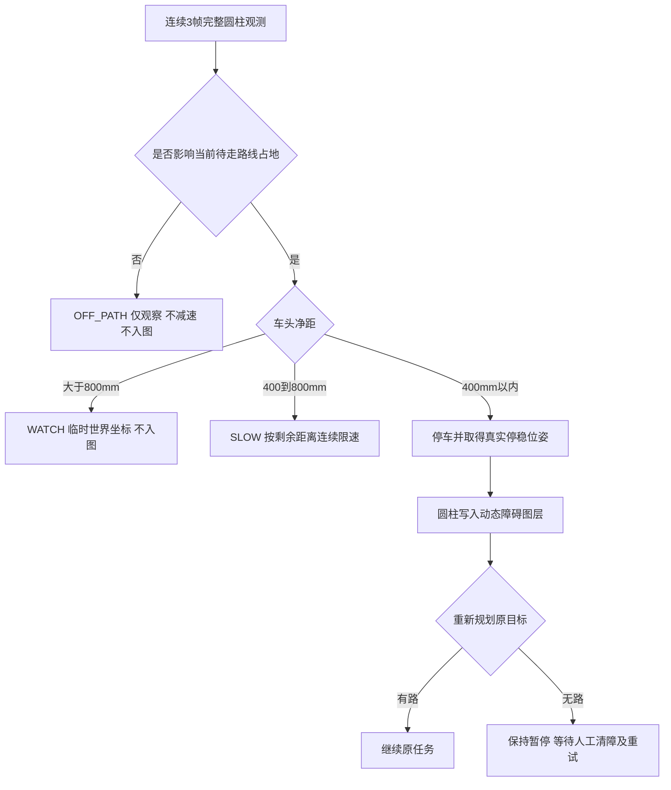

# V260 PRELIM / PC2.6.10：CAM2测距与分段避障

按用户确认，两张新图实测是**900mm和700mm**，测量起点为车头前沿，终点为圆柱近侧外壁。后续避障阈值确认为800/500～800/400mm，采用随距离连续变化的限速，不使用固定50%或30%速度档。

## 测距改进

原程序在两张图中都报NO_CYLINDER：目标仅27/35px宽，被小目标门槛及固定底部圆弧检查过滤。新版允许24px以上的小圆柱进入观测；小目标使用完整直立轮廓、暗色底端的双侧收缩及下方亮地面证据，保留原对比度、宽度稳定性和连续3帧确认。空地、细椅腿及平底矩形仍参与负例检查。

沿用直径50mm圆柱与相机位于车中心左侧100mm的横向安装假设。本次只重拟合纵向距离，没有重新标定相机横向位置或偏航。

| 样本 | 侧壁宽度 | 实测车头净距 | 新模型回放 |
| --- | --- | --- | --- |
| 20261102_201735_251061_14424 | 27px | 900mm | 902.4mm |
| 20261102_201826_485700_15357 | 35px | 700mm | 694.7mm |
| 原300mm样本 | 78px | 300mm | 308.2mm |
| 原200mm样本 | 122px | 200mm | 194.7mm |

四点对逆宽度作两参数最小二乘拟合：`gap_mm = 24539.9382 / width_px - 6.4473`。这些是标定样本回放，不是独立验证精度；`independently_validated`仍为false。像素取整、光照、圆柱直径与安装变化会影响结果，远距1px宽度误差可对应数十毫米。小于27px或大于122px继续标注为采样区间外粗估。接收范围上限1200mm不代表已在1200mm完成实测标定。

## 新流程

距离限速比例为 `clamp((gap_mm-400)/(800-400), 0, 1)`，相对于当前段设定的正常最高速度：

| 净距 | 速度上限比例 |
| --- | --- |
| 800mm及以上 | 100% |
| 700mm | 75% |
| 600mm | 50% |
| 500mm | 25% |
| 450mm | 12.5% |
| 400mm以内 | 进入原停车流程 |

实际输出取目的地原限速与避障限速较小值，并继续使用既有加减速渐变；400mm线外保留原1.5RPM非零逼近下限，避免停在线外不再接近。目的地末端逼近系数8、直行航向Kp0.03及其限幅不变。

相关性按当前剩余路线计算，考虑280mm车体半宽、50mm障碍地图半径以及已规划转角/工位转向扫掠占地，不只比较车中心线。正常出场还预看已知后续二维码通道。远处点仅为临时观测，不改变地图、地图修订号或当前车辆位姿；在靠近时，结合观测帧对应位姿及当前轮位反馈计算实际净距，减少通信延迟带来的落后。

400mm内才接入原停车/落图管线：先停止，等待新的四轮停稳反馈，按真实停车位姿重定位车辆，将近距观测投影的圆柱位置加入动态地图，然后重新规划原工位目标。不会把实测位置写成目标位置，也不会因为远处看见物体就先占用地图。若NO_PATH，继续原暂停等待，不新增MATCH FAULT；清除障碍地图后用 `vobs retry` 重试。

有效帧年龄仍要求不超过200ms；临时限速观测保留最多500ms以覆盖传输间隔，过期后释放该临时限速并沿用原速度渐变，不新增图像丢失停机。临近400mm的自动接管仍要求200ms以内观测。原会话号、递增序号、CRC和重连隔离保持。

## 生效范围与升级

- **稳定前进直线段及出场前进段**使用此流程。圆弧、原地转向、横移、视觉对齐和机械臂取放阶段沿用原观测限制；本次没有给圆弧强行加入视觉避障。
- 当前视觉目标仍是前方通道内的50mm黑圆柱，保持最近完整目标的单目标选择；不是任意物体识别或多目标全场建图。
- 独立预览只显示测距。CAM2接入运行后，由主控armed/eligible状态决定是否采纳观测，主控日志中的WATCH/SLOW/OFF_PATH/ACCEPTED表示实际处理结果。
- V260与PC2.6.10须配套升级。主控状态通告升级为VOBS v2；串口和CAM2无线0x86接收均已同步扩到1200mm，原8字节CRC协议保持。现有CAM2桥只转发该帧，不需重刷相机桥。新PC连接旧v1主控时，串口保留原500mm内近距发送限制，不宣称有新分段策略。
- 上位机观察距离、串口发送次数及桥接发送次数不等于已落图；是否入图看 `[VOBS MAP]`，重新规划看 `[VOBS REPLAN]`。无路时先移开实物并用 `clear` 清动态障碍，再 `vobs retry`；不跳过工位。

## 验证

PC避障专项50项通过，含新900/700mm原图、移除目标后的真实背景、24px边界、平底负例、三帧/帧龄、旧v1兼容和无线900mm帧；完整双路视觉/GUI72项回归通过。生产障碍数学/地图82项、实际运动拥有者331项通过，覆盖远距无地图写入、OFF_PATH不减速、700/600/500mm限速、观测过期释放、400mm停车后才入图、位移补偿跨入400mm、原路线继续与NO_PATH暂停。无线二进制接收回归及转向命令/版本21项通过。

Keil编译0错误、0警告，Code314182、RO-data67090、RW-data6888、ZI-data314660字节。均为图片回放、内存地图、假UART或本机回环测试，未烧录、未向实车发送运动指令。仅更新初赛分支，决赛仍V245；原W25格式和保存参数无需重存。
