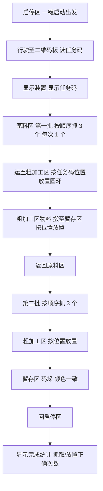

# 智能搬运赛项 · 重构蓝图

> 版本 v1.0 ｜ 适用范围：整车软硬件重构 ｜ 旧代码仅作算法参考

## 1. 项目背景与目标

- 赛事：2027 年第十届中国大学生工程实践与创新能力大赛 · 智能+工程创新赛道 · **智能搬运赛项**
- 现状：学长去年的代码（STM32H723VGT6 + Keil MDK + STM32CubeMX）作为参考
- 约束：车体、载物台、外形尺寸不变（铅垂投影 ≤ 300×300mm，高度 ≤ 400mm），**软硬件从零重做**
- 团队：机械、电控、硬件、视觉，共 4 人

## 2. 新旧规则对照

| 维度 | 旧（去年代码体现） | 新（2027 规则） |
| --- | --- | --- |
| 任务获取 | 扫码枪读条码，只拿颜色顺序 | 读二维码「任务码」，4 组三位数 |
| 任务码含义 | 仅颜色顺序 | 颜色顺序 + 放置圆环编号 |
| 颜色 | 红/绿/蓝 3 种 | 红1 黄2 蓝3 绿4 黑5 浅蓝6，共 6 种，每种 2 个，有色差 |
| 场地 | 转盘 / 霍夫圆 / 地面 / 存放区 | 原料区转盘 / 粗加工区 / 暂存区（圆环 1-6 评分）/ 启停区 2 处 |
| 搬运方式 | 机械臂夹取 | 不允许手爪夹持运送（物料须放载物台上再移动） |
| 障碍物 | 无 | 黑色 φ50×100mm 障碍物随机摆放 |
| 码垛 | 有码垛 | 第二批码垛且颜色必须一致 |
| 显示 | 无 | 任务码显示装置 + 完成统计，字体 ≥ 12mm |
| 尺寸 | 未知 | 投影 ≤ 300×300mm，高度 ≤ 400mm |

## 3. 新任务流程（状态机）

文字流程：

1. 启停区一键启动出发
2. 行驶至二维码板，读取任务码并显示
3. 原料区第一批抓取（按顺序，每次 1 个，放上载物台）
4. 运至粗加工区，按任务码位置放到对应圆环
5. 粗加工区物料搬到暂存区，按位置放置
6. 返回原料区
7. 第二批抓取（同第一批流程）
8. 粗加工区放置
9. 暂存区码垛（第二批码在第一批上，颜色一致）
10. 回启停区，显示完成统计

贯穿全程：灰色车道导航 + 避障（黑色障碍物）。

## 4. 任务码解析规则

- 任务码由 4 组三位数组成，以「+」连接，例：`156+123+516+231`
- 颜色编号：红 1、黄 2、蓝 3、绿 4、黑 5、浅蓝 6
- 第 1 组：第一批 3 个物料的颜色和搬运顺序
- 第 2 组：第一批物料在粗加工区和暂存区的放置位置（圆环编号）
- 第 3 组：第二批 3 个物料的颜色和搬运顺序
- 第 4 组：第二批物料在粗加工区的放置位置（圆环编号）

示例 `156+123+516+231`：第一批顺序红→黑→浅蓝，放在 1/2/3 号圆环；第二批顺序黑→红→浅蓝，放在 2/3/1 号圆环。

解析分工：视觉把二维码解成字符串发给电控，电控只做字符串解析，不碰图像。

## 5. 硬件 / 视觉架构

| 视角 | 方向 | 作用 | 推荐设备 |
| --- | --- | --- | --- |
| 下视 | 朝下（俯视转盘/地面） | 6 色识别 + 圆环定位闭环 | 摄像头（OpenMV 类） |
| 前置 | 朝前（水平） | 读竖着的二维码任务码 | 串口二维码模块 |
| 前向 | 朝前 | 避障（黑色障碍物） | 超声波 / TOF / 激光 |

- 显示装置：高亮屏，显示任务码 + 完成统计，字体 ≥ 12mm，放上部醒目位置，不被遮挡
- 补光：允许垂直向下补光，6 色识别需要稳定光源
- 电源：一个内部电源，比赛全程（含调试）不能更换

## 6. 复用 vs 重写

**复用（算法/动作，与规则无关）：**

- PID 实现（合并掉旧代码里的空壳）
- Mahony 姿态解算
- 运动学 `wheel_solution()`、脉冲换算
- 电机 / 舵机 / 机械臂底层驱动
- 转盘抓取的颜色识别思路（3 色扩展为 6 色）

**重写（规则绑定）：**

- 任务码解析（条码 → 二维码 4 组三位数）
- 主状态机（旧「地面抓取」改为「粗加工区↔暂存区二次搬运」）
- 导航 + 避障
- 圆环放置定位 PID
- 码垛逻辑（新增颜色一致校验）
- 显示装置驱动

## 7. 四人分工

| 角色 | 任务 |
| --- | --- |
| 机械 | 场地/点位测绘；运动学参数确认；载物台与机械臂动作范围；码垛机构可行性 |
| 硬件 | 控制板/供电/引脚/接线；前置二维码模块、下视摄像头、避障传感器、补光选型；显示装置 |
| 电控 | 分层骨架 + FreeRTOS 决策；复用移植（PID/Mahony/运动学/驱动）；新写（任务码解析/导航避障/圆环 PID/码垛/显示/主状态机）；整机联调 |
| 视觉 | 下视 6 色识别、圆环定位、转盘物料识别；与电控的视觉协议；决赛前评估前置识别升级 |

## 8. 分阶段计划

- **阶段 0（第 1 周）：接口对齐 + 冻结**
  - 定 4 组接口：硬件↔电控（引脚表）、机械↔电控（坐标/运动学）、视觉↔电控（协议）、硬件↔视觉（供电/安装）
  - 建 git + 文档；电控读透旧 `task.c`，画出旧流程
- **阶段 1（第 2~3 周）：并行开发**
  - 硬件画板；电控搭骨架 + 移植动作原语；视觉搭下视识别；机械出尺寸 + 标定
- **阶段 2（第 4 周）：合体联调**
  - 电控集成各模块，接上新状态机，逐动作调通
- **阶段 3（第 5 周起）：整机回归 + 调参**
  - 全流程跑通，重标所有时间/距离/PID，模拟「两次运行取最好」

## 9. 接口约定

4 组接口：

1. 硬件 ↔ 电控：引脚对照表、上电顺序
2. 机械 ↔ 电控：场地坐标、运动学参数、动作可达性
3. 视觉 ↔ 电控：识别能力清单、通信协议、偏差输出格式、帧率
4. 硬件 ↔ 视觉：摄像头供电、接口电平、安装位置

3 条协作约定：

1. 接口先行：改接口必须同步文档，上层只调抽象接口，不碰 HAL
2. 参数集中：速度/时间/PID/颜色编号进参数表，不硬编码进状态机
3. 非阻塞 + 分层：延时用时间戳/状态机，控制闭环单独放高优先级

## 10. FreeRTOS 决策

- 结论：推荐上 FreeRTOS（项目职责天然并发、能顺带解决旧码阻塞 delay 问题），但需一人吃透优先级模型
- 条件：队里没人懂 FreeRTOS 或赛前时间紧，则用「原版裸机 + 非阻塞状态机 + 定时器 tick」，风险更低
- 控制闭环必须单独由 1kHz 定时器信号量驱动，不能依赖调度器保证实时性

## 11. 关键约束 / 注意点

- 不许手爪夹持物料运送（物料须放载物台上）
- 物料没放上载物台，不能向下一区域运行
- 一键启动，只有一次启动机会
- 尺寸硬线：投影 ≤ 300×300mm、高度 ≤ 400mm
- 所有开环时间/距离常数必须重新标定（旧值是参考，换硬件失效）
- 圆环评分按外圈是否可见（1 环 15 分 → 6 环 1 分，6 环外 0 分）

## 附录：动作原语清单

- 底盘：前进 / 后退 / 左转 / 右转 / 原地自旋
- 抓取：转盘取料 / 放到载物台
- 放置：放到圆环（粗加工区 / 暂存区）/ 码垛
- 识别：读二维码 / 6 色识别 / 圆环定位
- 系统：显示任务码与统计 / 避障 / 导航
