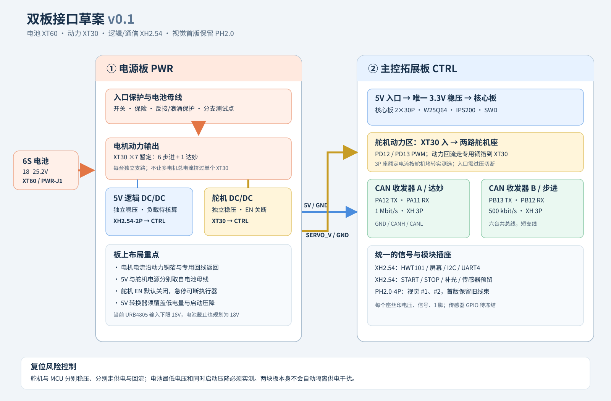

# 智能搬运车双板接口草案 v0.1

> **已由 [v0.2](双板接口草案_v0.2_2026-09-23.md) 取代。**v0.1 中把 ZDT 动力接口改成 XT30 与实物线束不符；实际 ZDT 为 XH2.54-4P，达妙为 XT30(2+2)。请勿按本版制板。

> 供讨论的接口定义，依据 2026-08-29 三页原理图、当前 `.ioc` 和固件。连接器编号是**逻辑编号**；嘉立创EDA 中必须按所选封装的插合面和线束方向复核物理 1 脚。未经实物核对，不用本草案直接压线/上电。

## 1. 连接器规则

| 用途 | 统一接口 | 理由 |
| --- | --- | --- |
| 6S 电池输入 | XT60，1 组 | 唯一电池入口，沿用现有方案 |
| 电机 6S 动力输出 | XT30，每台电机独立 2P 输出，暂定 7 组（6 步进 + 1 达妙） | 避免一个 XT30 承担多台电机合计电流；具体数量可按线束/电机驱动器实物整合，前提是逐支路峰值与连续电流核算 |
| 舵机电源板→拓展板 | XT30，1 组 2P | 两只舵机共用独立稳压轨；线束按两只同时堵转电流核算 |
| 5V 逻辑电源板→拓展板 | XH2.54-2P，1 组 | 5V 电源预计不超过 2A，和 24V XT30 外形不同，避免误插；最终按线规、负载及接插件温升核算 |
| CAN/UART/I2C/GPIO | XH2.54，2P/3P/4P | 信号和小电流模块统一；两个已焊视觉座 PH2.0-4P 可在首版保留，未来统一 XH 需同时改相机线束 |
| 舵机出线 | 优先保留舵机原生 3P 插头配套座；如确实统一 XH2.54-3P，仅在**单个舵机堵转电流低于所选端子和线束额定值**时采用 | XH 系列 22AWG 条件下额定 3A/触点；具体舵机堵转电流尚未确认 |

XT30 型号与配套线材要按**所选具体封装**确认。Amass XT30U-M 规格书给出持续 15A、瞬时 30A；不能把 15A 直接套用到整个分支、PCB 铜箔或未知兼容件。XT60 电池入口与保险、开关、铜厚同样按整车峰值核算。`24V_MOTOR` 与 `SERVO_V` 虽同为 XT30，但**电压不同且可互插**：首版须分区、醒目丝印、线束颜色/长度区分，并在拓展板舵机入口增加过压切断；若无法落实防错与保护，舵机轨改用机械上不兼容的高电流接口。

## 2. 电源板 PWR 接口表

| 编号 | 接口 | 逻辑针序 | 走向/条件 |
| --- | --- | --- | --- |
| PWR-J1 | XT60 电池输入 | `BAT+ / BAT−` | 6S：标称 22.2V、满电 25.2V |
| PWR-J2…J8 | XT30 动力输出 ×7（暂定） | `VBAT_MOTOR / PGND` | 六台步进、一台达妙；每路独立支路标识和可测试点，保险/限流按电机实测选 |
| PWR-J9 | XT30 舵机轨输出 | `SERVO_V / SERVO_GND` | 与电机动力连接区物理分开；默认暂按原理图 7.4V，舵机铭牌确认后冻结 |
| PWR-J10 | XH2.54-2P 逻辑电源输出 | `5V_LOGIC / LOGIC_GND` | 仅供核心/拓展/视觉等；不接舵机 |
| PWR-J11 | XH2.54-2P 舵机使能 | `SERVO_EN / GND` | MCU 控制电源模块使能时使用；需匹配使能脚电平，默认硬件下拉为关闭 |
| PWR-TP1… | 测试点 | `BAT+`, `5V_LOGIC`, `SERVO_V`, `GND` | 板边可测，便于分级上电 |

电源板内部顺序为 `XT60 → 开关/保险/反接/浪涌保护 → 电池母线 → 分支`。5V 和舵机电源使用**各自的 DC/DC**，两路输入从电池母线分别取电，各自输出电容靠近转换器与出口。电机的供电导线不从 5V 或舵机转换器前端的小信号回路取电。主控电源始终保持，以便急停时记录和显示故障。

现用 `URB4805YMD-10WR3` 是 5V/2A、18–75V 输入；6S 电池规划最低 18V，电机启动压降会侵蚀余量。v0.1 预留 `9–36V` 输入的 5V 模块位置，并要求全车视觉、屏幕、MCU、传感器的连续电流实测后才冻结功率。原图电源板 3.3V LDO 与可能存在的核心板 LDO 不可并联；v0.1 选择**拓展板本地产生唯一 3.3V**，电源板不再向拓展板输出 3.3V。核心板若确有板载 3.3V 稳压，须改为只保留其中一路。

## 3. 主控拓展板 CTRL 接口表

| 编号 | 接口 | 逻辑针序 | MCU/说明 |
| --- | --- | --- | --- |
| CTRL-J1 | XH2.54-2P 5V 输入 | `5V_LOGIC / LOGIC_GND` | 来自 PWR-J10；入口保险/反接及局部滤波后供核心板、视觉与 3.3V 稳压 |
| CTRL-J2 | XT30 舵机电源输入 | `SERVO_V / SERVO_GND` | 来自 PWR-J9；先经过压切断，再走短、宽铜箔到舵机口；回流直接回 J2 |
| CTRL-J3/J4 | 舵机 3P ×2 | `GND / SERVO_V / PWM` | 抓取 PD12/TIM4_CH1、转盘 PD13/TIM4_CH2；物理针序按舵机插头核对 |
| CTRL-J5 | XH2.54-3P 达妙 CAN | `GND / CANH / CANL` | PA12→收发器 D，收发器 R→PA11；1 Mbit/s；动力由电源板送 |
| CTRL-J6 | XH2.54-3P 张大头 CAN 主干 | `GND / CANH / CANL` | PB13→D，R→PB12；500 kbit/s；六台电机线束串接，禁止六条长星形支线 |
| CTRL-J7/J8 | PH2.0-4P 视觉 ×2（首版保留） | `GND / 5V / MCU_RX / MCU_TX` | J7 PB15/PB14，J8 PA3/PA2；相机 5V 供电与 TX 电平待实测 |
| CTRL-J9 | XH2.54-4P I2C 传感器 | `GND / 3V3 / SCL / SDA` | PB6/PB7，板上上拉到 3.3V |
| CTRL-J10 | XH2.54-4P HWT101 | `GND / V_MOD / MCU_RX / MCU_TX` | PE2/PE3；`V_MOD` 按模块实物确定，不能先印死 3.3V/5V |
| CTRL-J11 | XH2.54-4P 串口屏 | `GND / 5V / MCU_RX / MCU_TX` | PB11/PB10 |
| CTRL-J12 | XH2.54-3P UART4 | `GND / MCU_RX / MCU_TX` | PC11/PC10；蓝牙/日志 |
| CTRL-J13/J14 | XH2.54-2P 按键 | `SIG / GND` | START PA0、STOP PA1 |
| CTRL-J15/J16 | XH2.54-3P 补光 | `GND / 3V3 / PWM` | PD1/PD2；灯电流超过 GPIO 能力时需板侧驱动，不能直挂 IO |
| CTRL-J17 | XH2.54-5P SWD | `3V3 / GND / SWDIO / SWCLK / NRST` | PA13/PA14；放板边 |
| CTRL-J18/J19 | XH2.54-3P 传感器预留 | `GND / 3V3 / SIG` | 限位/载物检测 GPIO 尚待分配，不把预留脚当已冻结接口 |

两路 CAN 收发器从旧总线板并入 CTRL。每路独立 `RS` 电阻、终端跳线、CAN TVS、收发器供电去耦、TX/RX/H/L 测试点。原图两路 120Ω 固定电阻改为可选焊/跳线，仅在实际总线物理端点启用。PB12按最终软件和网表常规核验；2026-10-03用户确认旧异常为代码问题，撤回此前硬件短路描述。扩展板继续保留 W25Q64、IPS200、核心板 2×30P 排座。

## 4. 舵机启动时 MCU 会不会复位？

**会有可能**，如果舵机和 MCU 共用 5V 稳压器、细电源线/回流线，或 6S 电池在电机及舵机同时启动时跌到 5V 模块的最低输入以下。两块 PCB 的数量本身不是复位原因；关键是电源轨的转换器、线束阻抗、接插件、PCB 回流路径与瞬态负载。

本版规定：

1. 舵机使用独立 `SERVO_V` DC/DC，不从 `5V_LOGIC` 或核心板 3.3V 取电；5V DC/DC 专供 MCU、视觉、传感器和显示。
2. 电源板的电池母线向 5V 与舵机 DC/DC 分支供电，舵机输入/输出及拓展板 J2 旁放足符合转换器稳定性要求的电容；电容数值按实测堵转电流、线长和 DC/DC 数据手册决定，不能靠一颗大电容代替足额电源。
3. CTRL 板上舵机 `SERVO_V/SERVO_GND` 沿 J2→J3/J4 独立宽铜/铺铜布线；MCU 3.3V 稳压及核心排针放在另一供电区。PWM 线带信号参考地，但舵机大电流优先沿专用 XT30 回流。板间回流拓扑和连接点在 PCB 上核对，不允许电机电流经过核心排针。
4. 电源板 5V 模块采用覆盖实际电池电压和启动压降的输入范围；5V/3.3V 实测纹波与最低电压合格后，再启用舵机。STM32 的 BOR 可帮助在欠压时复位，却不能代替电源设计。
5. 上电验收用示波器在**核心板 VDD 引脚附近**测量 3.3V，同时让两只舵机做最坏启动/短时堵转和电机加速；记录 5V、`SERVO_V` 和电池母线最低值，确认无复位、无掉线、无异常发热。

## 5. 当前需要实物确认的值

- 两只舵机准确型号、额定电压、同时启动/短时堵转电流、原生插头针序；未确认前 `SERVO_V=7.4V` 仅沿用旧图，不可直接上电。
- 七台电机各自的工作/峰值输入电流与原有线束形式，决定 XT30 支路数量和保险规格。
- 视觉 #1/#2、串口屏、核心板及传感器的最大 5V/3.3V 电流，决定 5V DC/DC 和 3.3V 稳压器功率。
- 核心板是否自带 3.3V 稳压，以及其 5V/3.3V 排针的输入输出方向。

## 6. CAD 完成后的验收

本草案尚未形成可制造原理图/PCB，13 项设计验收均**待 CAD 阶段核验**：器件完整性、无重叠、模块名称、零 wire 网标连接、ERC 零错误、DRC 零错误、网络完整性、电源与地、器件就近、接口保护、信号隔离、标识与可制造性、BOM 一致性。特别要先完成每个接口的逐针针序表，再画封装和线束，最后断电做全网通断复核。
