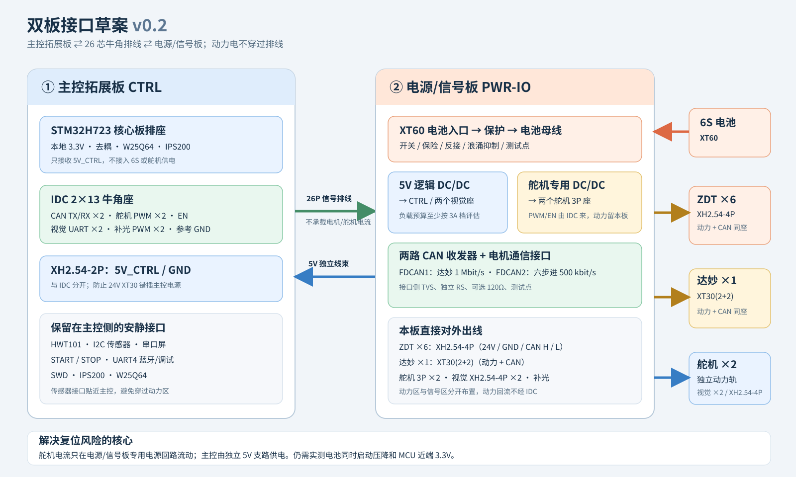

# 双板接口草案 v0.2：主控拓展板 + 电源/信号板

> 本版按“主控拓展板通过牛角排线连接电源/信号板，再由后者接电机、舵机及两个视觉模块”重画，取代 v0.1 的“CAN 收发器位于主控拓展板”方案。**2026-09-23 接口修订：六台 ZDT 使用 XH2.54-4P（电源+CAN），达妙使用 XT30(2+2)（电源+CAN），两路视觉均改为 XH2.54-4P。**这是接线与功能分区草案，尚非可制造嘉立创EDA 文件。以 2026-08-29 三页原理图、当前 `.ioc`、固件和用户确认的接口为事实源。

## 1. 两板分工

| 主控拓展板 CTRL | 电源/信号板 PWR-IO |
| --- | --- |
| STM32H723 核心板排座、3.3V 本地稳压/去耦、W25Q64、IPS200、SWD、HWT101、I2C 传感器、串口屏、START/STOP、蓝牙 UART4 | XT60 电池入口、保险/开关/浪涌保护、24V 动力分配、独立 5V 和舵机 DC/DC、两颗 CAN 收发器、电机接线、舵机接口、双视觉模块供电和 UART 座、两路补光驱动 |

两板连接分成**两条独立线束**：`IDC 2×13（26 芯）牛角排线`只传 3.3V 数字信号及参考 GND；`XH2.54-2P`单独送 `5V_CTRL/GND_CTRL` 给主控拓展板。**6S 电机电源、舵机电源、舵机大电流回流绝不进入牛角排线或核心板排座。**牛角排线尽量短（先按 ≤20 cm 布局），地线与信号线交替，CAN TX/RX 和 UART 为板间 3.3V 单端逻辑信号；连接器旁预留串阻/测试点，最终用示波器检查波形。两板的 GND 参考必须连续，PCB 上将电机/舵机大电流回流与控制信号区分路布置，并在电源入口附近核对汇流路径。

## 2. IDC 2×13 牛角接口定义

以下是**逻辑网络与针号**；实际元件插合面、红边 1 脚、排线两端同向/反向，须在选定牛角座封装与线束后逐针通断确认。两板使用完全相同的编号定义，不在一端凭外观镜像手工改序。

| 针 | 信号（CTRL → PWR-IO，RX 为返回） | 针 | 信号 |
| ---: | --- | ---: | --- |
| 1 | `DM_CAN_TX` = PA12 / FDCAN1_TX | 2 | `GND_SIG` |
| 3 | `DM_CAN_RX` = PA11 / FDCAN1_RX | 4 | `GND_SIG` |
| 5 | `ZDT_CAN_TX` = PB13 / FDCAN2_TX | 6 | `GND_SIG` |
| 7 | `ZDT_CAN_RX` = PB12 / FDCAN2_RX | 8 | `GND_SIG` |
| 9 | `SERVO_GRIP_PWM` = PD12 | 10 | `GND_SIG` |
| 11 | `SERVO_TURN_PWM` = PD13 | 12 | `GND_SIG` |
| 13 | `SERVO_EN` = PD0 **拟分配** | 14 | `GND_SIG` |
| 15 | `LIGHT_PWM1` = PD1 | 16 | `GND_SIG` |
| 17 | `LIGHT_PWM2` = PD2 | 18 | `GND_SIG` |
| 19 | `CAM1_MCU_TX` = PB14 / USART1_TX | 20 | `GND_SIG` |
| 21 | `CAM1_MCU_RX` = PB15 / USART1_RX | 22 | `GND_SIG` |
| 23 | `CAM2_MCU_TX` = PA2 / USART2_TX | 24 | `GND_SIG` |
| 25 | `CAM2_MCU_RX` = PA3 / USART2_RX | 26 | `GND_SIG` |

`PD0` 在旧 `.ioc` 中仍为 GPIO 输出，旧状态灯在接口冻结表中已取消；只有同步修改 `.ioc`/固件并检查核心板排针后，才能正式把 PD0 冻结为舵机使能。电源/信号板上的 EN 用晶体管/驱动电路匹配 DC/DC 使能脚，不让排线 GPIO 承担模块电源电流或 24V 控制电压。

## 3. 电源/信号板对外接口

| 接口组 | 连接器 | 连接内容 | 备注 |
| --- | --- | --- | --- |
| BAT_IN | XT60 ×1 | 6S `BAT+/BAT−` | 唯一电池入口，电源板保护链后分支 |
| ZDT_M1…M6 | **XH2.54-4P ×6** | 每口 `GND_MOTOR/VBAT_MOTOR/CANH/CANL`，同时接动力与通信 | 保留现有 ZDT 电机 4P 线，不拆成 XT30+CAN；每口电源触点/压线/铜箔按单台电机最大电流核算 |
| DM_MOTOR | **XT30(2+2) ×1** | 两个大电流触点 `VBAT_MOTOR/GND_MOTOR`，两个信号触点 `CANH/CANL` | 与达妙原机复合线束配对；信号针不能当动力触点 |
| SERVO_1/2 | 舵机原生 3P 配套座，或核流后 XH2.54-3P | `GND_SERVO/SERVO_V/PWM` | PWM 来自 IDC；动力仅在本板短距离分配 |
| CAM_1/2 | **XH2.54-4P ×2** | `1=GND, 2=5V_CAM, 3=MCU_RX, 4=MCU_TX` | 原图 CN10/CN11 是 PH2.0-4P；新版更换相机线束，逐针核实相机侧 TX/RX 与电平 |
| CTRL_5V | XH2.54-2P ×1 | `5V_CTRL/GND_CTRL` | 仅送主控拓展板，不接电机/舵机 |
| LIGHT_1/2 | XH2.54-3P ×2 | `GND/灯电源/PWM驱动` | PD1/PD2 是逻辑 PWM；灯实际电流超 GPIO 能力则在本板加 MOS 驱动 |

图 3 截图所画 **ZDT P1～P6 逻辑针序**为 `1=GND, 2=VCC_OUT, 3=CANH, 4=CANL`；**达妙 CON1 逻辑针序**为 `1=CAN2_L, 2=CAN2_H, 3=GND, 4=VCC_OUT`。这是旧原理图的符号编号，不能直接推断电机实物插头的正面视角；新板封装和实物线束要用通断表核对后再上电。

两路视觉沿用原图 CN10/CN11 的**逻辑针序**（`1=GND, 2=5V, 3=STM32_RX, 4=STM32_TX`），仅把板端座改成 XH2.54-4P。CAM_1 对应 `PB15/PB14`，CAM_2 对应 `PA3/PA2`。相机侧需要新做 XH2.54 线束；若相机本体仍为 PH2.0，应使用 **XH2.54↔PH2.0 转接线**，不能把不同间距插头强插或仅按线色连接。

两颗 SN65HVD230 及 CAN TVS、可选 120Ω 终端、各自 RS 电阻、供电去耦和测试点全部放在 PWR-IO 板的**信号接口区**，远离 DC/DC 开关节点和动力铜排。FDCAN1 专接达妙（1 Mbit/s），FDCAN2 专接六台步进（500 kbit/s）。六个 4P 座共用一条 ZDT CAN 总线，不能每座各焊 120Ω；按六条实际线束长度评估支线拓扑并测波形。图 3 旧网络命名/物理座对应曾误导接线，新板改用 `DM_*`、`ZDT_*`。

**收发器位置定案（基于两板相距约 20 cm 的短排线）**：两颗 SN65HVD230 放在 PWR-IO 板的低噪声信号区，靠近 ZDT/达妙出线口；CTRL 板通过 IDC 传 `FDCAN_TX/RX` 和相邻参考地，不让 CANH/CANL 在两板间排线上绕行。PWR-IO 板从本板 5V 生成独立的 CAN 用 3.3V，小电源入口及每颗收发器 VCC 引脚就近去耦；动力铜排和舵机回流从另一侧返回电源入口，CAN 数字地保持连续参考，不在 TX/RX 下方切开地平面。IDC 两端 TX/RX 预留可调串阻/测试点，并在装车线长下检查 1 Mbit/s 达妙与 500 kbit/s ZDT 的波形和错误计数。若板间距离后来显著增加，则重新评估板间物理层，不能直接把长单端 TX/RX 排线当作已验证设计。

XH2.54 原厂 XH 系列在 AWG22 条件下额定 3A/触点；实际 ZDT 电机线可能更细，不能只按座子标称决定安全电流。**保留 4P 接口的前提是实测/手册最大持续与启动电流、线规、端子和温升均合格。**若单台电机超过接插件能力，必须改动力连接方式，不能仅加宽 PCB 铜箔解决。

## 4. 舵机压降与 MCU 复位的处理

舵机堵转电流在 **PWR-IO 板内**从专用 `SERVO_V` DC/DC 经舵机座返回专用功率地，不经过牛角排线或主控拓展板。`5V_CTRL` 从另一只 DC/DC 的独立支路供给 MCU。两路 DC/DC 从 XT60 后的电池母线分开取电并各自保护/滤波。这样能避免舵机线束和板上供电走线造成的**直接**逻辑压降；若 6S 电池本身被大电机拉低，两个转换器仍可能同时掉压，所以还要核输入范围、线束电阻及总负载。

现有 `URB4805YMD-10WR3` 为 5V/2A、输入 18–75V；6S 规划截止 18V，裕量不足。旧电源文档估算两相机 5V/1A、显示 5V/0.5A、MCU 3.3V/0.6A，折算 5V 需求已约 2.1A（未计损耗和传感器），因此 **5V/2A 模块不作为新板的最终总电源选型**。v0.2 预留额定至少 3A 的 5V 模块，并在负载实测后冻结型号；`5V_CTRL` 与 `5V_CAM` 分支分别加限流/滤波。3.3V 只保留一个来源（核心板自带或 CTRL 板本地），不可把两个 LDO 输出硬并联。

上电验证顺序：断电测连接器逐针和电源轨对地阻抗；仅电源板上电测 5V/舵机轨；接 CTRL 板测 STM32 VDD；再逐一接视觉、舵机和电机；最后用示波器记录**两只舵机同时启动 + 电机加速**时 STM32 近端 3.3V、5V_CTRL、SERVO_V、BAT 的最低值及复位标志。电容用于抑制尖峰，不能替代足额稳压器和合适的电池输入范围。

## 5. 制板前必须冻结

1. 两只舵机确切型号、允许电压、堵转电流与原生插头；旧图的 7.4V 只是待核值。
2. 六台 ZDT 的 XH2.54-4P 线束针序、线规、单台最大电流，以及达妙 XT30(2+2) 的实物插合面；据此冻结封装和 ZDT 总线分支方式。
3. 核心板 5V/3.3V 排针究竟是输入还是输出，避免双 3.3V 源互顶。
4. 两板的相对位置和牛角排线长度；确认 26P 座和排线的 1 脚方向。
5. 5V 实测最大电流、舵机双启动电流、电机同时加速时电池最低电压。
6. 两只视觉模块本体接口的型号、针序与供电/串口电平，制作 XH2.54-4P 新线束后逐线测通断。

**CAD 验收状态：待绘制**。本文件给出连接和分区，尚未运行 ERC/DRC，也未核封装、位号、网表、PCB 回流和实物针序；完成 CAD 后按 EasyEDA 设计规范的 13 项逐项核验。
