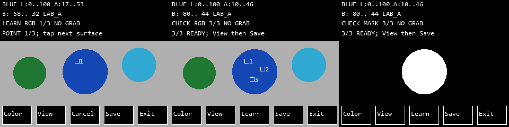

# 比赛现场物料取色

CAM1当前安装 `maix-v1-v1.1.16.zip`，启动版本 `2026-10-15-occupied-resources-v30`。三点取色界面保持，沿用主控原有 `arm color` 与flags04，CAM2不更新。

1. 车辆停车后发送 **`&arm color`**。主控先把机械臂移动到CAMERA姿态，等待实际READY，再发取色SET。等主控取色就绪、相机出现五个按钮后再操作；机械臂移动期间不取样。
2. 在 **MaixCAM实体触屏**上点 `Color` 选择当前物料颜色。屏幕依次RED红、YELLOW黄、BLUE蓝、GREEN绿、BLACK黑、LIGHTBLUE浅蓝，显示颜色名称，不显示JSON内部编号。MaixVision预览窗口点击不会产生设备触屏事件。
3. 先用 **`View`** 切换RGB彩色画面与MASK黑白阈值图，检查原有标定效果。顶栏显示当前颜色、L/A/B阈值及状态。白色是当前阈值命中的区域，黑色是未命中区域。
4. 点 **`Learn`**，强制回到彩色画面。用手指在物料顶部**选三个干净表面位置，各点一次并松开**，每点取12×12 LAB中值。屏幕显示 `0/3 → 1/3 → 2/3 → 3/3` 和点号1/2/3。避开白色反光、阴影、边缘、背景；无最小距离硬限制，但建议三点选不同位置。长按不会重复计数，已去掉中心Sample按钮。
5. **第三点完成后**才替换当前颜色的RAM样本、生成阈值，自动结束Learn，显示 `3/3 READY`。点 `View` 在RGB与MASK间切换对照。觉得效果不合适可再次点Learn重取三点。前1/2点不会覆盖旧阈值，其他已取颜色保留；Learn中的按钮变为 **`Cancel`**，可取消这组未完成点，仍保留旧值。未满三点时Save/Exit提示完成或Cancel；Color切换也会丢弃未满三点的暂存点。
6. 蓝色和浅蓝色都应分别点满三点，原配对互斥阈值规则保持。`NEED_PAIR` 表示还需另一色，`OVERLAP` 表示不可分，应重取两个颜色干净位置。
7. 点 **`Save`** 保存全部完成取样的颜色，看到 `Saved` 后才算落盘。仍保存到 **`~/maixcam_material_colors.json`**，原version1格式不变，原子替换。没有新完成样本时不重写文件；显示 `SAVE FAIL` 时没有宣告成功，可重试。
8. 点 **`Exit`**：已完成但未保存的样本先保存，成功后 `CAL DONE / WAIT STOP`。然后发送 **`&arm color stop`**；`&arm stop`也可取消。屏幕Exit不自行恢复普通检测、不改变会话；未满三点时先完成或Cancel才能正常Exit。

`&arm color status`查看主控进度。可用 `&arm color 1..6`指定初始颜色，命令编号为**1红、2黄、3蓝、4绿、5浅蓝、6黑**（现有线上工程ID），与二维码规则编号5黑/6浅蓝不同。JSON仍沿用内部规则号5黑/6浅蓝，程序自动换算，用户按屏幕颜色名称操作即可，不手改JSON编号。

三点及完成颜色到Save之前只在内存暂存；主控STOP、故障取消或换模式不自动保存，未保存改动会丢弃。下次普通物料检测重新读取已保存文件。原程序的Color/View/Learn和RAW/MASK对照已恢复；当前严格三点后生成、手动Save，与旧程序每次点击自动保存的行为不同。

取色模式灯板维持原PWM50%，圆环识别改为PWM15%。不改画面ISP、曝光或增益。取色时不运行物料检测，不发布任何有效抓取坐标；02帧始终VALID0且位置清零，心跳/ACK仍正常。车辆和机械臂的禁止动作约束由主控取色流程保证。

## 最小协议扩展

- SET：mode2、station1、target0..6、hz1..50、**flags0x04**。target0默认RED；1..6为现有线上工程颜色号。
- 0x04仅MATERIAL取色，不能与RING的0x01轴角/0x02带物料标志混用；普通MATERIAL flags0行为保持。
- ACK成功意味着文件已读取、取色触屏已创建。触屏初始化失败回失败ACK；首帧画面仍由相机后续读帧产生。
- 屏幕Save/Exit没有新增异步事件。主控手动STOP结束会话；Exit后心跳仍报告mode2。
- STOP/新SET清取色界面及触屏，旧有效观测仍按原epoch/写组机制丢弃。

292项离线检查通过，包括三点暂存/提交/取消、阈值前1/2点保持、独立按下/松开、真实临时文件、保存失败，以及RGB/MASK副本不污染LAB源图和强制无效02。保留物料/圆盘/圆环/補光回归；未实机操作。上方示意从左到右为Learn1/3、RGB3/3、MASK3/3，使用当前UI函数和合成圆形生成，字体与实机可能不同。
